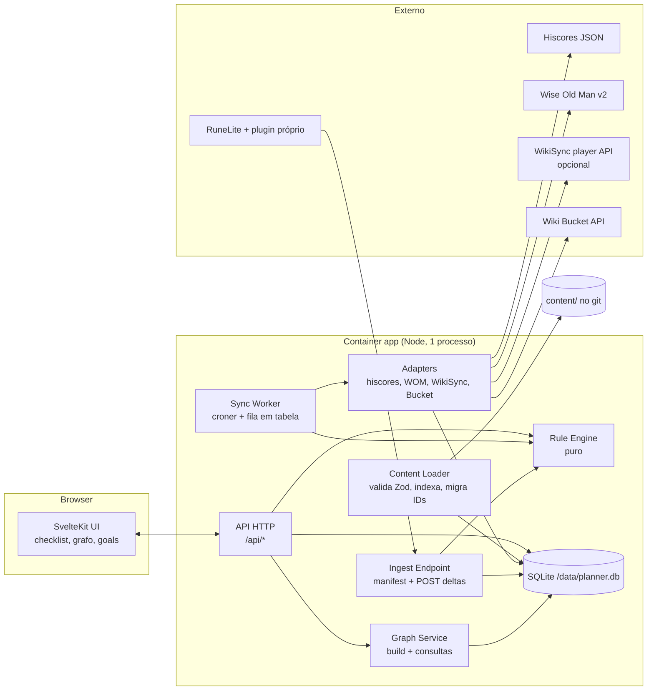
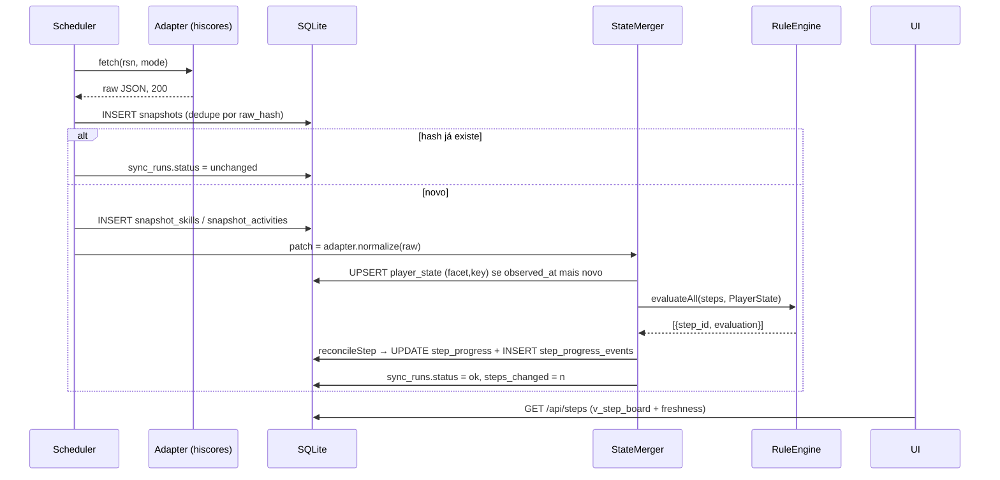
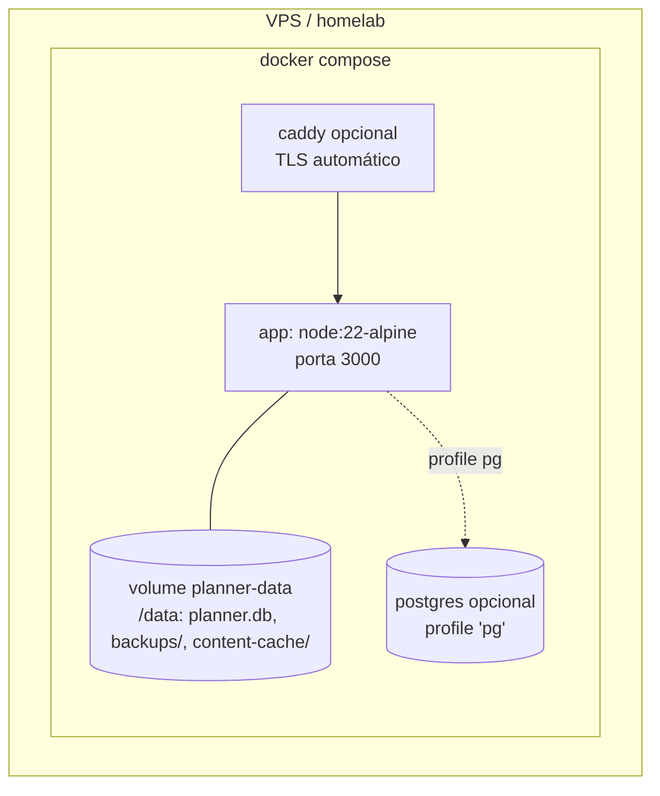
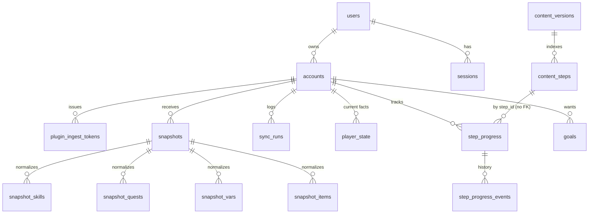

# Ironman Planner — Arquitetura

Data: 2026-11-03. Complementa `00-levantamento-inicial.md`. Artefatos técnicos em `docs/arquitetura/`: `guide.schema.json` (JSON Schema do conteúdo), `schema.sql` (banco; escrito em dialeto SQLite, portar para Postgres no Drizzle: `jsonb`, `timestamptz`, `bigint` para xp), `types.ts` (tipos Zod/TS compartilhados, assinaturas do rule engine e contrato do plugin).

## 0. Decisões em uma página

| Tema | Decisão |
|---|---|
| Stack | **Revisado (seção 9): backend em Go** (um binário com `serve`, CLI e servidor MCP) + Postgres + frontend Svelte embutido no binário. A opção SvelteKit full-stack das seções 1 e 2 fica registrada como alternativa; o que muda está na seção 9. Deploy no `saradomin` com Postgres e Zitadel existentes. |
| Grafo | Calculado no servidor em memória a partir de `content/` + cache do wiki; renderizado com **Cytoscape.js + ELK** (layout em camadas). |
| Conteúdo | Arquivos JSON/YAML em `content/guides/<id>/`, validados por Zod no boot e na CI. IDs do ironman.guide preservados (`1.1.76a`). |
| Estado do jogador | Snapshots brutos append-only + tabela `player_state` mesclada (uma linha por fato) que alimenta o rule engine. |
| Rule engine | Função pura `(rules, PlayerState) → {verdict, evidence}`; reavaliação completa a cada snapshot (576 steps × regras simples = milissegundos). |
| Plugin | Protocolo clone do WikiSync: `GET /api/ingest/manifest` + `POST /api/ingest` com deltas, token por cliente. |
| Deploy | Um container da app no compose do `saradomin`, apontando para o Postgres já existente (database própria `ironman_planner`). Sem volume de dados próprio; só backups via `pg_dump`. |
| Auth | **OIDC via Zitadel** (já rodando no `saradomin`): Authorization Code + PKCE no SvelteKit, sessão em cookie assinado, usuário criado no primeiro login pelo `sub`. Tokens `ipl_` por conta para o plugin Microbot (o plugin não faz OIDC); tokens de API para scripts. Autorização por lista de `sub` permitidos ou por role no Zitadel. |

## 1. Stack

### 1.1 Três opções

| Critério | A. SvelteKit + SQLite/Drizzle (TS full-stack) | B. Go API + React SPA | C. FastAPI + React |
|---|---|---|---|
| Um container, um processo | Sim: `node build` serve UI + API + cron. | Sim para o binário, mas o SPA precisa ser embutido (`embed`) e há dois toolchains. | Dois toolchains; uvicorn + build estático; scheduler (APScheduler/arq) separado ou in-process. |
| Compartilhar tipos conteúdo ↔ server ↔ client | Nativo: um schema Zod gera tipos TS, JSON Schema e validação nos três lugares. | Tipos Go ≠ TS; precisa de OpenAPI codegen e duplicar o schema do conteúdo. | Pydantic → OpenAPI → TS: funciona, mas o schema do conteúdo vive em Python e o front consome uma cópia. |
| Jobs em background | Cron in-process (`croner`) + fila em tabela; Node é single-thread mas os jobs são IO-bound e raros. | Melhor do grupo: goroutines, robusto. | Bom (asyncio), mas APScheduler in-process em uvicorn multi-worker dá dor de cabeça. |
| Bibliotecas de grafo | Cytoscape.js é framework-agnóstico; funciona perfeitamente em Svelte. React Flow não (React-only). | React Flow ou Cytoscape, sem restrição. | Idem B. |
| Produtividade para 1 dev | Alta: um repo, um `pnpm dev`, HMR em tudo, rotas `+server.ts` para API. | Média: duas bases de código, dois servidores em dev. | Média. |
| Migrar para Postgres depois | Drizzle troca dialeto; schema já escrito portável. | sqlc/pgx: fácil. | SQLAlchemy: fácil. |
| Risco | Node single-process: um bug no job trava a UI por alguns ms; mitigado por timeouts e `AbortSignal`. | Mais código para a mesma feature. | Tipagem do conteúdo duplicada é fonte de drift. |

### 1.2 Escolha: **A — SvelteKit + SQLite + Drizzle + Zod**

Por quê, em ordem de peso:

1. **Um schema, três consumidores.** O coração do projeto é o modelo de conteúdo (`Step`, `Rule`) e a função que avalia regras. Com Zod, esse código roda igual na CI (validar `content/`), no servidor (avaliar snapshots) e no browser (pré-visualizar "o que falta" sem round-trip). Em B e C isso vira duas implementações para manter em sincronia.
2. **Deploy trivial.** `adapter-node` produz um `build/index.js`; o Dockerfile é 15 linhas; não há proxy entre front e back, nem CORS, nem dois processos para supervisionar.
3. **Grafo.** Cytoscape.js (layouts via `cytoscape-elk`/`cytoscape-dagre`, compound nodes para colapsar seções, estilos por estado) é a biblioteca mais madura para grafos de dependência interativos e não depende de React. d3-dag é só layout (bom como fallback server-side para gerar SVG estático); Sigma.js é para grafos de dezenas de milhares de nós com WebGL, overkill aqui; React Flow é ótimo mas amarra o front ao React e é pensado para editores de nó, não para exploração de DAGs.
4. **SvelteKit, não Next.js.** Next.js assume serverless/edge; scheduler in-process é gambiarra (`instrumentation.ts`), e o App Router adiciona complexidade de RSC que não compra nada aqui. SvelteKit com `adapter-node` é um servidor Node comum: `hooks.server.ts` inicia o scheduler, `+server.ts` são handlers HTTP, `+page.server.ts` carrega dados com acesso direto ao banco.
5. **SQLite via better-sqlite3** é síncrono, rápido (dezenas de milhares de leituras/s), e com WAL aguenta leitura concorrente da UI enquanto o worker grava. Para 1 a 5 usuários é a escolha óbvia; backup é copiar um arquivo.

Bibliotecas fixadas: `drizzle-orm` + `drizzle-kit` (migrations), `zod`, `croner` (cron), `argon2` (senha), `ulid`, `cytoscape` + `cytoscape-elk`, `vitest`, `fast-check`, `playwright` (poucos e2e), `yaml` (conteúdo em YAML opcional), `pino` (logs).

## 2. Arquitetura do sistema

### 2.1 Componentes



Responsabilidades:

- **Web app (UI)**: páginas `/` (dashboard), `/guide/[section]` (checklist), `/graph` (grafo), `/goals`, `/account` (sync, tokens, export). Svelte 5, Tailwind, sem estado global além do que vem do servidor.
- **API**: rotas `+server.ts` sob `/api`. JSON, autenticadas por cookie de sessão ou `Authorization: Bearer`. Lista completa na seção 2.5.
- **Content Loader**: no boot e via `POST /api/admin/reload-content`, lê `content/guides/*/`, valida com `Guide` (Zod), calcula `content_hash`, grava `content_versions` + `content_steps`, aplica `step_id_aliases` (campo `replaces`) ao `step_progress`, e dispara reavaliação dos steps cujo `rule_hash` mudou.
- **Rule Engine**: módulo puro em `src/lib/core/rules/`. Sem IO. Seção 4.3.
- **Graph Service**: constrói o grafo de requisitos a partir de conteúdo + `wiki_cache`, guarda em `graph_cache`, responde consultas ("o que falta para X", "destravou agora"). Seção 5.
- **Sync Worker**: scheduler in-process. Cada tick enfileira `sync_runs` por (conta, fonte) respeitando cadência e backoff; um executor único consome a fila em série (evita estourar rate limit). Seção 6.
- **Ingest Endpoint**: `GET /api/ingest/manifest` e `POST /api/ingest`, autenticados por token `ipl_`. Seção 6.4.
- **Adapters**: um módulo por fonte com `fetch(raw)` e `normalize(raw) → StatePatch` (interface em `types.ts`). Só o adapter conhece o shape externo; quando o outro agente fechar os shapes exatos, só esses arquivos mudam.

### 2.2 Fluxo: snapshot → status dos steps



### 2.3 Deploy



`docker-compose.yml` (essência):

```yaml
services:
  app:
    build: .
    image: ironman-planner:latest
    restart: unless-stopped
    ports: ["3000:3000"]
    env_file: .env
    volumes:
      - planner-data:/data
      - ./content:/app/content:ro     # opcional: editar conteúdo sem rebuild
    healthcheck: { test: ["CMD", "wget", "-qO-", "http://localhost:3000/api/health"], interval: 30s }
  caddy:
    image: caddy:2
    profiles: ["tls"]
    ports: ["80:80", "443:443"]
    volumes: ["./Caddyfile:/etc/caddy/Caddyfile", "caddy-data:/data"]
  postgres:
    image: postgres:16-alpine
    profiles: ["pg"]
    environment: { POSTGRES_DB: planner, POSTGRES_USER: planner, POSTGRES_PASSWORD: ${PG_PASSWORD} }
    volumes: ["pg-data:/var/lib/postgresql/data"]
volumes: { planner-data: {}, caddy-data: {}, pg-data: {} }
```

Dockerfile multi-stage: `pnpm install --frozen-lockfile` → `pnpm build` → imagem final com `build/`, `node_modules` de produção, `content/` e `drizzle/` (migrations rodam no boot). O conteúdo vai dentro da imagem por padrão; o bind-mount é para quem quer editar o guia sem rebuild.

### 2.4 Configuração (`.env`)

| Variável | Default | Função |
|---|---|---|
| `DATABASE_URL` | `file:/data/planner.db` | SQLite; `postgres://…` ativa o dialeto Postgres. |
| `ADMIN_USERNAME` / `ADMIN_PASSWORD` | — | Criam o usuário owner no primeiro boot (depois ignorados). |
| `SESSION_SECRET` | — | 32+ bytes aleatórios; assina cookies. |
| `PUBLIC_BASE_URL` | `http://localhost:3000` | Usado no manifest do plugin e em links. |
| `CONTENT_DIR` | `./content` | Onde o loader lê guias. |
| `SYNC_ENABLED` | `true` | Desliga o scheduler (útil em dev/teste). |
| `SYNC_HISCORES_MINUTES` | `30` | Cadência base do hiscores. |
| `SYNC_WOM_HOURS` | `6` | Cadência do Wise Old Man (`0` desliga). |
| `WIKISYNC_IMPORT_ENABLED` | `false` | Liga o importador opcional (com aviso na UI). |
| `WIKI_BUCKET_REFRESH_DAYS` | `7` | Renova cache de quests/diaries. |
| `STALE_AFTER_HOURS` | `24` | Idade a partir da qual um status vira `stale`. |
| `BACKUP_KEEP_DAYS` | `14` | Retenção de `VACUUM INTO` noturno. |
| `LOG_LEVEL` | `info` | pino. |

Configurações por conta (tabela `settings`): layer ativa, modo, fontes habilitadas, horas de stale por fonte, se bank sync está autorizado.

### 2.5 Auth e API

- **Login**: `POST /api/auth/login` com usuário/senha → cookie `sid` HttpOnly, SameSite=Lax, 30 dias, hash em `sessions`. `hooks.server.ts` resolve `event.locals.user`. Sem OAuth, sem e-mail. Rate limit de 5 tentativas/min por IP.
- **Multiusuário futuro**: `users.role`, `accounts.user_id` já existem; adicionar convite por link é um endpoint.
- **Tokens de API** (`api_tokens`): `Authorization: Bearer apk_…`, para scripts de export e CLI.
- **Tokens do plugin** (`plugin_ingest_tokens`): `Authorization: Bearer ipl_…`, escopo = uma conta, criados em `/account/tokens`, mostrados uma vez, armazenados como sha256, revogáveis, com `scopes` (bank/inventory são opt-in explícito).

Rotas principais:

| Rota | Função |
|---|---|
| `GET /api/health` | liveness + versão do conteúdo + idade do último sync |
| `GET /api/guide` / `GET /api/guide/:section` | conteúdo filtrado por modo/layer da conta |
| `GET /api/steps?account=` | board: status, freshness, evidência resumida |
| `PATCH /api/steps/:id` | `{status: manual_done\|skipped\|pending, locked, note}` |
| `GET /api/state?account=` | `PlayerState` atual |
| `POST /api/sync/now` | `{source?}` enfileira com debounce de 60 s |
| `GET /api/sync/runs` | histórico |
| `GET /api/graph?focus=ref&depth=n` | subgrafo para render |
| `GET /api/plan?goal=ref` | plano topológico |
| `GET/POST /api/goals` | metas |
| `GET /api/export` / `POST /api/import` | JSON completo da conta |
| `GET /api/ingest/manifest`, `POST /api/ingest` | plugin |
| `POST /api/admin/reload-content` | recarrega `content/` |

### 2.6 Backups e export

- **Automático**: job noturno `VACUUM INTO '/data/backups/planner-YYYYMMDD.db'`, retenção `BACKUP_KEEP_DAYS`. É um arquivo consistente mesmo com WAL ativo.
- **Export lógico**: `GET /api/export` devolve `{schema_version, account, settings, step_progress, step_progress_events, goals, snapshots?: 'latest'|'all'}`. Import reaplica com `cause='import'`. Esse JSON é também o formato de migração entre instâncias e o seguro contra qualquer mudança de schema.
- **Conteúdo**: está no git; nada a fazer.
- **Restore**: parar o container, copiar o `.db` para o volume, subir.

## 3. Modelo de conteúdo

Schema completo em `docs/arquitetura/guide.schema.json`; tipos Zod equivalentes em `types.ts`. Hierarquia: `Guide → Section[] → Step[]`.

### 3.1 O que um step carrega

```jsonc
{
  "id": "1.1.258a",                      // estável, opaco; herdado do ironman.guide
  "text": "Train Runecraft to 10, then complete Temple of the Eye quest to unlock Guardians of the Rift",
  "location": "Wizard Tower",
  "notes": [{ "kind": "tip", "text": "GOTR is a massive improvement for RC training..." }],
  "complete_when": [                     // AND implícito
    { "type": "skill_level", "skill": "runecraft", "level": 10 },
    { "type": "quest_state", "quest": "Temple of the Eye", "state": "FINISHED" }
  ],
  "requires": ["quest:Enter the Abyss"], // aresta dura; o loader também deriva requisitos da wiki
  "unlocks": ["item:Guardians of the Rift access"],
  "tags": ["new-content", "runecraft"],
  "layers": ["enhanced"],                // só aparece no Enhanced Mode
  "modes": ["ironman", "hcim", "uim", "gim"],
  "source": { "origin": "ironman.guide", "original_id": "1.1.258a", "imported_at": "2026-11-03" }
}
```

Pontos de design:

- **`complete_when` é uma lista de regras com AND implícito**; `{any: [...]}`, `{all: [...]}`, `{not: ...}` dão expressividade sem virar linguagem. Ausente ou vazio ⇒ step **manual** (checkbox). `manual_ok: true` (default) permite marcar na mão mesmo com regras automáticas; `false` reserva para steps em que a mão não faz sentido (ex.: "Quest cape").
- **Tipos de regra**: `skill_level`, `skill_xp`, `quest_state` (com `op: gte|eq`), `diary_task`, `diary_tier`, `combat_achievement`, `boss_kc`, `activity_score`, `collection_log_item`, `varbit`, `varp`, `item_owned`, `manual`. Cada regra declara implicitamente de qual **faceta** do `PlayerState` depende, o que dá o `stale` por step e a lista de fontes necessárias ("esse step precisa do plugin").
- **`layers`**: `classic` é o guia original do Oziris; `enhanced` são os 38 steps adicionados pelo site (GOTR, Sleeping Giants, Pandemonium...). Um step com `["classic","enhanced"]` aparece sempre; `["enhanced"]` só no modo enhanced. A conta escolhe a layer; trocar não perde progresso.
- **`modes`**: filtra steps que não fazem sentido para UIM (banco) ou GIM. Notas específicas de HCIM ficam como `notes[kind=hcim]`, não como modo, porque o step em si vale para todos.
- **`tags`** são livres mas com namespace sugerido: `phase:mid`, `sailing`, `new-content`, `skill:thieving`, `region:kandarin`.
- **`section.kind = track`** modela a Sailing Track (`"track": true` no `_index.json`): trilha paralela, não entra no "próximo passo" do guia principal, mas entra no grafo.
- **`source`** por step e por guia: origem, ID original, autor, licença. Serve para atribuição e para o diff quando o site atualizar.
- **`unlocks`** declara o que o step entrega; junto com `requires` vira aresta no grafo (seção 5).

### 3.2 IDs estáveis e sobrevivência do progresso

`step_progress` é chaveado por `(account_id, step_id)` **sem FK** para `content_steps`: remover um step do guia não apaga progresso. Regras de edição (verificadas na CI):

1. ID nunca muda e nunca é reutilizado. Steps novos entre `1.1.76` e `1.1.77` ganham `1.1.76b`, `1.1.76c` (padrão já usado pelo site) ou um ID descritivo (`1.1.gotr-prep`).
2. Dividir ou fundir steps: o step novo declara `replaces: ["id-antigo"]`. O loader grava `step_id_aliases` e, uma única vez, copia o progresso (`manual_done`/`skipped` migram; `auto_done` é reavaliado). Evento com `cause='migration'`.
3. Mudar só o texto não muda nada. Mudar `complete_when` muda o `rule_hash` ⇒ o engine reavalia só esses steps.
4. Progresso órfão (step_id que não existe mais e não tem alias) aparece em `/account/orphans` para o usuário decidir.

### 3.3 Migração do shape extraído

Script `scripts/migrate-ironman-guide.ts` lê `data/guide/*.json` e emite `content/guides/oziris-main/sections/*.json`. Mapeamento campo a campo:

| Campo extraído | Destino | Regra |
|---|---|---|
| `id` | `id` | igual |
| `text`, `location` | `text`, `location` | igual |
| `note` | `notes[]` | `kind: hcim` se `hcim: true`, senão `tip` |
| `updateNote` | `notes[]` | `kind: update` |
| `quest` + `questStatus: complete` | `complete_when` | `{type: quest_state, quest, state: FINISHED}` |
| `quest` + `questStatus: start` | `complete_when` | `{type: quest_state, quest, state: IN_PROGRESS, op: gte}` — satisfeito por IN_PROGRESS **ou** FINISHED (quem terminou a quest obviamente começou) |
| `skillGoal {skill, level}` | `complete_when` | `{type: skill_level, skill, level}`; `runecrafting` → `runecraft` (nome do hiscores) |
| quest + skillGoal no mesmo step (ex.: `1.1.219`, `1.1.258a`) | `complete_when` | ambas as regras (AND) |
| `items[]` | `items[]` | strings como estão; `"(equip)"` no texto vira `{name, equip: true}` quando trivial, senão fica string |
| `links[{type,url,text}]` | `links[]` | `image/video/guide` mapeiam 1:1 |
| `enhanced: true` | `layers` | `["enhanced"]`; ausente ⇒ default `["classic","enhanced"]` |
| `hcim: true` | `notes[kind]` + `tags` | nota vira `hcim`; adiciona tag `hcim-note` |
| `phase` | `phase` + `tags` | `phase: mid` e tag `phase:mid` |
| `newQuest: true` | `tags` | `new-content` |
| `sailingRelated: true` | `tags` | `sailing` |
| seção `track: true` | `section.kind` | `track` |
| seção `related`, `description` | iguais | `seoTitle` descartado |
| sem `quest` nem `skillGoal` (≈400 steps) | `complete_when: []` | **manual** |
| todos | `source` | `{origin: "ironman.guide", original_id: id, imported_at}` |

Derivações automáticas feitas pelo mesmo script (gravadas no arquivo, não calculadas em runtime, para ficarem revisáveis no diff):

- Step `quest X complete` ganha `requires: ["step:<id do step 'start' da mesma quest>"]` quando esse step existe (33 casos de `start`).
- Step cujo texto contém "Finish/Complete <quest>" e cujo `quest` é outra ⇒ nada; não adivinhar.
- `estimate_minutes` fica vazio; é preenchido à mão depois.

Resultado esperado: 576 steps, ~190 com regra automática (144 quest + 47 skill, com sobreposição), ~385 manuais. Steps manuais continuam úteis: são o checklist persistente que o site não oferece, e muitos podem ganhar regra `varbit` depois (ex.: "Unlock fairy rings" → varbit de Fairytale II parcial) via PR no conteúdo.

## 4. Banco de dados e rule engine

DDL completa em `docs/arquitetura/schema.sql` (compila em SQLite; 28 tabelas/views).

### 4.1 Grupos de tabelas



- **`snapshots`** é append-only com `raw` bruto e `UNIQUE(account_id, source, raw_hash)` (idempotência: puxar duas vezes o mesmo hiscores não gera nada). Tabelas `snapshot_*` são a normalização por snapshot: histórico para gráficos e diffs. Um `adapter_version` por snapshot permite re-normalizar o passado quando o adapter corrigir um bug.
- **`player_state`** é a novidade em relação ao levantamento: uma linha por fato `(facet, key)` com `value` JSON, fonte e `observed_at`. Hiscores só sabe skills e KC; plugin sabe tudo; WOM sabe skills com histórico. O merge é "observação mais nova vence dentro da faceta", com prioridade `plugin > wikisync > hiscores > wom` em empate. O rule engine só lê essa tabela, carregada em memória como `PlayerState`.
- **`step_progress`** guarda o status atual, `evidence` (JSON com a regra, o valor observado, a fonte e o snapshot) e `manual_locked`. **`step_progress_events`** guarda transições; é daí que sai "você concluiu 7 steps hoje".
- **`content_steps`** é só um índice do conteúdo carregado (posição, `rule_hash`, layers, modes) para que SQL consiga montar o board sem parsear JSON.
- **`goals`** guarda a referência tipada (`quest:…`, `item:…`, `skill:agility:70`) e um `plan_cache`.
- **`wiki_cache`** e **`graph_cache`** são caches reconstruíveis.

### 4.2 Por que SQLite aguenta

576 steps × 1 conta × 1 snapshot a cada 30 min = 48 reavaliações/dia, cada uma lendo ~1.500 linhas de `player_state` e escrevendo poucas dezenas. Snapshots brutos do hiscores têm ~10 KB; um ano são ~175 MB se guardar todos; a política default guarda todos os snapshots com mudança (`unchanged` não grava) e um job mensal compacta snapshots de hiscores com mais de 90 dias para um por dia.

### 4.3 Rule engine

Contrato (em `types.ts`):

```ts
evaluateRules(rules: Rule[], state: PlayerState, opts): Evaluation
// Evaluation = { verdict: 'met'|'unmet'|'unknown', evidence: Evidence[], oldest_observed_at?, monotonic }
reconcileStep(step, previous: StepProgressRow | undefined, evaluation, ctx): { row, changed }
```

Semântica:

1. **Três veredictos, não dois.** `unknown` significa que a faceta nunca foi observada para a conta (ex.: regra `quest_state` sem plugin nem WikiSync). A UI mostra "precisa de plugin/WikiSync" em vez de "não feito". `all` com qualquer `unmet` ⇒ `unmet`; `all` só com `met`/`unknown` ⇒ `unknown` se houver algum `unknown`; `any` com um `met` ⇒ `met`.
2. **Evidência sempre.** Cada regra atômica devolve `{rule, verdict, observed, source, observed_at, snapshot_id}`. O step guarda a evidência do momento em que virou `auto_done`, então "por que isso está marcado?" tem resposta mesmo meses depois.
3. **Reavaliação total a cada snapshot.** Simples e barato (ms). Só steps cujo `changed === true` geram escrita e evento. Também reavalia no reload de conteúdo para steps com `rule_hash` alterado.
4. **Manual × automático** (`reconcileStep`):

| Estado anterior | Avaliação | Resultado |
|---|---|---|
| ausente / `pending` | `met` | `auto_done`, `completed_at = observed_at` da evidência mais recente |
| `pending` | `unmet`/`unknown` | fica `pending` |
| `auto_done` | `met` | sem mudança (evidência não é reescrita; `rule_hash` sim, se mudou) |
| `auto_done` monotônica | `unmet` | fica `auto_done`, marca `regressed_at` (dado provavelmente errado ou snapshot parcial); UI mostra alerta |
| `auto_done` não monotônica (`item_owned`, `varbit` sem `min`) | `unmet` | volta a `pending`, evento `engine` |
| `manual_done` / `skipped` | qualquer | **intocado**; se `met`, a UI mostra "também confirmado automaticamente" (evidência salva, status não muda) |
| qualquer com `manual_locked = 1` | qualquer | intocado. `locked` é o que o usuário usa para dizer "não marque isso sozinho" (ex.: desmarcou um `auto_done` de propósito) |

Regras monotônicas: `skill_level`, `skill_xp`, `quest_state`, `diary_*`, `combat_achievement`, `boss_kc`, `activity_score`, `collection_log_item`, `varbit`/`varp` com `min`. Não monotônicas: `item_owned`, `varbit`/`varp` com `eq`/`bit`.

5. **Stale.** Cada step tem `freshness` calculada na leitura, não armazenada: pega as facetas que suas regras tocam, acha o `observed_at` mais antigo entre elas e compara com `STALE_AFTER_HOURS` (configurável por fonte: hiscores 24 h, plugin 72 h, pois o jogador pode simplesmente não ter logado). `stale` não muda status; muda a cor e habilita "sync now" em destaque. Steps manuais nunca ficam stale. Se nenhuma faceta foi observada ⇒ `unknown`.

6. **Determinismo.** `now` é parâmetro; nada de `Date.now()` dentro do engine. Isso é o que torna os testes de fixture triviais.

## 5. Grafo de requisitos

### 5.1 Nós e arestas

| Tipo de nó | ID (`Ref`) | Origem | "Feito" quando |
|---|---|---|---|
| quest | `quest:Lost City` | Bucket `quest` | `player_state.quest = FINISHED` |
| skill (um nó por skill; **níveis são atributos de aresta**, não nós) | `skill:agility` | implícito | n/a (satisfação é por aresta) |
| diary tier | `diary:Ardougne:easy` | Bucket/diary cache | todas as tasks `done` |
| diary task | `diary_task:Ardougne:easy:3` | idem | `done` |
| item / unlock | `item:Barrows gloves`, `item:Fairy rings` | `unlocks` do guia + manual | `item_owned` ou step que o entrega concluído |
| boss | `boss:Zulrah` | hiscores | KC ≥ limiar da aresta |
| combat achievement | `ca:…` | plugin | `done` |
| guide step | `step:1.1.258a` | conteúdo | `step_progress` done |
| goal | `goal:<ulid>` | usuário | nó alvo; aponta para um `Ref` |

Arestas `A -requires-> B` com atributos `{kind: hard|soft, threshold?: number, source: wiki|guide|derived}`:

- **wiki → hard**: `quest X requires quest Y`, `quest X requires skill S ≥ n` (atributo `threshold`), `diary tier requires quest/skill`. Vem do Bucket (`quest.requirements`, `quest.skill_requirements`), cacheado em `wiki_cache`.
- **guia → hard**: `step.requires`.
- **guia → soft**: `step.recommended_after` e a ordem do guia (step N recomendado após N−1 na mesma seção), usada só para desempate topológico.
- **derivadas**: `step.complete_when` com `quest_state FINISHED` ⇒ `step -requires-> quest` (hard); com `skill_level` ⇒ `step -requires-> skill (threshold)`; `step.unlocks` ⇒ `item -requires-> step` (o item depende do step que o entrega).

Skill-por-aresta é o que evita a explosão: 24 nós de skill em vez de 24 × 99.

### 5.2 Armazenamento

Em memória, reconstruído de `content/` + `wiki_cache` quando qualquer um muda; serializado em `graph_cache` para boot rápido. Não há tabela de adjacência editável: o grafo é derivado, nunca fonte da verdade. Tamanho estimado: ~170 quests + 24 skills + 48 diary tiers + ~500 tasks + 576 steps + itens ⇒ < 2.000 nós, < 6.000 arestas. Cabe em um `Map`.

### 5.3 Algoritmos

Todos em `src/lib/core/graph/`, puros, recebendo `(graph, PlayerState, progress)`:

- **Satisfação de aresta**: `isSatisfied(edge, state)` — para nó quest compara estado; para skill compara `level ≥ threshold`; para step olha `step_progress`.
- **"O que falta para X"**: BFS reverso a partir do alvo seguindo só arestas `hard` cuja satisfação é falsa; nós já satisfeitos cortam a busca (não expandem). Resultado = subgrafo pendente. Depois **Kahn** sobre esse subgrafo com desempate por (fase do guia, posição do step, menor custo estimado) ⇒ plano linear. Ciclos (raros, por erro de dado) são detectados e reportados como aviso, nunca travam.
- **"Destravou agora"**: `available(state) = {n : todas as arestas hard de saída satisfeitas e n não feito}`; diff entre `available(snapshot B)` e `available(snapshot A)` é a lista. Rodado no fim de cada reavaliação e gravado como evento de resumo.
- **Caminho crítico**: no subgrafo pendente, peso de aresta = `estimate_minutes` do step destino (ou XP faltante ÷ taxa configurável para arestas de skill); caminho mais longo em DAG (ordem topológica + relaxamento). É o que a tela de goal destaca.
- **Caminho recomendado do guia**: filtra o plano para manter só steps, reordena pela ordem do guia quando a topologia permite (ordenação topológica estável com a posição como prioridade).

### 5.4 Render sem hairball

- **Focus + context**: a tela nunca renderiza o grafo todo. Entra sempre por um foco (goal, quest ou step) e mostra ancestrais pendentes até `depth` (default 3), com os satisfeitos colapsados em um nó-resumo "12 requisitos concluídos" expansível.
- **Compound nodes por seção**: steps viram filhos de um nó composto da seção; seção colapsada vira um único retângulo com contagem feito/total.
- **Skills como badges**: aresta `step → skill:agility (56)` é desenhada como etiqueta "Agility 56" no nó do step com cor verde/vermelha, não como aresta para um nó distante. Só vira nó quando o usuário foca em uma skill ("tudo que precisa de Agility").
- **Layout ELK `layered`**, direção esquerda→direita, com `nodePlacement.strategy: NETWORK_SIMPLEX`; recalculado só ao expandir/colapsar.
- **Cores por estado**: feito (cinza), disponível (verde), bloqueado (vermelho com contador do que falta), stale (hachurado), manual pendente (amarelo).
- **Limite duro** de ~150 nós visíveis; acima disso, aumenta a agregação automaticamente.
- Vista alternativa em lista (o plano topológico), porque para executar é mais útil que o grafo.

## 6. Estratégia de sync

### 6.1 Cadência e gatilhos

| Fonte | Cadência | Condição | Observações |
|---|---|---|---|
| Hiscores | a cada 30 min (jitter ±5) | conta ativa; acelera para 10 min por 2 h após "sync now" ou após um ingest do plugin (o jogador está jogando) | 404 ⇒ `rsn` não ranqueado ou renomeado; 3 seguidas ⇒ alerta na UI |
| Wise Old Man | a cada 6 h | `SYNC_WOM_HOURS > 0` | Lê histórico; opcionalmente `POST /players/:name` para pedir update, no máximo 1×/h |
| WikiSync | a cada 6 h | `WIKISYNC_IMPORT_ENABLED` e consentimento na UI | Importador, não base; UI exibe o aviso da wiki |
| Wiki Bucket | semanal + no boot se cache vazio | global, não por conta | Alimenta `wiki_cache` e invalida `graph_cache` |
| Plugin | push | token válido | Define `account.last_plugin_seen_at` |
| Manual | `POST /api/sync/now` | debounce 60 s por (conta, fonte) | Responde com `sync_run_id`; UI faz polling |

O scheduler roda a cada minuto, decide o que está vencido (`next_allowed_at` ≤ agora), enfileira `sync_runs(status=queued)` e um único executor processa em série com `AbortSignal` de 15 s por chamada. Nunca há duas chamadas simultâneas à mesma fonte.

### 6.2 Rate limit, backoff e idempotência

- Por fonte, `rateLimit: {minIntervalSec, maxPerHour}` no adapter; o executor respeita antes de chamar.
- `429`/`503` ⇒ `status=rate_limited`, `next_allowed_at = now + 2^n × 5 min` (n = falhas consecutivas, teto 6 h). `5xx` outros ⇒ `error` com backoff igual. Sucesso zera.
- Idempotência de leitura: `raw_hash`. Idempotência de escrita no `player_state`: só atualiza se `observed_at` novo ≥ existente (ou fonte de maior prioridade com mesmo timestamp). Reprocessar um snapshot antigo nunca regride o estado.
- Reavaliação é idempotente por construção (função pura + `changed` flag).

### 6.3 Mudança de nome

- O plugin é a fonte autoritativa: ele envia `username`; se diferir de `accounts.rsn` para aquele token, o servidor registra em `name_history`, atualiza `rsn`/`rsn_normalized` e segue (o token identifica a conta, não o nome).
- Sem plugin: hiscores 404 três vezes seguidas ⇒ alerta "conta não encontrada; renomeou?" com campo para o nome novo; WOM tem endpoint de name change e o adapter tenta resolver automaticamente antes de alertar.
- `rsn_normalized` (lowercase, espaços → `_`) é a chave de busca em todas as fontes.

### 6.4 Plugin RuneLite: contrato de ingestão

Modelo: WikiSync (BSD-2). Lá, o plugin baixa `GET /runelite/manifest` (`{version, varbits[], varps[], collections[]}`) a cada 20 min, a cada 10 s lê todos os varbits/varps do manifest e níveis, faz `subtract(novo, último_enviado)` e só envia o delta em `POST /runelite/submit` com `{username, profile, data:{varb, varp, level, collectionLogSlots, collectionLogItemCount}}`; backoff quadrático em falha; o cache local só avança após `200`. Copiamos isso e estendemos:

```mermaid
sequenceDiagram
  participant P as Plugin (RuneLite)
  participant S as Servidor (/api/ingest)
  P->>S: GET /api/ingest/manifest  (Bearer ipl_…)
  S-->>P: {version: 7, varbits:[…], varps:[…], collections:[…], items:{bank:false,…}, interval_seconds:10, full_resync:true}
  Note over P: login → lê tudo que o manifest pede
  P->>S: POST /api/ingest {kind:"full", client_seq:1, manifest_version:7, data:{…}}
  S-->>P: {ok, accepted_seq:1, resync:false, manifest_version:7}
  loop a cada 10 s, se algo mudou
    P->>S: POST /api/ingest {kind:"delta", client_seq:n, data:{varb:{…só mudados}, level:{…}}}
    S-->>P: {ok, accepted_seq:n, steps_changed:2}
  end
  Note over S: manifest muda (novo varbit em regra) → version 8
  P->>S: POST (manifest_version:7)
  S-->>P: {ok, resync:true, manifest_version:8}
  P->>S: GET manifest; POST kind:"full"
```

Detalhes do contrato (schemas Zod em `types.ts`: `IngestManifest`, `IngestPayload`, `IngestResponse`):

- **Manifest é gerado pelo servidor** a partir do conteúdo: união de todos os `varbit`/`varp` usados em `complete_when`, mais os varbits de quests/diaries do `wiki_cache` (chisel mapping) necessários para `quest_state` e `diary_task`, mais `collections` (lista de item_ids do collection log, ordem fixa = índice do bitset). `version` é hash truncado desse conjunto; muda ⇒ cliente faz `full`. Escopos do token controlam `items.bank/inventory/equipment`.
- **Delta**: igual ao WikiSync para `varb/varp/level`; para `items`, delta é `item_id → qty` com `qty: 0` significando removido. `collectionLogSlots` continua bitset base64 (o clog só cresce; mandar o bitset inteiro é barato, ~1 KB).
- **Ordem e idempotência**: `client_seq` monotônico por token; servidor rejeita `seq ≤ last_seq` com `ok:false, accepted_seq:last_seq` (cliente então faz `full`). Cada POST aceito vira um `snapshots(kind=delta|full, raw=payload, client_seq)` e um merge em `player_state`.
- **Baseline**: se o servidor não tem nenhum snapshot `full` para o token (ex.: banco restaurado), responde `resync:true`. Login do personagem também dispara `full` no cliente.
- **Cadência**: 10 s de verificação local, envio só se houver delta, backoff quadrático como no original, timeout 3 s. O plugin também envia `full` ao deslogar (último estado conhecido).
- **Config do plugin**: URL do servidor, token, toggles por categoria (bank/inventory/equipment desligados por default), indicador de último envio.

### 6.5 Privacidade

- Tudo fica no servidor do dono; nenhum terceiro recebe dados do plugin.
- O manifest limita o que o cliente lê: o plugin não varre todos os varbits, só os pedidos — e o usuário pode ver o manifest em `/account/tokens`.
- Banco/inventário são opt-in duplo (escopo do token + toggle no plugin); regras `item_owned` aparecem como `unknown` sem isso.
- WikiSync como importador exige aceite explícito na UI, mostrando o texto da política da wiki, e roda no máximo 4×/dia.
- Tokens são hash no banco; revogação é imediata; `last_ip` e `last_seen_at` ficam visíveis.
- Exports contêm snapshots brutos (incluindo banco, se habilitado); a UI avisa ao exportar.

## 7. Repositório, workflow, testes e sequência de MVP

### 7.1 Layout

```
ironman-planner/
├─ content/
│  ├─ guides/oziris-main/
│  │  ├─ guide.json                 # metadados + ordem das seções
│  │  └─ sections/1-1-early-game.json … S-sailing.json
│  ├─ migrations/2026-11-initial-ids.json   # replaces/aliases
│  └─ reference/                    # overrides manuais do wiki (varbits, nomes canônicos)
├─ data/guide/                      # extração original (somente leitura; fonte do script de migração)
├─ docs/
├─ drizzle/                         # migrations SQL geradas
├─ plugin/                          # projeto Gradle do plugin RuneLite (fase 2)
├─ scripts/
│  ├─ migrate-ironman-guide.ts      # data/guide → content/
│  ├─ validate-content.ts           # CI: schema + IDs únicos + refs resolvíveis
│  ├─ seed-dev.ts                   # conta fake + snapshots de fixture
│  └─ export-json-schema.ts         # Zod → guide.schema.json
├─ src/
│  ├─ lib/core/                     # PURO: schema (Zod), rules/, graph/, content/ (parse+merge)
│  ├─ lib/server/                   # db/ (drizzle), adapters/, sync/, ingest/, auth/, backup/
│  ├─ lib/ui/                       # componentes Svelte (StepRow, GraphView, Freshness)
│  ├─ routes/                       # páginas + /api/**/+server.ts
│  └─ hooks.server.ts               # auth, boot (migrate, load content, start scheduler)
├─ tests/
│  ├─ fixtures/player_states/*.json, fixtures/http/*.json
│  ├─ core/*.test.ts, server/*.test.ts, e2e/*.spec.ts
├─ Dockerfile, docker-compose.yml, Caddyfile, .env.example
└─ package.json, pnpm-lock.yaml, svelte.config.js, drizzle.config.ts, vitest.config.ts
```

Regra de dependência (lint via `eslint-plugin-import` com `no-restricted-paths`): `core` não importa de `server` nem de `$app`; `ui` não importa de `server`.

### 7.2 Workflow de desenvolvimento

- `pnpm dev` sobe tudo com SQLite em `./dev.db`; `pnpm seed` cria conta de teste com snapshots de fixture (sem bater em API externa).
- **CI (GitHub Actions)** em todo PR: `pnpm validate:content` (schema, IDs únicos, `replaces` apontando para IDs que existiram, `requires` resolvíveis, nenhum `quest` fora do `wiki_cache` versionado em `content/reference/quests.json`), `pnpm test`, `pnpm check` (svelte-check), build da imagem. PR de conteúdo mostra o diff do JSON, que é legível porque o script de migração emite chaves em ordem canônica.
- Alterar o guia = editar JSON (ou YAML) e abrir PR; o container recarrega via `POST /api/admin/reload-content` ou no próximo deploy.
- Versionamento: `guide.version` segue `AAAA.MM.N`; o changelog é o git log de `content/`.

### 7.3 Testes

| Camada | Abordagem |
|---|---|
| Rule engine | **Tabela de fixtures**: `tests/fixtures/player_states/<caso>.json` + `expected.json` por step; cobre cada tipo de regra, `any/all/not`, `unknown`, `op: gte`. **Propriedades** com fast-check: monotonicidade (aumentar level/KC/quest state nunca leva `met → unmet`), idempotência de `reconcileStep`, `manual_locked` nunca alterado. Golden test: os 576 steps migrados contra 3 estados sintéticos (fresh account, mid-game, maxed) com contagens esperadas. |
| Adapters | `normalize()` testado com respostas HTTP gravadas em `tests/fixtures/http/`; quando o outro agente entregar os shapes exatos, eles viram fixtures. `fetch()` testado com `undici` MockAgent para 200/404/429/timeout. |
| Merge de estado | Casos de prioridade por fonte, timestamp antigo não regride, delta do plugin com `qty: 0`. |
| Grafo | Grafos pequenos construídos à mão: transitive requirements, ciclo detectado, diff de "destravou", caminho crítico. Snapshot test do grafo gerado a partir do conteúdo real (contagem de nós/arestas) para pegar regressões no loader. |
| Ingest | Testes de contrato: seq fora de ordem, manifest desatualizado ⇒ `resync`, token revogado ⇒ 401, escopo sem bank ⇒ items ignorados. |
| E2E | 3 fluxos Playwright: login → marcar step manual → recarregar persiste; sync now com adapter mockado → step vira auto_done; export → import em banco vazio reproduz board. |

### 7.4 Sequência de construção do MVP

Cada item é uma sessão de 2 a 4 horas; a ordem respeita dependências. Ao fim do item 12 já existe algo usável diariamente.

1. **Bootstrap**: `pnpm create svelte` (TS, Vitest, Playwright), Tailwind, ESLint com regra de camadas, `.env.example`, Dockerfile + compose, `GET /api/health`. Commit inicial.
2. **Core schema**: portar `types.ts` para `src/lib/core/schema/`, script `export-json-schema.ts`, `validate-content.ts` com IDs únicos e refs.
3. **Migração do guia**: `migrate-ironman-guide.ts` conforme tabela 3.3; gerar `content/guides/oziris-main/`; validar 576 steps; snapshot test das contagens. Revisar à mão os 33 `start`.
4. **Banco**: Drizzle schema a partir de `schema.sql`, migrations, boot com PRAGMAs, `content_versions`/`content_steps` no loader; `POST /api/admin/reload-content`.
5. **Auth**: usuário owner do `.env`, login/logout, cookie, `hooks.server.ts`, rate limit de login, página `/login`.
6. **Checklist manual**: páginas `/guide` e `/guide/[section]` com filtro por layer/modo, `PATCH /api/steps/:id` (manual_done/skipped/pending/locked/nota), `step_progress_events`. Persistência real desde já.
7. **Rule engine v1**: `evaluateRules` para `skill_level`, `skill_xp`, `boss_kc`, `activity_score`, `manual`, combinadores; `reconcileStep` com a tabela 4.3; fixtures e propriedades.
8. **Adapter hiscores + merge**: `fetch/normalize`, `snapshots` + `snapshot_skills/activities`, `player_state` merge, reavaliação, `sync_runs`. Botão "sync now" e página `/account/sync`.
9. **Scheduler**: `croner`, fila, backoff, jitter, aceleração pós-atividade, `SYNC_ENABLED`. Freshness/stale na UI.
10. **Export/import JSON** + backup noturno `VACUUM INTO`. Testar restore.
11. **Dashboard**: próximos steps disponíveis (ordem do guia, só pendentes, filtrados), concluídos hoje (eventos), skills com delta desde ontem, alertas (404, stale, regressed).
12. **Docker end-to-end**: build da imagem, `docker compose up` em máquina limpa, volume, healthcheck, README de instalação. **Marco: MVP em uso.**
13. **Wiki Bucket adapter**: quests (requisitos de skill/quest), diaries; `wiki_cache`; `content/reference/quests.json` versionado como fallback offline para a CI.
14. **Rule engine v2**: `quest_state`, `diary_task`, `diary_tier`, `combat_achievement`, `collection_log_item`, `varbit/varp`, `item_owned`; veredito `unknown` na UI ("precisa de plugin").
15. **Importador WikiSync** (opt-in com aviso) usando o adapter de normalização que o plugin próprio também usará (mesmo `StatePatch`).
16. **Ingest endpoint**: manifest gerado do conteúdo + wiki cache, `POST /api/ingest` com seq/resync/escopos, tokens `ipl_` na UI. Testes de contrato.
17. **Plugin RuneLite v0**: fork conceitual do WikiSync (manifest, poll de 10 s, subtract, backoff), config de URL/token, envio de `level/xp/varb/varp/collectionLogSlots`. Sideload local.
18. **Plugin v1**: bank/inventory/equipment com toggles, `full` no login/logout, tratamento de `resync`.
19. **Grafo: build + consultas**: `src/lib/core/graph/` (nós, arestas derivadas, satisfação, "o que falta", Kahn, diff de destravados), `graph_cache`, `GET /api/graph` e `GET /api/plan`.
20. **Grafo: UI**: Cytoscape + ELK, foco+contexto, compound por seção, badges de skill, lista do plano ao lado.
21. **Goals**: CRUD, plano por goal, caminho crítico com `estimate_minutes`, "destravou agora" no dashboard.
22. **WOM adapter** para histórico e gráficos de XP; Postgres como profile opcional (só rodar a suíte com `DATABASE_URL=postgres://`).

Depois disso: anotações ricas por step, múltiplas contas por usuário, convites, reordenação dinâmica do guia pela disponibilidade atual.


## 8. Adendo de 2026-11-03: deploy no saradomin, Zitadel e Postgres

Decisões do dono que substituem o que está acima onde houver conflito:

- **Banco: Postgres** existente no `saradomin`. Drizzle com driver `postgres` (porsager). Mudanças no `schema.sql`: `TEXT`/`INTEGER` ficam; JSON bruto de snapshot vira `jsonb`; datas viram `timestamptz`; xp e kc em `bigint`; `player_state` pode usar índice GIN no `jsonb` para consultas por fato. Migrations com `drizzle-kit`. Testes do rule engine continuam puros; testes de repositório rodam contra Postgres em container (testcontainers) ou SQLite em memória se o dialeto for mantido portável.
- **Auth: Zitadel** via OIDC. Registrar uma aplicação Web (PKCE, sem client secret) com redirect `https://planner.<domínio>/auth/callback`. No SvelteKit, `hooks.server.ts` valida a sessão; `/auth/login` inicia o fluxo; `/auth/callback` troca o código, cria ou atualiza `users` pelo `sub` e grava sessão em cookie `HttpOnly`. Bibliotecas: `arctic` + `oslo` (leves) ou `@auth/sveltekit` com provider OIDC genérico. Autorização: no começo, lista `ALLOWED_SUBS` no `.env`; depois, role `planner-user` no projeto do Zitadel lida do claim de roles.
- **Plugin Microbot** não faz OIDC: continua com token `ipl_` gerado na UI (escopo por conta), enviado em `Authorization: Bearer`. Opcionalmente, um client credentials do Zitadel para scripts de servidor.
- **Deploy**: imagem Node (adapter-node) publicada no registry que o `saradomin` já usa; serviço no compose com `DATABASE_URL`, `OIDC_ISSUER`, `OIDC_CLIENT_ID`, `SESSION_SECRET`, `PUBLIC_BASE_URL`; atrás do reverse proxy já existente. Health em `/api/health`. Sem SQLite no deploy.
- **Backups**: `pg_dump` da database `ironman_planner` dentro da rotina já existente do servidor; o export JSON da app continua como plano B legível.

Tarefas da seção 7.4 afetadas: 1 (compose aponta para Postgres externo), 4 (Drizzle pg), 5 (vira OIDC Zitadel em vez de senha única), 10 (backup via pg_dump), 12 (deploy no saradomin em vez de "máquina limpa").


## 9. Revisão de 2026-11-03: Go como núcleo, um binário com vários formatos

Motivo dado pelo dono: quer buildar o mesmo núcleo em vários formatos (servidor web, CLI para usar com agentes, servidor MCP) e manter afinidade com o ecossistema de plugins que já desenvolve. Go atende isso melhor que Node: binário único estático, cross-compile trivial, pouca RAM no `saradomin`, e um `cmd` por formato compartilhando o mesmo pacote de domínio.

### 9.1 O que muda e o que fica

| Tema | Antes (seções 1 a 8) | Agora |
|---|---|---|
| Domínio (schema de conteúdo, rule engine, grafo) | TypeScript/Zod compartilhado | Pacote Go `internal/core` (structs + validação por JSON Schema com `santhosh-tekuri/jsonschema`), sem dependência de banco ou HTTP. É o que todo formato importa. |
| API e scheduler | SvelteKit server routes + croner | `net/http` (mux do Go 1.22+) ou `chi`; scheduler in-process com `robfig/cron/v3` ou ticker próprio; adapters de fonte em `internal/sources/{hiscores,wom,wikisync,wiki}`. |
| Banco | Drizzle (TS) | `pgx` + `sqlc` (SQL versionado, tipos gerados) e migrations com `goose` ou `golang-migrate`. Postgres via docker também em dev; SQLite sai de cena. |
| Auth | OIDC no SvelteKit | `coreos/go-oidc` + `golang.org/x/oauth2` (PKCE), sessão com `alexedwards/scs` em cookie; tokens `ipl_` iguais. |
| Frontend | SvelteKit renderizando no servidor | **Svelte (Vite) como SPA estática**, embutida no binário com `embed.FS` e servida em `/`. Cytoscape + ELK continuam. Tipos TS gerados a partir do Go (`tygo`) ou do JSON Schema para não digitar o schema duas vezes. |
| Plugin Microbot | Java, HTTP | Igual. Go não roda dentro do Microbot; o que se compartilha é o contrato HTTP (manifest + ingest). Lógica Go no cliente só via sidecar local chamado pelo plugin; não vale a pena agora. |
| Deploy | imagem Node | imagem `distroless` ou `scratch` com o binário (~20 MB), mesmas variáveis de ambiente. |

### 9.2 Formatos do mesmo binário (`cmd/ironman`)

```
ironman serve                     # API + SPA + scheduler + ingest (único que fala com o Postgres)
ironman now [--json]              # próximo passo, itens a levar, bloqueios (cliente da API via IRONMAN_URL e IRONMAN_TOKEN)
ironman done 1.1.75 | skip | note # marcar passo
ironman plan barrows-gloves       # plano ordenado de uma meta
ironman sync [--source hiscores]  # força sync
ironman state skills|quests|diaries
ironman mcp                       # servidor MCP por stdio para agentes (tools: get_now, list_steps, mark_step, plan_goal, player_state, search_guide)
ironman content validate|migrate  # valida content/ e migra o JSON do ironman.guide
```

Regra: só `serve` abre o banco. CLI e MCP são clientes da API com token, então funcionam de qualquer máquina e o modelo de permissão é um só. O MCP usa o SDK oficial `github.com/modelcontextprotocol/go-sdk`.

### 9.3 Layout do repositório (Go)

```
cmd/ironman/              main.go, subcomandos (cobra)
internal/core/            content (schema, loader), rules (engine), graph (grafo, plano, diff), player (estado mesclado)
internal/sources/         hiscores, wom, wikisync, wiki (bucket + wikitext), ingest (manifest + delta do plugin)
internal/store/           sqlc queries, migrations, repositórios
internal/httpapi/         handlers, OIDC, sessões, tokens, SSE para "sync agora"
internal/mcp/             tools do servidor MCP, finos sobre o client da API
internal/client/          client Go da API, usado por CLI e MCP
web/                      Svelte + Vite; build vai para web/dist e é embutido
content/guides/oziris-main/   JSON do guia (migrado de data/guide/normalized)
content/reference/        quests.json, diary_tasks.json do wiki (fallback offline)
plugin-microbot/          plugin Java (ou repositório separado no fork do Microbot)
docs/
```

### 9.4 Custos aceitos

- Sem compartilhamento nativo de tipos entre servidor e browser; mitigado com geração de tipos.
- Mais código de infraestrutura que SvelteKit (roteamento, sessões). Aceitável: a UI é um app logado, não precisa de SSR.
- Grafo continua em JS no browser; o cálculo (fechamento transitivo, Kahn, caminho crítico) fica em Go e é exposto por `GET /api/plan` e `GET /api/graph`, então CLI e MCP têm o mesmo resultado que a tela.

### 9.5 Sequência de MVP revisada (substitui a 7.4 nos itens afetados)

1. `go mod init`, cobra, `ironman content validate` lendo `data/guide/normalized/guide.json` contra `guide.schema.json`. Migração para `content/guides/oziris-main/`.
2. `internal/core/rules`: engine puro com testes de tabela (skill_level, quest_state, diary_tier, manual, combinadores, implied).
3. Postgres: migrations, sqlc para accounts, snapshots, player_state, step_progress, goals, tokens.
4. `ironman serve`: health, OIDC Zitadel, sessão, `GET /api/now`, `PATCH /api/steps/:id`.
5. Adapter hiscores + merge + reavaliação + scheduler; `POST /api/sync`.
6. Ingest: manifest + `POST /api/ingest`; plugin Microbot v0 em paralelo (doc 06).
7. SPA Svelte: telas Agora e Checklist conforme o canvas de design; embed no binário; Docker `distroless`; deploy no `saradomin`. **Marco: em uso.**
8. CLI `now/done/plan/state` sobre `internal/client`; `ironman mcp`.
9. Wiki adapter + grafo em Go + telas Conta, Meta e Grafo.
10. WOM, export/import, notas, múltiplas contas.
