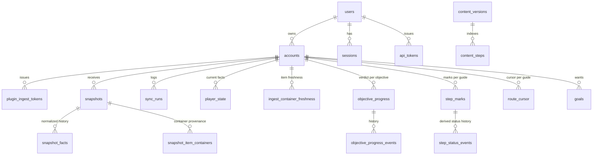

# Ironman Planner — Arquitetura

Data: 2026-11-03. Reescrito em 2026-11-04 como a arquitetura vigente, em Go. As opções descartadas
(SvelteKit full-stack, SQLite, Drizzle, Zod como fonte da verdade) e as sequências anteriores de MVP
ficam no histórico do git (versões deste arquivo até o commit `17887c3`). Artefatos técnicos que valem:
`content/schema/guide.schema.json` (schema do conteúdo, embutido no binário), `db/migrations/` (goose,
Postgres), `docs/arquitetura/types.ts` (contrato de ingest e tipos de readiness em Zod, só como
referência para clientes TS), `docs/arquitetura/modelo-de-dados.dbml` (modelo do banco em DBML:
parte atual gerada das migrations por `just dbml`, mais as tabelas planejadas do doc 09). O modelo de domínio por objetivos está no doc 09 e prevalece sobre este
documento onde houver conflito.

## 0. Decisões em uma página

| Tema | Decisão |
|---|---|
| Stack | **Go** como núcleo: um binário (`ironman`) com `serve`, CLI e servidor MCP; Postgres 17 via pgx + sqlc + goose; SPA Svelte 5 embutida no binário. Toolchain no doc 07. |
| Domínio | **Objetivo** (entidade canônica + alvo) é a unidade rastreável e o passo é a unidade de navegação; progresso da conta compartilhado entre rotas, marcas e cursor por guia (doc 09). |
| Conteúdo | JSON em `content/guides/<id>/` (`oziris-main` e `bruhsailer-main`, rotas independentes), gerado por importadores e validado contra `content/schema/guide.schema.json` no boot e na CI; objetivos extraídos em sidecars `annotations/` (doc 09, seção 4.2). Ids sempre escopados por guia. |
| Estado do jogador | Snapshots brutos append-only + tabela `player_state` mesclada (uma linha por fato) que alimenta o motor. |
| Motor | Função pura `(regras, PlayerState) → {veredito, evidência}` em `internal/core/rules`; status do passo derivado dos objetivos em `internal/core/progress`; reavaliação completa a cada snapshot. |
| Grafo | Calculado no servidor em memória a partir de `content/` + catálogos + cache do wiki; renderizado com **Cytoscape.js + ELK**. Nós são chaves de objetivo. |
| Plugin | Protocolo clone do WikiSync: `GET /api/ingest/manifest` + `POST /api/ingest` com deltas, token `ipl_` por cliente; contrato v1 na seção 6.4. Plugin somente leitura no Microbot (doc 06). |
| Execução | Local-first na estação `zaros` com `AUTH_MODE=dev`; depois a mesma imagem no `saradomin` com Postgres e Zitadel existentes (seção 8). |
| Auth | `AUTH_MODE=dev` (usuário fixo) hoje; **OIDC via Zitadel** (PKCE, `coreos/go-oidc`, sessão `alexedwards/scs`) na tarefa de deploy. Tokens `ipl_` por conta para o plugin; tokens de API para CLI e MCP. |

## 1. Stack

Motivo da escolha (decisão do dono, 2026-11-03): buildar o mesmo núcleo em vários formatos (servidor
web, CLI para usar com agentes, servidor MCP) e manter afinidade com o ecossistema de plugins que ele
já desenvolve. Go dá binário único estático, cross-compile trivial, pouca RAM no `saradomin` e um `cmd`
por formato compartilhando o mesmo pacote de domínio.

| Camada | Escolha |
|---|---|
| Domínio | `internal/core` em Go puro: conteúdo (structs + validação por JSON Schema com `santhosh-tekuri/jsonschema`), entidades, regras, planning, progresso, grafo. Sem dependência de banco ou HTTP; todo formato importa daqui. |
| API e scheduler | `net/http` com o mux da biblioteca padrão; scheduler in-process; adapters de fonte em `internal/sources/{hiscores,wom,wiki}`. |
| Banco | Postgres 17 em todos os ambientes; `pgx` + `sqlc` (queries em `db/queries`, tipos gerados em `internal/store/db`) + `goose` (`db/migrations`). |
| Auth | `AUTH_MODE=dev` ou `oidc` (`coreos/go-oidc` + `golang.org/x/oauth2`, PKCE; sessão `alexedwards/scs` com `pgxstore`). |
| Frontend | Svelte 5 + SvelteKit `adapter-static` + Vite em `web/`; `web/dist` embutido com `embed.FS`; Cytoscape + ELK para o grafo. Tipos TS espelham o contrato HTTP à mão (`web/src/lib/progress/types.ts`). |
| Plugin | Java no Microbot, repositório `microbot-plugins`; só o contrato HTTP é compartilhado. |
| Deploy | Imagem `distroless` não-root com o binário; `docker compose`. |

Custos aceitos: sem compartilhamento nativo de tipos entre servidor e browser; mais código de
infraestrutura que um framework full-stack (a UI é um app logado, não precisa de SSR); o grafo é
calculado em Go e exposto por `GET /api/plan` e `GET /api/graph`, então CLI, MCP e tela têm o mesmo
resultado.

## 2. Componentes e fluxo

### 2.1 Componentes


Responsabilidades:

- **SPA**: telas da página v4 do canvas, tema Pergaminho: `/setup` (primeiro acesso: RSN, modo,
  camadas, rota, primeiro sync; um RSN já cadastrado entra direto), `/` (Agora, o cursor da rota ativa),
  `/rotas` (lista com cobertura), `/rotas/[guia]/[seção]` (a seção por trecho de banco), `/mundo` e
  `/conta` (ainda "em breve"). Sem tela de comparação (decisão 1 do v4): o cruzamento entre rotas é o
  "também na rota X" do passo e a cobertura da lista. Os caminhos antigos redirecionam.
- **API**: handlers em `internal/httpapi` sob `/api`, JSON. Hoje sem sessão: rotas por conta só em
  `AUTH_MODE=dev`. Lista na seção 2.5.
- **Content loader**: no boot lê `content/guides/*/guide.json` e os sidecars `annotations/`, valida contra
  os schemas embutidos, compõe os objetivos, calcula o hash do conteúdo, grava `content_versions` +
  `content_steps`, aplica `step_id_aliases` às marcas e dispara reavaliação. Hoje só carrega e valida;
  o resto é o item 8 da sequência (seção 9).
- **Motor**: `internal/core/rules` (veredito com evidência por regra), `internal/core/planning`
  (readiness do trecho) e `internal/core/progress` (status derivado do passo, cascata, cursor). Puros.
- **Grafo**: `internal/core/graph` constrói o grafo de requisitos a partir do conteúdo, dos catálogos e
  do `wiki_cache`, guarda em `graph_cache` e responde "o que falta para X" e "destravou agora".
- **Scheduler**: in-process; cada tick enfileira `sync_runs` por (conta, fonte) respeitando cadência e
  backoff; um executor único consome em série.
- **Ingest**: `GET /api/ingest/manifest` e `POST /api/ingest` com token `ipl_`; `internal/store/ingest`
  valida, persiste o snapshot, normaliza para `player_state` e registra o frescor dos containers.
- **Adapters**: um pacote por fonte com `fetch` e `normalize`; só o adapter conhece o shape externo.

### 2.2 Formatos do mesmo binário (`cmd/ironman`)

```
ironman serve                        # API + SPA + scheduler + ingest (único que abre o Postgres)
ironman content validate [path]      # schema + checagens semânticas de guide.json e anotações
ironman content migrate              # data/guide/normalized → content/guides/oziris-main
ironman content import-bruhsailer    # DOCX pinados → content/guides/bruhsailer-main
ironman content mcp                  # servidor MCP stdio da extração, só sobre content/ (doc 09, seção 6)
ironman now [--json]                 # próximo passo, itens a levar, bloqueios (cliente da API)
ironman done <step> | skip | note    # marcar passo
ironman plan <meta>                  # plano ordenado de uma meta
ironman sync [--source hiscores]     # força sync
ironman state skills|quests|diaries
ironman mcp                          # servidor MCP por stdio para agentes, sobre a API da conta
```

Regra: só `serve` abre o banco. CLI e `ironman mcp` são clientes da API com token (`IRONMAN_URL`,
`IRONMAN_TOKEN`), então funcionam de qualquer máquina e o modelo de permissão é um só. O MCP usa o SDK
oficial `github.com/modelcontextprotocol/go-sdk`. `now`, `done`, `plan`, `sync`, `state` e `mcp` ainda
são stubs.

### 2.3 Fluxo: snapshot → objetivos → status dos passos

```mermaid
sequenceDiagram
  participant S as Scheduler / Ingest
  participant A as Adapter
  participant DB as Postgres
  participant M as Merge
  participant R as Motor
  participant U as UI
  S->>A: fetch(rsn) ou POST do plugin
  A-->>S: raw
  S->>DB: INSERT snapshots (dedupe por raw_hash ou client_seq)
  alt nada mudou
    S->>DB: sync_runs.status = unchanged
  else novo
    S->>DB: INSERT snapshot_facts (histórico normalizado)
    S->>M: patch = normalize(raw)
    M->>DB: UPSERT player_state (facet, key) se observed_at mais novo
    M->>R: avaliar todos os objetivos de todos os guias
    R-->>M: vereditos + evidência
    M->>DB: UPSERT objective_progress + objective_progress_events
    M->>R: status derivado por passo e guia; cascata na rota ativa; cursores
    M->>DB: step_status_events, step_marks(implied), route_cursor
    M->>DB: sync_runs.status = ok, steps_changed = n
  end
  U->>DB: GET /api/guides/{guide}/board?account= (status derivado + frescor)
```

### 2.4 Configuração

Variáveis lidas por `internal/config`: `IRONMAN_ADDR` (`:8080`), `DATABASE_URL`, `AUTH_MODE`
(`dev` | `oidc`), `OIDC_ISSUER`, `OIDC_CLIENT_ID`, `OIDC_REDIRECT_URL`, `SESSION_SECRET`, `CONTENT_DIR`
(`content`), `LOG_LEVEL`, `PUBLIC_BASE_URL`. `.env.example` documenta cada uma; detalhes, modos e
troubleshooting no doc 07. Configurações por conta (tabela `settings`): layer ativa, modo, fontes
habilitadas, horas de stale por fonte, se o sync de banco está autorizado.

### 2.5 Auth e API

- **Hoje**: `AUTH_MODE=dev` loga um usuário fixo sem OIDC; é o modo dos testes e da CI. Rotas que
  expõem dados por id de conta (`?account=`) só existem nesse modo.
- **Depois**: OIDC Zitadel (seção 8); `users.role`, `accounts.user_id` já existem para multiusuário.
- **Tokens de API** (`api_tokens`): `Authorization: Bearer apk_…`, para CLI, MCP e scripts.
- **Tokens do plugin** (`plugin_ingest_tokens`): `Authorization: Bearer ipl_…`, escopo = uma conta,
  mostrados uma vez, sha256 no banco, revogáveis, com `scopes` (`state:write`; `items:*` são opt-in).

| Rota | Estado | Função |
|---|---|---|
| `GET /api/health`, `GET /api/version` | feita | liveness, versão, contagem de conteúdo, estado do banco |
| `GET /api/guides`, `GET /api/guides/{guide}` | feita | guias carregados e sumário de seções |
| `GET /api/guides/{guide}/sections/{section}`, `GET /api/guides/{guide}/steps/{id}` | feita | conteúdo (steps planos e segmentos) |
| `GET /api/guides/{guide}/now` | stub | primeiro passo e os cinco seguintes; vira o cursor da rota |
| `GET /api/ingest/manifest`, `POST /api/ingest` | feita | plugin (seção 6.4) |
| `POST /api/dev/ingest-token` | feita (dev) | bootstrap de token sem UI |
| `GET /api/guides/{guide}/readiness?account=&step=`, `GET /api/guides/{guide}/segments/{segment}/readiness?account=` | feita (dev) | readiness do trecho (seção 6.4.1) |
| `GET /api/guides/{guide}/board?account=` | feita (dev) | status derivado e veredito por objetivo de cada passo, marcas, cursor, contagens, órfãos; frescor fica para o item 9 |
| `PATCH /api/guides/{guide}/steps/{id}/mark?account=` | feita (dev) | `{kind: manual_done\|skipped\|pinned_open\|confirm_implied\|clear, note}`; `note` ausente mantém, `""` limpa |
| `POST /api/guides/{guide}/implied/confirm?account=` | feita (dev) | "confirmar tudo": toda marca `implied` do guia vira `manual_done` |
| `POST /api/guides/{guide}/marks?account=` | feita (dev) | "marcar tudo antes deste": `before_step_id` marca `manual_done` todo passo da rota principal antes dele, visível e pendente sem marca ou presumido (`implied`); pulados ficam; `restore` (a lista `undo` da resposta) devolve a cada passo a marca anterior |
| `PUT /api/guides/{guide}/cursor?account=` | feita (dev) | `{step_id}` fixa o passo atual (passo feito é recusado); `{step_id: null}` volta ao automático |
| `GET /api/objectives?account=` | feita (dev) | vereditos compartilhados com evidência |
| `GET /api/progress?account=` | feita (dev) | resumo das rotas: rota ativa, cursor (com a referência do autor), contagens por seção, cobertura, fontes |
| `GET /api/guides/{guide}/events?account=&limit=` | feita (dev) | o que mudou: eventos de passo do guia e de objetivo da conta, com a fonte do snapshot |
| `PUT /api/account/guide?account=` | feita (dev) | troca a rota ativa e reavalia na mesma transação |
| `GET /api/setup/lookup?rsn=`, `POST /api/accounts` | feita (dev) | primeiro acesso (`/setup`, V4Setup): conta existente pelo RSN, ou modo detectado e níveis do hiscores; cria a conta e reavalia |
| `POST /api/sync?account=` | feita (dev) | sync do hiscores agora; 429 com `retry_at` no debounce de 60 s ou no recuo |
| `GET /api/sync/runs?account=&limit=` | feita (dev) | tentativas de sync (status, HTTP, erro, `steps_changed`, `next_allowed_at`) |
| `GET /api/state?account=` | planejada | estado da conta |
| `GET/POST /api/goals?account=`, `DELETE /api/goals/{id}?account=` | feita (dev) | metas: objetivo fixado (chave canônica validada no registry); alcançada quando o objetivo vira met |
| `GET /api/goals/{id}/plan?account=` | feita (dev) | plano da meta: fechamento de `QuestEntry.Requires` contra fatos e vereditos; unknown nunca conta como feito, presumido pela marca fica fora do "N de M" |
| `GET /api/world?account=` | feita (dev) | entidades que as rotas tocam, com veredito por objetivo e onde cada rota as faz (Mundo) |
| `GET /api/graph?focus=&depth=`, `GET /api/plan?goal=` | planejadas | grafo e plano da meta (esperam os requisitos de quest no catálogo) |
| `GET /api/export`, `POST /api/import` | planejadas | JSON completo da conta |

### 2.6 Backups e export

- **Banco**: `pg_dump` da database `ironman_planner` (manual ou via `just` no zaros; rotina existente no
  saradomin). Restore com `pg_restore`.
- **Export lógico** (planejado): `GET /api/export` devolve `{schema_version, account, settings,
  objective_progress, step_marks, route_cursor, goals, snapshots?: 'latest'|'all'}`; o import reaplica
  com `cause='import'`. É o formato de migração entre instâncias e o seguro contra mudança de schema.
- **Conteúdo**: está no git; nada a fazer.

## 3. Modelo de conteúdo

Schema canônico: `content/schema/guide.schema.json`, embutido no binário (`content/schema` →
`internal/core/content`) e usado por `ironman content validate` e pelo loader. Hierarquia:
`Guide → Variant → Section → Segment → Step`. Segmentos são `bank_leg` (começa numa ação de banco
explícita) ou `sequence`, com `bank_actions` e `loadout` (`known`/`partial`/`unknown`), sempre com
proveniência (doc 05, seção 11). Os objetivos de cada passo vêm de `complete_when` (convertido pelo
loader) e dos sidecars de anotação (doc 09, seção 4).

### 3.1 O que um step carrega

```jsonc
{
  "id": "1.1.258a",                      // estável, opaco; herdado do ironman.guide
  "text": "Train Runecraft to 10, then complete Temple of the Eye quest to unlock Guardians of the Rift",
  "location": "Wizard Tower",
  "notes": [{ "kind": "tip", "text": "GOTR is a massive improvement for RC training..." }],
  "complete_when": [                     // AND implícito; o loader converte em objetivos `completes`
    { "type": "skill_level", "skill": "runecraft", "level": 10, "meta": { "origin": "skillGoal", "confidence": "high" } },
    { "type": "quest_state", "quest": "Temple of the Eye", "state": "FINISHED" }
  ],
  "prerequisites": [],                   // regras informativas; viram objetivos `requires`
  "requires": ["step:1.1.257"],          // aresta dura para outro passo do mesmo guia
  "entities": [                          // menções resolvidas pelo registry, com citação e posição
    { "ref": "quest:temple_of_the_eye", "source_text": "Temple of the Eye", "field": "/complete_when/1/quest", "method": "rule", "match": "name" }
  ],
  "tags": ["new-content", "runecraft"],
  "layers": ["enhanced"],                // só aparece no Enhanced Mode
  "modes": ["ironman", "hcim", "uim", "gim"],
  "source": { "origin": "ironman.guide", "original_id": "1.1.258a", "imported_at": "2026-11-03" }
}
```

Pontos de design:

- **`complete_when` é uma lista de regras com AND implícito**; `{any}`, `{all}` e `{not}` dão
  expressividade sem virar linguagem. Ausente ou vazio ⇒ passo **manual** (checkbox). Cada regra atômica
  pode levar `meta` com proveniência (`origin`, `inferred`, `confidence`, `match`). O campo continua
  aceito durante a migração para objetivos e sai quando os importadores emitirem objetivos.
- **Tipos de regra**: `skill_level`, `skill_xp`, `quest_state` (com `op: gte|eq`), `diary_task`,
  `diary_tier`, `combat_achievement`, `boss_kc`, `activity_score`, `collection_log_item`, `varbit`,
  `varp`, `item_owned`, `manual`. Cada regra declara implicitamente de qual **faceta** do `PlayerState`
  depende, o que dá o `stale` por passo e a lista de fontes necessárias ("esse passo precisa do plugin").
- **Referências**: `requires`, `recommended_after` e `unlocks` usam `graphRef`: um `entityRef`
  (`step:<id>` dentro do guia, `step:<guia>/<id>` entre guias, ou um ref do registry) ou uma chave de
  objetivo (`quest:<slug>@finished`, `skill:<skill>>=<nível>`). O formato antigo `quest:<nome wiki>` e
  `skill:<skill>:<nível>` saiu do schema no item 2. O grafo usa chaves de objetivo.
- **`objectives`**: o passo carrega objetivos (doc 09, seções 3.2 a 4.2). `content.Load` junta os do
  `guide.json`, os convertidos de `complete_when`/`prerequisites` e os dos sidecars em
  `content/guides/<id>/annotations/`, verificados contra o texto (hash e citação) e o catálogo.
- **`layers`**: `classic` é o guia original do Oziris; `enhanced` são os 38 passos adicionados pelo site.
  Um passo com `["classic","enhanced"]` aparece sempre; `["enhanced"]` só no modo enhanced. A conta escolhe
  a layer; trocar não perde progresso.
- **`modes`**: filtra passos que não fazem sentido para UIM ou GIM. Notas de HCIM ficam como
  `notes[kind=hcim]`, porque o passo em si vale para todos.
- **`tags`** são livres com namespace sugerido: `phase:mid`, `sailing`, `new-content`, `skill:thieving`.
- **`section.kind = track`** modela a Sailing Track: trilha paralela, não entra no "próximo passo" nem na
  cascata, mas entra no grafo.
- **`source`** por passo e por guia: origem, id original, autor, licença. Serve para atribuição (regra 6
  do CLAUDE.md) e para o diff quando a fonte atualizar.

### 3.2 Ids estáveis e sobrevivência do progresso

Marcas (`step_marks`), eventos de passo e cursor são chaveados por `(account_id, guide_id, step_id)`
**sem FK** para `content_steps`: remover um passo do guia não apaga progresso. Regras:

1. Id nunca muda e nunca é reutilizado. No Oziris, passos novos entre `1.1.76` e `1.1.77` ganham
   `1.1.76b`, `1.1.76c` (padrão do site). No BRUHsailer o id é posicional da numeração upstream
   (`bruh-1.1-05` de `CH1.5`), com o hash do texto em `source.fingerprint` para detectar edição (doc 09,
   decisão D6).
2. Dividir, fundir ou renumerar: o importador grava os aliases (`step_id_aliases`, por guia). O loader
   aplica os aliases uma única vez às marcas, aos eventos e ao cursor, com evento `cause='migration'`.
3. Mudar só o texto não muda o id; muda o `fingerprint`, o que invalida a anotação daquele passo e o
   `text_hash` de `content_steps`; o boot reavalia tudo.
4. Progresso órfão (id que não existe mais e não tem alias) aparece em `/account/orphans` para o dono
   decidir.

### 3.3 Importadores, derivação e sidecars

- `ironman content migrate` lê `data/guide/normalized/guide.json` (normalizador Python do doc 05) e
  escreve `content/guides/oziris-main/`; mapeamento campo a campo no doc 05, seção 10.
- `ironman content import-bruhsailer` lê os DOCX pinados em `data/sources/bruhsailer/` e escreve
  `content/guides/bruhsailer-main/`; proveniência no README do guia.
- Os dois passam por `internal/core/content/derive` (segmentos, ações de banco, loadouts) e por
  `internal/core/entities/enrich` (menções resolvidas; o resto vai para `entities.report.json`).
- Saída determinística: mesmo input ⇒ mesmos bytes. `guide.json` nunca é editado à mão (regra 9).
- Os objetivos extraídos pelo agente vivem em `content/guides/<id>/annotations/*.json`, escritos só por
  `ironman content mcp` e compostos pelo loader; os importadores nunca os tocam (doc 09, seção 4.2).

## 4. Banco de dados e avaliação

DDL em `db/migrations/` (goose, Postgres); `0001_init.sql` é o schema base, `0002` o frescor do ingest,
`0003` a identidade por guia. O modelo em DBML, com a parte atual gerada e a planejada à mão, está em
`docs/arquitetura/modelo-de-dados.dbml`, e é lá que as mudanças de schema de cada item ficam listadas. Em
resumo: a migration do item 7 colapsa as nove tabelas `snapshot_*` tipadas numa `snapshot_facts` com o
shape de `player_state` (decisão do dono, 2026-11-04); a do item 8 cria as tabelas de objetivos (doc 09,
seção 5), derruba `step_progress`, `step_progress_events` e `v_step_board` depois de copiar as marcas, e
reduz `content_steps` ao índice mínimo. `wiki_cache` e `graph_cache` ficam, vazias, até terem uso.

### 4.1 Grupos de tabelas



- **`snapshots`** é append-only com `raw` bruto; dedupe por `raw_hash` para fontes de polling e por
  `(ingest_token_id, client_seq)` para o plugin. **`snapshot_facts`** `(snapshot_id, facet, key, value)`
  é a normalização por snapshot, com o mesmo shape de `player_state`: histórico para gráficos e diffs
  sem uma tabela por faceta (hoje ainda são as nove `snapshot_*` da migration 0001, quatro delas sem
  escritor; o colapso é o item 7). Um `adapter_version` por snapshot permite re-normalizar o passado.
- **`player_state`**: uma linha por fato `(facet, key)` com `value` JSON, fonte e `observed_at`. Facetas:
  `skill`, `activity`, `quest`, `diary_task`, `combat_achievement`, `collection_log`, `varbit`, `varp`,
  `item`; a faceta `diary` (tier completa, a partir dos varbits de referência) entra com o item 7 da
  sequência. O merge é "observação mais nova vence dentro da faceta", com prioridade
  `plugin > wikisync > hiscores > wom` em empate. O motor só lê essa tabela, carregada em memória como
  `rules.PlayerState`.
- **`ingest_container_freshness`** e **`snapshot_item_containers`**: estado (`unavailable`/`restored`/
  `live`), `revision` e `live_epoch` por container; `restored` nunca vira `live` (seção 6.4).
- **`objective_progress`** guarda o veredito por `(conta, chave de objetivo)` com evidência, snapshot,
  `first_met_at`, `met_in_guide_id` e `regressed_at`; **`objective_progress_events`** as transições.
- **`step_marks`** guarda a marca do dono por `(conta, guia, passo)`: `manual_done`, `skipped`,
  `pinned_open` ou `implied` (com `implied_by_step_id`). O status automático **não é armazenado**: é
  derivado dos objetivos na leitura; **`step_status_events`** registra as transições do status derivado
  por guia (fonte do F6 e de `steps_changed`).
- **`route_cursor`**: passo atual por `(conta, guia)`, com causa `pin` ou `auto`.
- **`content_versions`** e **`content_steps`**: índice mínimo do conteúdo carregado (seção, posição,
  hash) para joins de eventos e detecção de órfãos; **`step_id_aliases`** por guia.
- **`goals`** guarda a chave de objetivo e um `plan_cache`.
- **`wiki_cache`** e **`graph_cache`** são caches reconstruíveis.

### 4.2 Dimensionamento

802 passos × 1 conta × 1 snapshot a cada 30 min = 48 reavaliações/dia, cada uma lendo ~1.500 linhas de
`player_state` e escrevendo poucas dezenas; com o plugin, um delta a cada 10 s só quando algo mudou.
Snapshots brutos do hiscores têm ~10 KB; um ano são ~175 MB se guardar todos. Política: guardar todos os
snapshots com mudança (`unchanged` não grava) e um job mensal compacta snapshots de hiscores com mais de
90 dias para um por dia. Nada disso pressiona o Postgres.

### 4.3 Motor de regras e status derivado

Contrato (Go, `internal/core/rules`):

```go
rules.Evaluate(rules []content.Rule, ps rules.PlayerState) rules.Result
// Result = {Verdict: met|unmet|unknown, Evidence []Evidence, Monotonic bool}
```

Semântica:

1. **Três veredictos, não dois.** `unknown` significa que a faceta nunca foi observada para a conta (ex.:
   `quest_state` sem plugin). A UI mostra "precisa do plugin" em vez de "não feito". `all` com qualquer
   `unmet` ⇒ `unmet`; `all` só com `met`/`unknown` ⇒ `unknown` se houver algum `unknown`; `any` com um
   `met` ⇒ `met`.
2. **Evidência sempre.** Cada regra atômica devolve `{rule, verdict, observed, reason, stale}`; o
   objetivo guarda a evidência e o snapshot do momento em que virou `met`, então "por que isso está
   marcado?" tem resposta meses depois.
3. **Reavaliação total a cada snapshot.** Barata (milissegundos). Só objetivos cujo veredito mudou geram
   escrita e evento; o status derivado dos passos é recalculado em seguida e só as transições geram
   `step_status_events`. Também reavalia no reload de conteúdo para objetivos cuja regra mudou.
4. **Status do passo, marcas e cascata**: definidos uma vez no doc 09 (seção 5 e decisão 9.1) e
   implementados em `internal/core/progress`; este documento não os repete.
5. **Regressão.** Objetivo `met` continua `met`, com a evidência do snapshot que o provou, para
   qualquer alvo; quando o fato deixa de valer, `regressed_at` registra, e volta a `NULL` se ele valer
   de novo (a UI alerta). Vale também para item: gastar as penas não reabre o passo "compre 120
   feathers" (decisão do dono, 2026-11-04, item 8). A readiness continua lendo o estado atual.
6. **Stale.** Cada passo tem `freshness` calculada na leitura, não armazenada: pega as facetas que seus
   objetivos tocam, acha o `observed_at` mais antigo e compara com o limite por fonte (hiscores 24 h,
   plugin 72 h). `stale` não muda status; muda a cor e destaca "sync now". Passos manuais nunca ficam
   stale. Se nenhuma faceta foi observada ⇒ `unknown`.
7. **Determinismo.** `now` é parâmetro; nada de relógio dentro do motor. Testes de tabela com fixtures em
   `internal/core/.../testdata`.

## 5. Grafo de requisitos

### 5.1 Nós e arestas

Os nós são **chaves de objetivo** (doc 09, seção 3.2), então o grafo, as metas e as rotas falam a
mesma língua:

| Tipo de nó | Chave | Origem | "Feito" quando |
|---|---|---|---|
| quest | `quest:lost_city@finished`, `quest:lost_city@started` | catálogo + Bucket `quest` | `objective_progress` = `met` |
| skill (um nó por skill; **níveis são atributos de aresta**) | `skill:agility` | implícito | n/a (satisfação é por aresta, `>= N`) |
| diary tier | `diary:ardougne:easy@complete` | catálogo | `met` |
| item | `item:7462x1` | extração do guia + wiki | `met` (posse) |
| unlock | `unlock:fairy_rings@done` | catálogo de unlocks | `met` (varbit) ou marca manual |
| boss | `boss:zulrah>=N` | hiscores | `met` |
| combat achievement | `ca:574@done` | catálogo | `met` |
| quest points | `qp>=N` | varp 101 ou soma do catálogo | `met` |
| passo | `step:<guia>/<id>` | conteúdo | status derivado do passo |
| meta | `goal:<ulid>` | usuário | nó alvo; aponta para uma chave |

Arestas `A -requires-> B` com atributos `{kind: hard|soft, threshold?, source: wiki|guide|derived}`:

- **wiki → hard**: `quest X requires quest Y`, `quest X requires skill S ≥ n`, `diary tier requires
  quest/skill`. Vem de `data/wiki/quests.json` e `diary_tasks.json` (Bucket), cacheado em `wiki_cache`.
- **guia → hard**: objetivos `requires` do passo e `step.requires`.
- **guia → soft**: `recommended_after` e a ordem do guia (passo N depois de N−1 na mesma seção), usada
  só para desempate topológico.
- **derivadas**: objetivo `completes` ⇒ `step -requires-> objetivo`; objetivo `uses` de item ⇒ aresta
  suave para a posse.

Skill-por-aresta é o que evita a explosão: 24 nós de skill em vez de 24 × 99.

### 5.2 Armazenamento

Em memória, reconstruído de `content/` + catálogos + `wiki_cache` quando qualquer um muda; serializado
em `graph_cache` para boot rápido. Não há tabela de adjacência editável: o grafo é derivado, nunca fonte
da verdade. Tamanho: ~225 quests + 24 skills + 48 diary tiers + 802 passos + itens e unlocks ⇒ menos de
3.000 nós e 8.000 arestas. Cabe em um mapa.

### 5.3 Algoritmos

Todos em `internal/core/graph`, puros, recebendo `(grafo, vereditos, marcas)`:

- **Satisfação de aresta**: para nó de objetivo compara o veredito; para skill compara
  `level ≥ threshold`; para passo olha o status derivado.
- **"O que falta para X"**: BFS reverso a partir do alvo seguindo só arestas `hard` não satisfeitas; nós
  satisfeitos cortam a busca. Resultado = subgrafo pendente. Depois **Kahn** com desempate por (fase do
  guia, posição do passo na rota ativa, menor custo estimado) ⇒ plano linear. Ciclos (erro de dado) são
  reportados como aviso, nunca travam.
- **"Destravou agora"**: `available(estado) = {n : todas as arestas hard de saída satisfeitas e n não
  feito}`; diff entre dois snapshots é a lista. Rodado no fim de cada reavaliação e gravado como evento.
- **Caminho crítico**: no subgrafo pendente, peso = `estimate_minutes` do passo destino (ou XP faltante ÷
  taxa configurável para arestas de skill); caminho mais longo em DAG.
- **Caminho recomendado do guia**: filtra o plano para manter só passos e reordena pela ordem da rota
  ativa quando a topologia permite.

### 5.4 Render sem hairball

- **Focus + context**: a tela nunca renderiza o grafo todo. Entra sempre por um foco (meta, quest ou
  passo) e mostra ancestrais pendentes até `depth` (default 3), com os satisfeitos colapsados em um
  nó-resumo "12 requisitos concluídos" expansível.
- **Compound nodes por seção**: passos viram filhos de um nó composto da seção.
- **Skills como badges**: `step → skill:agility (56)` é uma etiqueta no nó do passo, não uma aresta para um
  nó distante. Só vira nó quando o usuário foca em uma skill.
- **Layout ELK `layered`**, esquerda→direita, recalculado só ao expandir/colapsar.
- **Cores por estado**: feito, disponível, bloqueado (com contador do que falta), stale, manual pendente.
- **Limite duro** de ~150 nós visíveis; acima disso, aumenta a agregação.
- Vista alternativa em lista (o plano topológico), porque para executar é mais útil que o grafo.

## 6. Estratégia de sync

### 6.1 Cadência e gatilhos

| Fonte | Cadência | Condição | Observações |
|---|---|---|---|
| Hiscores | a cada 30 min (jitter ±5; `SYNC_HISCORES_MINUTES`, 0 desliga) | conta ativa com nome; a aceleração para 10 min ainda não existe | tabela do modo, com a normal de reserva num 404; skill sem rank fica de fora (não sabemos); fatos iguais (sem ranks) ⇒ `unchanged`; 404 três vezes seguidas ⇒ alerta na UI |
| Wise Old Man | a cada 6 h | `SYNC_WOM_HOURS > 0` | Lê histórico; opcionalmente `POST /players/:name` para pedir update, no máximo 1×/h |
| Wiki Bucket | semanal + no boot se cache vazio | global, não por conta | Alimenta `wiki_cache` e invalida `graph_cache` |
| Plugin | push | token válido | Define `last_seen_at` do token |
| Manual | `POST /api/sync` | debounce 60 s por (conta, fonte) | Responde com o `sync_run` terminado (o sync é síncrono) |

WikiSync não é fonte: o wiki pede para não usar a API em projetos de terceiros (doc 02, seção 3) e o
plugin próprio cobre tudo que ela daria. O scheduler roda a cada minuto, decide o que está vencido
(`next_allowed_at` ≤ agora), enfileira `sync_runs(status=queued)` e um único executor processa em
série com timeout de 15 s por chamada.

### 6.2 Rate limit, backoff e idempotência

- Por fonte, `minInterval` e `maxPerHour` no adapter; o executor respeita antes de chamar.
- `429`/`503` ⇒ `status=rate_limited`, `next_allowed_at = now + 2^n × 5 min` (n = falhas consecutivas,
  teto 6 h). Outros `5xx` ⇒ `error` com backoff igual. Sucesso zera.
- Idempotência de leitura: `raw_hash`. Idempotência de escrita no `player_state`: só atualiza se
  `observed_at` novo ≥ existente. Reprocessar um snapshot antigo nunca regride o estado.
- Reavaliação é idempotente por construção (função pura + eventos só nas transições).

### 6.3 Mudança de nome

- O plugin é a fonte autoritativa: ele envia `username`; se diferir de `accounts.rsn` para aquele token,
  o servidor registra em `name_history`, atualiza `rsn`/`rsn_normalized` e segue.
- Sem plugin: hiscores 404 três vezes seguidas ⇒ alerta "conta não encontrada; renomeou?"; WOM tem
  endpoint de name change e o adapter tenta resolver antes de alertar.
- `rsn_normalized` (lowercase, espaços → `_`) é a chave de busca em todas as fontes.

### 6.4 Plugin Microbot: contrato de ingestão

Modelo: WikiSync (BSD-2). Lá, o plugin baixa `GET /runelite/manifest` a cada 20 min, a cada 10 s lê os
varbits/varps do manifest e os níveis, calcula o delta e só envia o que mudou; backoff quadrático em
falha; o cache local só avança após `200`. Copiamos isso e estendemos. Implementação: `internal/core/ingest`
(tipos e validação), `internal/store/ingest` (manifest, aceitação, normalização, frescor) e o plugin
`fm/ironmanplanner` no repositório `microbot-plugins` (doc 06).

```mermaid
sequenceDiagram
  participant P as Plugin (Microbot)
  participant S as Servidor (/api/ingest)
  P->>S: GET /api/ingest/manifest  (Bearer ipl_…)
  S-->>P: {contract_version:1, manifest_version:7, token_scopes:["state:write"], varbits:[…], items:{bank:false,…}, resync:true}
  Note over P: login → lê tudo que o manifest pede
  P->>S: POST /api/ingest {contract_version:1, kind:"full", client_seq:1, manifest_version:7, data:{…}}
  S-->>P: {contract_version:1, ok:true, accepted_seq:1, resync:false, manifest_version:7}
  loop a cada 10 s, se algo mudou
    P->>S: POST /api/ingest {kind:"delta", client_seq:n, data:{varb:{…só mudados}, level:{…}, quest:{…}}}
    S-->>P: {ok, accepted_seq:n, steps_changed:2}
  end
  Note over S: manifest muda (novo varbit de referência) → version 8
  P->>S: POST (manifest_version:7)
  S-->>P: 409 {ok:false, resync:true, manifest_version:8}
  P->>S: GET manifest; POST kind:"full"
```

Detalhes do contrato (tipos Go em `internal/core/ingest/contract.go`; espelho Zod em
`docs/arquitetura/types.ts`):

- **Versões**: `contract_version` é literalmente `1`; campos novos opcionais não mudam a versão, mudança
  incompatível cria outro contrato. `manifest_version` é um hash truncado do conjunto gerado pelo servidor:
  varbits/varps de referência (`content/reference/varbits.json`: diaries, unlocks, varp 101) mais os
  usados em regras do conteúdo, `collections` (item ids em ordem fixa para o bitset) e `only_item_ids`.
  Manifest diferente exige novo `full`.
- **Facetas** de `data`: `varb`, `varp`, `level`, `xp`, `boosted` (mapas id → valor), `collectionLogSlots`
  (bitset base64) e `items`. **Nova (item 7 da sequência do doc 09)**: `quest`, mapa nome RuneLite →
  `NOT_STARTED | IN_PROGRESS | FINISHED`, lido com `Quest.getState` na thread do cliente (doc 02, seção 6);
  obrigatório em `full`, só os que mudaram em `delta`. O servidor resolve o nome pelo registry (aliases
  do WikiSync cobrem os nomes divergentes) e grava a faceta `quest`. O servidor rejeita campos
  desconhecidos (`DisallowUnknownFields`), então ele sobe antes do plugin.
- **Escopos**: todo token anuncia `state:write`; dados privados usam `items:bank`, `items:inventory` e
  `items:equipment`. Os booleanos de `items` no manifest são a permissão efetiva e devem corresponder aos
  escopos. Ainda há o segundo opt-in no cliente; os três toggles locais começam desligados.
  `only_item_ids`, quando presente, limita as chaves aceitas.
- **Formato Java-friendly**: mapas são objetos JSON com chaves decimais canônicas (`"4151"`), portanto
  o cliente usa `Map<String, Long>` do Gson sem adaptador.
- **Full versus delta**: `full` contém todos os mapas, mesmo vazios, e uma observação explícita para cada
  um de `bank`, `inventory` e `equipment`. Em `delta`, facetas e containers inalterados são omitidos.
  `collectionLogSlots` é sempre o bitset completo.
- **Ordem e idempotência**: `client_seq` monotônico por token; o servidor responde `409` com
  `ok:false, accepted_seq:last_seq, resync:true` para `seq ≤ last_seq` ou manifest antigo, e o cliente
  renumera e manda `full`. Cada POST aceito vira um `snapshots(kind, raw, client_seq)` e um merge em
  `player_state`.
- **Resync**: `resync:true` no manifest ou na resposta manda o cliente atualizar o manifest e fazer `full`
  no ciclo seguinte. Login e logout também disparam `full` (o de logout leva o último estado conhecido).
- **Cadência**: 10 s de verificação local, envio só se houver delta, backoff quadrático, timeout 3 s com
  retry no mesmo `client_seq`.

Cada container de itens é uma observação discriminada; um mapa persistido nunca pode ter o mesmo shape
de um evento ao vivo:

| `state` | Campos obrigatórios | Campos proibidos | Semântica |
|---|---|---|---|
| `unavailable` | `observed_at` | `revision`, `live_epoch`, `quantities` | o plugin confirmou naquele instante que não podia ler o container (sem escopo, toggle desligado, logout/cache ausente); não equivale a vazio |
| `restored` | `observed_at`, `revision`, `quantities` | `live_epoch` | espelho completo recuperado de persistência; só é aceito em `full` e não prova que o banco foi aberto nesta sessão |
| `live` | `observed_at`, `revision`, `live_epoch`, `quantities` | — | leitura/evento do cliente na sessão corrente; pode aparecer em `full` ou `delta` |

`observed_at` é RFC 3339 com offset, representa quando o conteúdo foi realmente observado e não pode ser
posterior a `sent_at`. `revision` é inteiro não negativo e monotônico dentro da origem; em `live`, é
comparado só dentro do mesmo `live_epoch`, identificador opaco criado por login. O servidor **não**
promove `restored` a `live`.

`quantities` usa `item_id → qty`. Em `full`, é a imagem inteira do container: mapa vazio significa
container observado vazio e toda quantidade presente deve ser `> 0`. Em `delta`, é patch de um container
`live`: quantidade positiva substitui o total e `0` é tombstone. A observação `unavailable` não leva
`quantities`, para não confundir "não li" com "li e estava vazio".

Exemplo abreviado de um `full`:

```json
{
  "quest": {"Cook's Assistant": "FINISHED", "X Marks the Spot": "IN_PROGRESS"},
  "items": {
    "bank": {
      "state": "restored",
      "observed_at": "2026-11-04T11:55:00Z",
      "revision": 41,
      "quantities": {"4151": 1, "995": 250000}
    },
    "inventory": {
      "state": "live",
      "observed_at": "2026-11-04T12:00:00Z",
      "revision": 3,
      "live_epoch": "session-5b1c…",
      "quantities": {"995": 1200}
    },
    "equipment": {
      "state": "unavailable",
      "observed_at": "2026-11-04T12:00:00Z"
    }
  }
}
```

### 6.4.1 Posse, prontidão do trecho e ações de banco

Os containers ingeridos alimentam três perguntas distintas, que nunca se misturam (`internal/core/rules`
e `internal/core/planning`):

- **Posse** (`item_owned`, `rules.Owns`): a conta tem `qty` do item em algum dos containers pedidos.
  Forma noteada e não noteada contam como o mesmo item; doses/cargas não. Um banco `restored` pode
  sustentar `met`, mas com `stale: true`. Ausência só é provada por container `live` com baseline `full`;
  `restored`, `unavailable`, container nunca observado e deltas sem baseline resultam em `unknown`.
- **Prontidão do trecho** (`planning.EvaluateSegment`): o inventário e o equipamento **live** batem com
  o loadout do segmento. Ids comparados de forma exata dentro de cada variante de `ItemRequirement`
  (planks noteadas ≠ planks); `any_of` aceita qualquer id da lista e `family` qualquer variante da
  família. Item de inventário pode estar empunhado; item de equipamento precisa estar no equipamento.
  Status: `ready`, `listed_ready` (loadout `partial`), `not_ready`, `unknown`, `no_loadout`. Slots livres
  são um intervalo `free_min..free_max`, porque a empilhabilidade de itens fora do catálogo é desconhecida.
- **Ações de banco**: instruções do guia (`bank_actions`), devolvidas como texto com proveniência. Nunca
  são marcadas como concluídas nem inferidas do estado.
- **Prévia pelos próximos passos** (`planning.LookAhead`): quando o loadout do trecho atual é `unknown`, a
  rota `/readiness` devolve também `ahead`, os requisitos de item dos passos do trecho a partir do passo
  pedido. Cada item aparece uma vez, no passo do primeiro uso (`offset` conta os passos à frente,
  `also_at` lista os outros usos), avaliado como item de loadout (carregado e posse). Item que um passo
  anterior da janela obtém (objetivo `item:<id>x<n>` com papel `completes`) vai para `obtained`. É
  derivado, não instrução do guia: não tem status e nunca deixa um trecho `ready`. A janela exibida (15,
  30 ou o trecho inteiro) é filtrada no cliente.

Baseline: o servidor considera um container completo só quando existe um snapshot `full` que o observou
no mesmo `state` e no mesmo `live_epoch` da observação atual (`ListItemContainerFreshness`). Fatos de
item de outro estado ou epoch são descartados na leitura. O plugin já força `full` em qualquer troca de
estado ou de epoch.

Rotas: `GET /api/guides/{guide}/readiness?account=&step=` (segmento que contém o passo e o próximo
`bank_leg` da mesma variante, sem atravessar tracks) e
`GET /api/guides/{guide}/segments/{segment}/readiness?account=`. Como expõem o banco por id de conta e
ainda não há sessão, só são registradas com `AUTH_MODE=dev`.

### 6.5 Privacidade

- Tudo fica no servidor do dono; nenhum terceiro recebe dados do plugin.
- O manifest limita o que o cliente lê: o plugin não varre todos os varbits, só os pedidos, e o usuário
  pode ver o manifest em `/account/tokens`.
- Banco/inventário/equipamento são opt-in duplo (escopo do token + toggle no plugin); regras `item_owned`
  aparecem como `unknown` sem isso.
- Tokens são hash no banco; revogação é imediata; `last_ip` e `last_seen_at` ficam visíveis.
- Exports contêm snapshots brutos (incluindo banco, se habilitado); a UI avisa ao exportar.

## 7. Repositório, workflow e testes

### 7.1 Layout

```
cmd/ironman/          cobra: serve, content (validate, migrate, import-bruhsailer, mcp),
                      stubs now/done/plan/sync/state/mcp
internal/core/        domínio puro: content (loader, schema, derive, migrate), entities (registry,
                      catálogos, resolver, enrich, catalogbuild), ingest (contrato), rules, planning;
                      annotate (extração por agente); planejados: progress, graph
internal/importer/    bruhsailer (DOCX pinados → guia canônico)
internal/store/       repositórios (ingest); internal/store/db é saída do sqlc
internal/httpapi/     handlers; internal/sources/hiscores é o adapter do hiscores; planejado: internal/client
internal/mcp/         servidor MCP stdio mínimo (JSON-RPC, só tools), usado por content mcp e pelo mcp da conta
web/                  SPA Svelte; web/src/lib/progress é o view-model (view.ts puro e testado em node)
content/              guides/<id>/{guide.json, README.md, entities.report.json, annotations/},
                      schema/, reference/ (catálogos)
db/migrations, db/queries, sqlc.yaml
data/                 extração original (guide/, sources/bruhsailer/, wiki/, samples/); tools/ (Python)
docs/
```

Regra de dependência: `internal/core` não importa banco nem HTTP; CLI e MCP não importam
`internal/store` (regra 1 do CLAUDE.md).

### 7.2 Workflow

- `just` lista os alvos: `setup`, `dev` (Postgres do `compose.yaml` + `air` + Vite), `web-dev`, `build`,
  `test`, `lint`, `content-validate`, `migrate-*`, `sqlc`, `up`/`down`/`logs`.
- **CI (GitHub Actions)** em todo PR: web (`pnpm check`, `pnpm test`, build), Go (build, vet,
  golangci-lint, `go test -race`, `ironman content validate`), migrations (goose up/down/up no Postgres
  17) e build da imagem na `main`.
- Alterar o conteúdo = corrigir o importador ou o normalizador e regenerar (regra 9); o diff do JSON é
  legível porque a saída é determinística com chaves em ordem canônica. Objetivos extraídos mudam só via
  `ironman content mcp` (doc 09, seção 6).
- Versionamento: `guide.version` segue `AAAA.MM.N`; o changelog é o git log de `content/`.

### 7.3 Testes

| Camada | Abordagem |
|---|---|
| Conteúdo | loader e schema contra fixtures em `internal/core/content/testdata`; importadores com regeneração byte a byte e contagens; `content validate` na CI |
| Entidades | resolver com casos de nome, alias, plural, link wiki, ambíguo; catálogos regenerados por `catalogbuild -update` e checados na CI |
| Motor | tabelas por tipo de regra, `any/all/not`, `unknown`, `op: gte`; posse e readiness com holdings sintéticos (`restored` vs `live`, baseline); progresso: derivação de status, cascata e cursor por tabela |
| Ingest | contrato (sequência fora de ordem, manifest antigo ⇒ `409`, token revogado ⇒ `401`, escopo sem bank ⇒ `403`), integração no Postgres (`DATABASE_URL` definido; `just db-up`) |
| HTTP | handlers com `httptest`, incluindo um teste ponta a ponta com o binário real |
| Web | `view.ts` em `node --test`; `pnpm check`; conferência das telas no navegador contra o canvas |
| Plugin | JUnit no repositório `microbot-plugins` (diff, baseline, frescor, ACK/retry, backoff); `mb-test` no jogo |

## 8. Deploy: local-first no zaros, depois saradomin

Decisão do dono (2026-11-04): o MVP roda na estação de trabalho (`zaros`), onde o Microbot também roda;
o deploy no `saradomin` fica para depois, com a mesma imagem e outras variáveis de ambiente.

- **Local-first**: `docker compose` com Postgres e o binário (`compose.yaml`), ou o mesmo Postgres com
  `air` e `pnpm dev` no host (`just dev`). Acesso em `localhost:8080` (dev: `localhost:5173`);
  celular pela rede local ou Tailscale. `AUTH_MODE=dev`. Plugin com `serverUrl=http://localhost:8080` e
  token `ipl_` gerado localmente. `pg_dump` manual ou via `just`.
- **saradomin** (decisão de 2026-11-03): Postgres existente (database `ironman_planner`), Zitadel via
  OIDC com uma aplicação Web (PKCE, sem client secret) e redirect `https://planner.<domínio>/auth/callback`;
  `/auth/login` inicia o fluxo, `/auth/callback` troca o código, cria ou atualiza `users` pelo `sub` e
  grava a sessão em cookie `HttpOnly`. Autorização: lista de `sub` permitidos no `.env`, depois role no
  projeto do Zitadel. O plugin continua com token `ipl_`. Imagem publicada no registry que o servidor já
  usa, serviço no compose existente, atrás do reverse proxy; health em `/api/health`; `pg_dump` na rotina
  do servidor.
- Nada no código distingue os dois ambientes além da configuração (doc 07).

## 9. Estado em 2026-11-04 e sequência vigente

Feito e na `main` (commits `990acd1` e `7a59256`; plugin em `FelipeMalacarne/microbot-plugins`, commit
`68fc1c6`):

| Peça | Onde | Verificação |
|---|---|---|
| Multi-guia: Oziris + BRUHsailer como rotas independentes, ids escopados por guia | `internal/core/content`, `internal/importer/bruhsailer`, `content/guides/*`, migration 0003 | `content validate` (802 passos), testes de importação byte a byte |
| Segmentos `bank_leg`/`sequence`, ações de banco e loadouts com proveniência | `internal/core/content/derive` | testes de tabela |
| Registry de entidades e menções por passo | `internal/core/entities`, `content/reference`, `entities.report.json` | testes, relatório por guia |
| Contrato de ingest v1, tokens com escopo, `GET /api/ingest/manifest`, `POST /api/ingest`, frescor por container | `internal/core/ingest`, `internal/store/ingest`, migration 0002 | testes de integração no Postgres 17 |
| Readiness: `item_owned`, prontidão do trecho, rotas `/readiness` (só `AUTH_MODE=dev`) | `internal/core/rules/items.go`, `internal/core/planning`, seção 6.4.1 | testes de tabela, integração e teste ponta a ponta com binário real |
| API por guia `/api/guides/{guide}/...` | `internal/httpapi` | testes HTTP |
| Web `/plan` e `/compare` sobre a API real, card da perna de banco | `web/src/lib/planner`, `web/src/routes/{plan,compare}` | `pnpm test`, `pnpm check`, build, renderização headless |
| Plugin Microbot Ironman Planner 1.0.0 (somente leitura) | `microbot-plugins`: `fm/ironmanplanner` | 36 testes JUnit; **nunca rodou no jogo** |
| Objetivos no conteúdo: `entities.ObjectiveKey`, tipos `unlock`/`location`, `ItemRequirement` (`item_id`/`any_of`/`family`, `noted`), `entityRef`/`objectiveKey`/`graphRef` no schema, sidecars de anotação (`annotations.schema.json`) lidos, verificados e compostos pelo loader; `complete_when`/`prerequisites` viram objetivos no `content.Load` | `internal/core/entities/objective.go`, `internal/core/content/{objectives,annotations}.go`, `content/schema/` | testes de tabela (chaves, conversão das 269 regras, citação dobrada, hash, composição, rejeições); `content validate` |
| Posse e readiness sobre as variantes de item | `rules.OwnsFamily`/`OwnsAnyOf`, `planning.evaluateItem` | testes de tabela |
| Ferramental de extração: `ironman content mcp` (stdio, offline) com `status`, `next_batch`, `resolve_entity`, `propose_entity`, `revise_entity`, `submit`, `record_decision`, `list_decisions`, `report`; registry relido quando o catálogo muda no disco; checagem de ordem com XP de recompensa de quest; `.mcp.json`; skill `annotate-guide@2`; o loader exige `confirmed_by: owner` em toda inferência e decisões citadas existentes | `internal/core/annotate`, `internal/mcp`, `cmd/ironman/content_mcp.go`, `.claude/skills/annotate-guide` | testes de tabela (resolução de nomes, requisitos de item, checagens do submit, ordem da rota com XP de quest, ida e volta pelo loader, hash desatualizado, `propose_entity`, `revise_entity`, releitura do registry, contagens do relatório); lote de exemplo do Oziris 1.1 pelo stdio |
| Catálogos gerados: todos os itens do jogo com página na wiki (14.870 ids), XP de recompensa de 167 quests, varbits de referência (48 diaries + quest points); `locations.json` (57 locais) e `unlocks.json` (Player-owned house) povoados pela extração | `tools/extract_wiki_items.py` → `data/wiki/items.json`; `data/wiki/scripts/build_quests.py` → `data/wiki/quests.json`; `internal/core/entities/catalogbuild` | `catalogbuild -update` sem rede; o catálogo contém os 856 ids do anterior com o mesmo nome; nenhum ref já resolvido nos guias mudou de id |
| Anotações do Oziris 1.1: 286 passos com objetivos, itens, ações de banco e local verificados; 11 decisões gerais do dono | `content/guides/oziris-main/annotations/` | `content validate`; `annotations.report.json` (doc 09, seção 6.6) |

Progresso sobre objetivos (item 8, branch `feat/progresso`): migration 0004 (objetivos, marcas, eventos
de status, cursor; derruba `step_progress`, `step_progress_events` e `v_step_board`),
`internal/core/progress` (avaliação da chave, veredito travado, status, cascata, cursor; testes de
tabela), `internal/store/progress` (reavaliação na transação do ingest com `steps_changed`, marcas,
cursor, board, indexação de `content_versions`/`content_steps` e dos aliases de `step.replaces` no
boot; teste de integração no Postgres 17) e as rotas dev do board, das marcas e do cursor. Contas de
teste: `just account-create`/`account-guide`. Hoje só skill e item saem de `unknown`: quest, diary,
unlock, CA e `qp` esperam o item 7.

Web v4 (item 9, branch `feat/progresso`): Agora, Rotas e Rota no tema Pergaminho, sobre o progresso
real; a API devolve por passo a referência do autor, a posição, os nomes dos refs e o "também em"; os
ícones do jogo vêm de `tools/fetch_wiki_icons.py` para `web/static/icons`.

Hiscores (item 10, branch `feat/progresso`): adapter puro testado com as amostras do doc 02, sync
com `sync_runs`, snapshot, fatos e reavaliação numa transação, recuo exponencial e scheduler no `serve`.

Metas (F9, parte A): fixar um objetivo do Mundo, veredito, onde cada rota o conclui e o painel no
Agora. A parte B (plano da meta) usa os requisitos de quest que `content/reference/quests.json` passou
a trazer: `requires` (chaves de objetivo das quests diretas `@finished`, dos níveis de skill com
`boostable` e `during_quest`, e de `qp`) e `combat_level`, gerados por `catalogbuild` a partir de
`quest_reqs`, `skill_reqs` e `quest_points_required` de `data/wiki/quests.json`; acesso por
`entities.Registry.Quest(id).Requires`.

Ainda não existe: anotações além do Oziris 1.1 e do BRUHsailer 1.1, plano da meta, faceta de quest e
diary no `player_state` (doc 09, seção 1), sessão/OIDC, CLI/MCP sobre
o cliente, grafo, tela de conta e o módulo de controle do Microbot (doc 08). As fixtures das telas
antigas saíram com a web v4; Mundo e Conta mostram "em breve" até seus itens.

Sequência vigente. É a única lista do projeto; o doc 09 e o doc 01 apontam para cá. A ordem dos itens
2 a 9 foi decidida pelo dono (doc 09, decisão D7): extração completa antes do progresso persistido.

| # | Entrega | Pronto quando |
|---|---|---|
| 1 | Doc 09 revisado e decisões fechadas | **feito** (2026-11-04; doc 09, seções 9.1 e 9.3) |
| 2 | Schema: `objectives` (chave canônica, `entities.ObjectiveKey`), `ItemRequirement`, tipos `unlock`/`location` no registry, `$defs/ref` substituído por `entityRef`, schema dos sidecars; loader converte `complete_when` e compõe anotações; readiness e posse avaliam as variantes de item | **feito** (2026-11-04; detalhes da composição no doc 09, seção 4.2) |
| 3 | Dados e catálogos: script em `tools/` extrai da wiki os itens citados pelos guias mais famílias para `data/wiki/items.json`; `catalogbuild` gera `content/reference/items.json`; `unlocks.json`, `locations.json` e `varbits.json` iniciais | **feito** (2026-11-04). Itens do Oziris sem resolução 96 → 62 e resolvidos 87 → 119; os ambíguos subiram de 11 para 13, porque nomes antes desconhecidos agora caem em vários ids (doc 09, seção 7) |
| 4 | `internal/core/annotate` (lote, verificação, composição), `ironman content mcp` com `propose_entity`, `.mcp.json`, `content validate` cobrindo os sidecars, skill `annotate-guide` | **feito** (2026-11-04; contrato das tools no doc 09, seção 6.8) |
| 5 | Piloto da extração (Oziris 1.1, BRUHsailer 1.1) com o agente no Claude Code, dono acompanhando | critérios do doc 09, seção 6.6. **Oziris 1.1 feito** (2026-11-04): 99,3% aceitos no primeiro envio; 88 de 95 objetivos de regra reproduzidos (abaixo dos 95%, as 7 divergências explicadas no doc 09, seção 6.6); levou ao catálogo de itens completo, ao XP de quest na ordem e ao `revise_entity`. **BRUHsailer 1.1 feito** (2026-11-04): 17 de 18 aceitos no primeiro envio, 13 perguntas em 3 lotes; expôs o corte da linha "Items needed:" no importador e os itens inobteníveis resolvidos por nome, ambos corrigidos |
| 6 | Extração completa dos dois guias; reimport do BRUHsailer com ids posicionais | relatório revisado pelo dono; `validate` verde |
| 7 | Contrato v1 com `data.quest` e varbits de referência no manifest; migration que colapsa `snapshot_*` em `snapshot_facts` e adiciona a faceta `diary`; normalizador gravando `quest` e `diary`; plugin 1.1.0 lendo `Quest.getState`; `mb-test` no jogo; revisão de integração entre os dois repositórios | teste de integração no Postgres com um `full` que contém quests; uma quest do Oziris sai de `unknown` com o plugin real; `just dbml` regenerado |
| 8 | Progresso sobre objetivos: migration (tabelas do doc 09, derruba `step_progress`/`step_progress_events`/`v_step_board`, `content_steps` mínimo), `internal/core/progress`, API de marcas, cursor e board, reavaliação por snapshot, indexação de conteúdo e aliases no boot | `PATCH` de marca, cascata e reavaliação testados no Postgres; `steps_changed` correto; `just dbml` regenerado e bloco planejado esvaziado. **Feito** (2026-11-04, `feat/progresso`) |
| 9 | Web sobre objetivos (telas v4: Agora, Rotas, Rota; `/compare` volta na v5 do canvas, artboard V5Comparar, revendo a decisão 3 da v4); metas (F9) | "também na rota X" e cobertura vindos da API; o mesmo objetivo feito nas duas rotas. **Feito** (2026-11-04): telas, metas parte A e parte B (plano da meta no Mundo, V4Meta: "N de M", gargalos de nível, ordem sugerida, onde cada rota chega; `GET /api/goals/{id}/plan`). `/compare` (Rotas › Comparar) sobre o progresso real: cursor e contagens de cada rota, objetivos que mais de uma rota conclui (só evidência cruza; marca à mão não) e quanto falta até o mesmo marco. Fora: grafo por foco, presets e estimativa de tempo; meta de item sem plano até haver requisitos de item no catálogo |
| 10 | Hiscores: adapter, snapshots, scheduler, `POST /api/sync` | **marco: em uso no zaros**. **Feito** (2026-11-04): `internal/sources/hiscores`, `internal/store/syncrun`, botão Sincronizar e faixa de fonte no Agora; na `main` e em uso no zaros (scheduler a cada 30 min, `sync_runs` ok e unchanged na conta do dono) |
| 11 | CLI `now/done/plan/state` e `ironman mcp`; depois grafo e tela de conta; depois OIDC e saradomin; depois o controle do Microbot (doc 08, nasce desligado com `MICROBOT_CONTROL=off`) | por entrega |

Os itens 3 e 7 não dependem do 2 e podem ser adiantados em paralelo sem mudar a ordem.

Em paralelo com o item 6 (decisão 21 do doc 01, 2026-11-04): os itens 8, 9 e 10 andam numa sessão
própria, num git worktree com branch própria, para o dono usar e testar o que já foi extraído. A
extração não muda de ordem e continua na sessão de extração, Oziris primeiro. A divisão de arquivos
evita conflito:

- a extração mexe em `content/guides/*/annotations`, `content/reference`, `data/wiki/entity_aliases.json`
  e no ferramental de extração (`internal/core/annotate`, `internal/core/entities`, importadores);
- a outra sessão mexe em `web/`, `internal/httpapi`, `internal/store`, `db/migrations`,
  `internal/core/progress` e no adapter de hiscores, e é a única que muda o schema do banco;
- as duas editam este doc e o doc 09; quem chega depois faz rebase na `main` antes do merge. O
  progresso lê os sidecars no boot, então cada seção extraída aparece lá sem trabalho extra.

O item 7 continua depois, porque depende de rodar o plugin no jogo.
