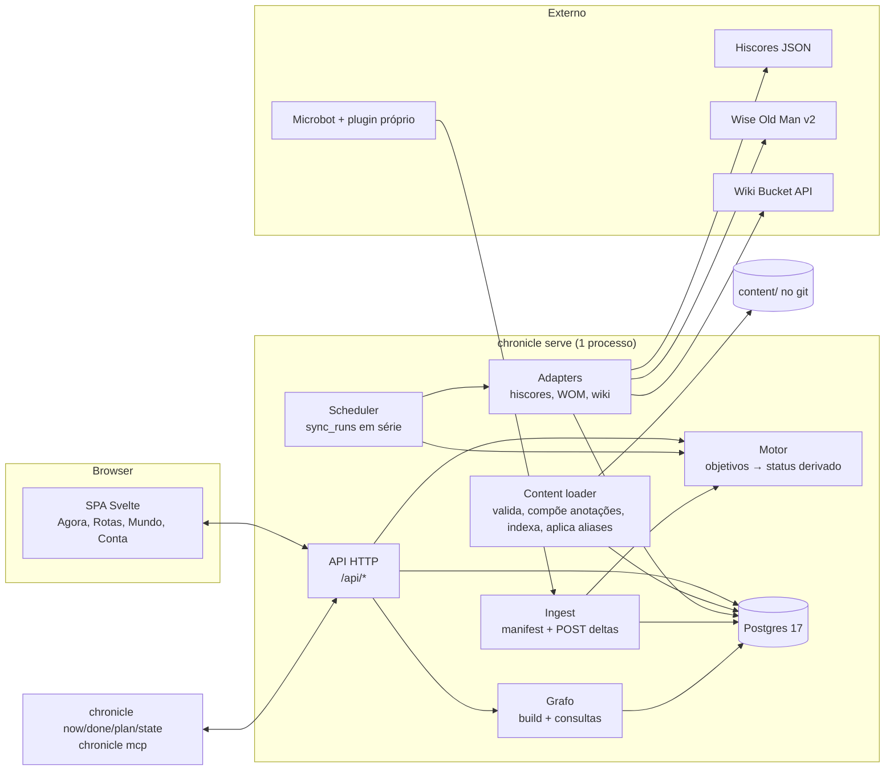
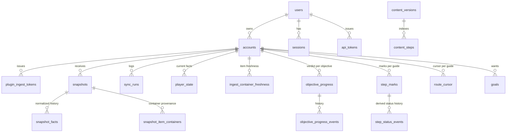

# Ironman Planner — Arquitetura

Data: 2026-11-03. Reescrito em 2026-11-04 como a arquitetura vigente, em Go. As opções descartadas
(SvelteKit full-stack, SQLite, Drizzle, Zod como fonte da verdade) e as sequências anteriores de MVP
ficam no histórico do git (versões deste arquivo até o commit `17887c3`). Artefatos técnicos que valem:
`content/schema/guide.schema.json` (schema do conteúdo, embutido no binário), `db/migrations/` (goose,
Postgres), `docs/arquitetura/types.ts` (contrato de ingest e tipos de readiness em Zod, só como
referência para clientes TS), `docs/arquitetura/modelo-de-dados.dbml` (modelo do banco em DBML:
parte atual gerada das migrations por `just dbml`, mais as tabelas planejadas do doc 09). O modelo de domínio por objetivos está no doc 09 e prevalece sobre este
documento onde houver conflito.

## 0. Decisões em uma página

| Tema | Decisão |
|---|---|
| Stack | **Go** como núcleo: um binário (`chronicle`) com `serve`, CLI e servidor MCP; Postgres 17 via pgx + sqlc + goose; SPA Svelte 5 embutida no binário. Toolchain no doc 07. |
| Domínio | **Objetivo** (entidade canônica + alvo) é a unidade rastreável e o passo é a unidade de navegação; progresso da conta compartilhado entre rotas, marcas e cursor por guia (doc 09). |
| Conteúdo | JSON em `content/guides/<id>/` (`oziris-main` e `bruhsailer-main`, rotas independentes), gerado por importadores e validado contra `content/schema/guide.schema.json` no boot e na CI; objetivos extraídos em sidecars `annotations/` (doc 09, seção 4.2). Ids sempre escopados por guia. |
| Estado do jogador | Snapshots brutos append-only + tabela `player_state` mesclada (uma linha por fato) que alimenta o motor. |
| Motor | Função pura `(regras, PlayerState) → {veredito, evidência}` em `internal/core/rules`; status do passo derivado dos objetivos em `internal/core/progress`; reavaliação completa a cada snapshot. |
| Grafo | Calculado no servidor em memória a partir de `content/` e dos catálogos (`progress.BuildGraph`), por foco; renderizado em colunas de cartões (1440) e árvore (640), em HTML, como o canvas v6 desenhou (seção 5). Nós são chaves de objetivo. |
| Plugin | Protocolo clone do WikiSync: `GET /api/ingest/manifest` + `POST /api/ingest` com deltas; contrato v1 na seção 6.4. Plugin somente leitura no Microbot (doc 06), com painel da rota e marcas a partir da 1.2.0. Hoje autentica com token `ipl_` por cliente; planejado (decisão 28 do doc 01): sem token em `AUTH_MODE=dev` (só de `127.0.0.1`) e device flow do Zitadel em `oidc`. |
| Execução | Local-first na estação `zaros` com `AUTH_MODE=dev`; depois a mesma imagem no `saradomin` com Postgres e Zitadel existentes (seção 8). |
| Auth | `AUTH_MODE=dev` (usuário fixo) no zaros; **OIDC via Zitadel** (PKCE, `coreos/go-oidc`, sessão `alexedwards/scs` no Postgres) feito para a web, falta o deploy no saradomin (seção 8). Plugin: hoje token `ipl_` por conta; planejado sem token em dev e Device Authorization Grant do Zitadel em `oidc`, com roles do projeto no JWT (seção 2.5). CLI e `chronicle mcp`: nada em dev, device flow do Zitadel e access token JWT como bearer em `oidc` (seção 2.5). |

## 1. Stack

Motivo da escolha (decisão do dono, 2026-11-03): buildar o mesmo núcleo em vários formatos (servidor
web, CLI para usar com agentes, servidor MCP) e manter afinidade com o ecossistema de plugins que ele
já desenvolve. Go dá binário único estático, cross-compile trivial, pouca RAM no `saradomin` e um `cmd`
por formato compartilhando o mesmo pacote de domínio.

| Camada | Escolha |
|---|---|
| Domínio | `internal/core` em Go puro: conteúdo (structs + validação por JSON Schema com `santhosh-tekuri/jsonschema`), entidades, regras, planning, progresso, grafo. Sem dependência de banco ou HTTP; todo formato importa daqui. |
| API e scheduler | `net/http` com o mux da biblioteca padrão; scheduler in-process; adapters de fonte em `internal/sources/{hiscores,wom,wiki}`. |
| Banco | Postgres 17 em todos os ambientes; `pgx` + `sqlc` (queries em `db/queries`, tipos gerados em `internal/store/db`) + `goose` (`db/migrations`). |
| Auth | `AUTH_MODE=dev` ou `oidc` (`coreos/go-oidc` + `golang.org/x/oauth2`, PKCE; sessão `alexedwards/scs` com `pgxstore`). |
| Frontend | Svelte 5 + SvelteKit `adapter-static` + Vite em `web/`; `web/dist` embutido com `embed.FS`; o grafo é HTML (colunas e árvore), sem biblioteca de grafo. Tipos TS espelham o contrato HTTP à mão (`web/src/lib/progress/types.ts`). |
| Plugin | Java no Microbot, repositório `microbot-plugins`; só o contrato HTTP é compartilhado. |
| Deploy | Imagem `distroless` não-root com o binário; `docker compose`. |

Custos aceitos: sem compartilhamento nativo de tipos entre servidor e browser; mais código de
infraestrutura que um framework full-stack (a UI é um app logado, não precisa de SSR); o grafo é
calculado em Go e exposto por `GET /api/plan` e `GET /api/graph`, então CLI, MCP e tela têm o mesmo
resultado.

## 2. Componentes e fluxo

### 2.1 Componentes



Responsabilidades:

- **SPA**: telas da página v4 do canvas, tema Pergaminho: `/setup` (primeiro acesso: RSN, modo,
  camadas, rota, primeiro sync; um RSN já cadastrado entra direto), `/` (Agora, o cursor da rota ativa),
  `/rotas` (lista com cobertura), `/rotas/[guia]/[seção]` (a seção por trecho de banco), `/mundo` e
  `/conta` (ainda "em breve"). Sem tela de comparação (decisão 1 do v4): o cruzamento entre rotas é o
  "também na rota X" do passo e a cobertura da lista. Os caminhos antigos redirecionam.
- **API**: handlers em `internal/httpapi` sob `/api`, JSON. Hoje sem sessão: rotas por conta só em
  `AUTH_MODE=dev`. Lista na seção 2.5.
- **Content loader**: no boot lê `content/guides/*/guide.json` e os sidecars `annotations/`, valida contra
  os schemas embutidos, compõe os objetivos, calcula o hash do conteúdo, grava `content_versions` +
  `content_steps`, aplica `step_id_aliases` às marcas e dispara reavaliação. Hoje só carrega e valida;
  o resto é o item 8 da sequência (seção 9).
- **Motor**: `internal/core/rules` (veredito com evidência por regra), `internal/core/planning`
  (readiness do trecho) e `internal/core/progress` (status derivado do passo, cascata, cursor). Puros.
- **Grafo**: `internal/core/graph` constrói o grafo de requisitos a partir do conteúdo, dos catálogos e
  do `wiki_cache`, guarda em `graph_cache` e responde "o que falta para X" e "destravou agora".
- **Scheduler**: in-process; cada tick enfileira `sync_runs` por (conta, fonte) respeitando cadência e
  backoff; um executor único consome em série.
- **Ingest**: `GET /api/ingest/manifest` e `POST /api/ingest` com token `ipl_`; `internal/store/ingest`
  valida, persiste o snapshot, normaliza para `player_state` e registra o frescor dos containers.
- **Adapters**: um pacote por fonte com `fetch` e `normalize`; só o adapter conhece o shape externo.

### 2.2 Formatos do mesmo binário (`cmd/ironman`)

```
chronicle serve                        # API + SPA + scheduler + ingest (único que abre o Postgres)
chronicle content validate [path]      # schema + checagens semânticas de guide.json e anotações
chronicle content migrate              # data/guide/normalized → content/guides/oziris-main
chronicle content import-bruhsailer    # DOCX pinados → content/guides/bruhsailer-main
chronicle content mcp                  # servidor MCP stdio da extração, só sobre content/ (doc 09, seção 6)
chronicle login | logout                # entra no servidor (device flow em oidc; nada em dev) e o torna padrão
chronicle accounts | use <conta>       # contas do usuário; conta padrão da CLI e do MCP
chronicle now [--limit N] [--json]     # passo atual da rota ativa, objetivos, o que levar, próximos passos
chronicle done | skip | undo [passo] [--note]  # marca do dono (o passo atual sem argumento)
chronicle plan [meta]                  # metas; com uma, o plano ordenado dela
chronicle sync                         # força o sync do hiscores
chronicle state [skills|quests|diaries]
chronicle mcp                          # servidor MCP por stdio para agentes, sobre a API da conta
```

Regra: só `serve` e `migrate` (as migrations do goose embutidas no binário, para o deploy) abrem o banco.
O binário se chamava `ironman` até 2026-11-11: as variáveis `IRONMAN_*` ainda valem quando a `CHRONICLE_*`
não está definida, e o `~/.config/ironman` é movido para `~/.config/chronicle` no primeiro uso
(`internal/appenv`). CLI e `chronicle mcp` são clientes da API (`internal/client`), então
funcionam de qualquer máquina e o modelo de permissão é o da web. Servidor: `--url`, senão
`CHRONICLE_URL`, senão `config.json`, senão `https://chronicle.saradomin.ftm.dev.br` (desde 2026-11-12; o `just dev` é `CHRONICLE_URL=http://localhost:8080`; o agent e o `progress check` seguem a mesma ordem); conta: `--account`, senão
`CHRONICLE_ACCOUNT`, senão `config.json`, senão a única conta do usuário. A configuração fica em
`~/.config/chronicle/` (ou `CHRONICLE_CONFIG_DIR`): `config.json` (URL e conta padrão) e
`credentials.json` (modo 0600, o login de cada servidor: issuer, `client_id`, access e refresh
token). `CHRONICLE_TOKEN` é um bearer usado como está, no lugar do login guardado (scripts). O MCP da
conta usa o mesmo `internal/mcp` mínimo do `content mcp` (sem o SDK oficial) com as tools `now`,
`mark_step`, `goals`, `goal_plan`, `account_state`, `step` e `sync`; `mark_step` grava marcas do
dono e as instruções do servidor mandam chamá-la só quando o dono pede. `account_state` devolve uma
parte por vez (`summary` por padrão, `skills`, `quests`, `diaries`, `items`, com `search` por nome):
o estado inteiro passa de 70 mil caracteres (217 quests e o banco) e o Claude Code recusa um
resultado desse tamanho.

### 2.3 Fluxo: snapshot → objetivos → status dos passos

```mermaid
sequenceDiagram
  participant S as Scheduler / Ingest
  participant A as Adapter
  participant DB as Postgres
  participant M as Merge
  participant R as Motor
  participant U as UI
  S->>A: fetch(rsn) ou POST do plugin
  A-->>S: raw
  S->>DB: INSERT snapshots (dedupe por raw_hash ou client_seq)
  alt nada mudou
    S->>DB: sync_runs.status = unchanged
  else novo
    S->>DB: INSERT snapshot_facts (histórico normalizado)
    S->>M: patch = normalize(raw)
    M->>DB: UPSERT player_state (facet, key) se observed_at mais novo
    M->>R: avaliar todos os objetivos de todos os guias
    R-->>M: vereditos + evidência
    M->>DB: UPSERT objective_progress + objective_progress_events
    M->>R: status derivado por passo e guia; cascata na rota ativa; cursores
    M->>DB: step_status_events, step_marks(implied), route_cursor
    M->>DB: sync_runs.status = ok, steps_changed = n
  end
  U->>DB: GET /api/guides/{guide}/board?account= (status derivado + frescor)
```

### 2.4 Configuração

Variáveis lidas por `internal/config`: `CHRONICLE_ADDR` (`:8080`), `DATABASE_URL`, `AUTH_MODE`
(`dev` | `oidc`), `OIDC_ISSUER`, `OIDC_CLIENT_ID`, `OIDC_REDIRECT_URL`, `OIDC_ALLOWED_SUBJECTS`,
`OIDC_REQUIRED_ROLE`, `OIDC_PROJECT_ID`, `SESSION_SECRET`, `CONTENT_DIR` (`content`), `LOG_LEVEL`, `PUBLIC_BASE_URL`,
`SYNC_HISCORES_MINUTES`. `.env.example` documenta cada uma; detalhes, modos e
troubleshooting no doc 07. Configurações por conta (tabela `settings`): layer ativa, modo, fontes
habilitadas, horas de stale por fonte, se o sync de banco está autorizado.

### 2.5 Auth e API

- **`AUTH_MODE=dev`**: um usuário fixo (`subject = 'dev'`) sem login; é o modo do zaros, dos testes e
  da CI. Rotas por id de conta (`?account=`) aceitam qualquer conta, sem sessão e sem cabeçalho CSRF.
- **`AUTH_MODE=oidc`** (feito para a web em 2026-11-05; `internal/auth`, `internal/store/identity`,
  `internal/httpapi/auth.go`): login no Zitadel pelo authorization code flow com PKCE, sem client
  secret (seção 8).
  - `GET /auth/login?return=<caminho>`: gera `state`, `nonce` e o verificador PKCE (desafio S256),
    guarda os três e o destino num cookie `ironman_oidc` cifrado (AES-GCM, chave derivada do
    `SESSION_SECRET`; `HttpOnly`, `SameSite=Lax`, `Path=/auth/callback`, 10 min) e redireciona ao
    issuer. Só caminhos locais valem como destino (nada de `//host`, URL absoluta ou `/auth/*`).
  - `GET /auth/callback`: confere o `state` com o cookie, troca o código com o verificador, verifica o
    ID token com o go-oidc (assinatura pela JWKS, `iss`, `aud`, `exp`) e o `nonce`, aplica a política,
    grava o usuário por `(issuer, sub)` e abre a sessão com token novo (sem fixação). Um `sub` que já
    é do usuário dev ou de outro issuer é recusado, nunca fundido.
  - `POST /auth/logout` (com o cabeçalho CSRF): destrói a sessão no banco e responde
    `{"redirect": …}`, o `end_session_endpoint` do discovery com `id_token_hint`, `client_id` e
    `post_logout_redirect_uri = PUBLIC_BASE_URL + "/"` (ou `/` se o issuer não anunciar o endpoint).
  - **Sessão**: `alexedwards/scs` com `pgxstore` na tabela `sessions` (migration 0001; limpeza dos
    vencidos a cada 5 min). Cookie `ironman_session` `HttpOnly`, `SameSite=Lax`, `Secure` quando
    `PUBLIC_BASE_URL` é https, persistente. Vale 7 dias sem uso e no máximo 30 dias depois do login;
    vencida, a próxima chamada responde 401 e a web vai para o login. Guarda id do usuário, `sub`,
    roles e o ID token (só para o logout).
  - **Autorização** (decisão do dono, 2026-11-05): com só `OIDC_ALLOWED_SUBJECTS`, passa um `sub`
    da lista; com só `OIDC_REQUIRED_ROLE`, quem tem a role; com os dois, precisa dos dois. As roles vêm
    das claims `urn:zitadel:iam:org:project:roles` e `urn:zitadel:iam:org:project:<id>:roles` do ID
    token (sem roles no ID token, as do userinfo); com `OIDC_PROJECT_ID`, só a claim desse projeto
    conta. O primeiro usuário OIDC é `owner`; os seguintes entram como `member`. O
    `serve` não sobe em oidc sem nenhuma das duas. A política é conferida de novo a cada requisição
    com o `sub` e as roles da sessão: tirar um `sub` da lista e reiniciar derruba as sessões dele; uma
    role tirada no Zitadel só vale no próximo login. Recusa: página PT-BR "Acesso negado" (403) no
    callback, com link para sair do Zitadel e entrar com outro usuário; JSON 403 na API.
  - **CSRF**: `SameSite=Lax` mais o cabeçalho `X-Ironman-CSRF: 1` exigido em todo método que não é
    GET/HEAD/OPTIONS nas rotas com sessão (e no logout). Escolhido no lugar da checagem de `Origin`
    porque não depende de o proxy reverso preservar `Host`/`Origin` nem de `PUBLIC_BASE_URL` bater
    byte a byte; outro site não manda cabeçalho próprio sem preflight de CORS, e o servidor não
    responde CORS. A web manda o cabeçalho em toda escrita (também em dev, onde é ignorado).
  - **Rotas por conta**: as mesmas do modo dev, atrás da sessão (401 sem ela, com
    `{"login":"/auth/login"}`), e só para contas com `accounts.user_id` do usuário; conta de outro
    usuário ou inexistente é o mesmo 404. O setup procura e cria contas do usuário da sessão; o id
    continua `acc_<rsn>`, então um RSN que já é conta de outro usuário dá 409. A web, num 401,
    vai para `/auth/login?return=<tela atual>`.
  - **Vínculo das contas de dev** (regra determinística): na primeira entrada de um `sub` novo, se
    ainda não existe nenhum outro usuário OIDC no banco, todas as contas do usuário dev (`subject =
    'dev'`, sem issuer) passam para ele, na mesma transação do login (log
    `first OIDC login claimed the dev accounts`). É o caso do banco do zaros levado ao saradomin por
    `pg_dump`. Qualquer usuário OIDC seguinte começa sem contas; contas de dev criadas depois disso
    ficam com o dev.
  - `GET /api/me` (dev e oidc): `{auth_mode, user: {id, username, email, display_name, role}, roles,
    accounts}`.
  - Falta: tela de login/logout no canvas (hoje não há botão "Sair"; o logout existe só na API) e as
    páginas de erro do login, que são HTML mínimo fora do design system.
- **Clientes nativos** (CLI, `chronicle mcp`; o plugin no item 15), feito em 2026-11-08:
  - `GET /api/auth/client` (público, todo modo): `{auth_mode: "dev"}`, ou em oidc `{auth_mode:
    "oidc", issuer, client_id, scopes}`. Sem `OIDC_NATIVE_CLIENT_ID` vem sem `client_id`, e o servidor
    não aceita bearer (só a sessão da web). O cliente só precisa da URL do planner.
  - `chronicle login`: Device Authorization Grant (RFC 8628) no issuer, com a aplicação nativa pública
    (sem secret, a mesma para toda instalação) e os scopes do servidor: `openid profile email
    offline_access urn:zitadel:iam:org:projects:roles` e, com `OIDC_PROJECT_ID`,
    `urn:zitadel:iam:org:project:id:<id>:aud`. Mostra a URL e o código, espera a confirmação e guarda
    access e refresh token; o cliente renova sozinho e regrava o refresh token rotacionado.
  - Nas rotas por conta, em oidc, `Authorization: Bearer <JWT>` autentica no lugar da sessão
    (`Server.authed`, `bearerAuthed`): assinatura pela JWKS em cache, `iss`, `aud` com o
    `OIDC_NATIVE_CLIENT_ID` e `exp`, sem chamar o Zitadel; roles do próprio token (o projeto precisa de
    "Assert Roles on Authentication"); a mesma política (`sub`/role) da sessão; o usuário de
    `(issuer, sub)` já tem de existir (o primeiro login é sempre o da web, que faz o vínculo das contas
    de dev); `accountParam` restringe às contas dele como na sessão. Token inválido ou vencido é 401
    com `WWW-Authenticate: Bearer`, nunca cai na sessão do cookie; não pede o cabeçalho CSRF (o
    navegador nunca manda um bearer sozinho). Em dev, nada muda: sem token, como a web.
  - A tabela `api_tokens` (tokens `apk_` planejados) fica sem uso: o login da CLI é o do Zitadel.
- **Tokens do plugin** (`plugin_ingest_tokens`): `Authorization: Bearer ipl_…`, escopo = uma conta,
  mostrados uma vez, sha256 no banco, revogáveis, com `scopes` (`state:write`; `items:*` são opt-in;
  `marks:write` deixa o painel do plugin gravar marcas). Continuam aceitos em qualquer modo, mas em
  `oidc` o plugin entra pelo device flow (item 15, feito). Auth do plugin (decisão 28 do doc 01, 2026-11-05):
  - **`AUTH_MODE=dev`, feito (item 14)**: ingest, manifest e as rotas do painel são aceitos sem
    `Authorization` quando o peer TCP é loopback (`127.0.0.0/8` ou `::1`, lido de `RemoteAddr`;
    `X-Forwarded-For` e afins nunca contam). O pedido leva `X-Ironman-Installation` (UUID minúsculo
    que o plugin gera uma vez) e, opcional, `X-Ironman-Account` (campo "Conta" da config, id da
    conta). Com `Authorization` presente vale só o token, também em dev (token errado é 401, nunca
    cai no modo sem token). O estado do protocolo fica num registro por instalação na mesma
    `plugin_ingest_tokens` (migration 0006: `installation_id`, `token_hash` nulo, um registro por
    `(conta, instalação)`), com o mesmo lock de linha e a mesma semântica de `client_seq` e 409 do
    token. Uma instalação de dev tem todos os escopos (o servidor é do dono e só escuta no
    loopback); os toggles de item do plugin continuam sendo o segundo opt-in. A conta
    (`ResolveDevAccount`, `internal/core/ingest`): a "Conta" quando preenchida (id desconhecido é
    404, nunca trocado); senão a conta cujo RSN normalizado é o `username` do push (espaço não
    separável do RuneLite conta como espaço); no manifest e no painel, que não têm RSN, a conta
    para a qual a instalação enviou por último; senão a única conta ativa; com várias e nada que
    decida, 422 pedindo a "Conta". O manifest sem token não depende da conta (é pedido antes do
    login). Na stack do compose o app roda num container e o peer é o gateway da bridge, não o
    loopback: lá o plugin usa o token.
  - **`AUTH_MODE=oidc`, feito (item 15, 2026-11-11; Chronicle Link 1.9.0, doc 06)**: nada sem token. Device Authorization Grant (RFC 8628) no Zitadel com a aplicação nativa
    pública da CLI (acima), a mesma para toda instalação, sem dynamic client registration. O plugin descobre issuer e
    `client_id` em `GET /api/auth/client`, mostra o código, guarda o refresh token na config do RuneLite e
    renova sozinho. O access token é um JWT validado pela JWKS em cache, sem chamar o Zitadel a cada
    push. As roles do projeto (`ingest`, `items:bank`, `items:inventory`, `items:equipment`,
    `marks:write`) substituem os `scopes` (`ingest` é `state:write`; sem ela, 403). Nas rotas do plugin,
    um bearer sem o prefixo `ipl_` é esse JWT (`pluginCredential`, `verifyBearer`): o pedido leva
    `X-Ironman-Installation` e, opcional, `X-Ironman-Account`, e a conta é resolvida como em dev, mas
    só entre as contas ativas do usuário.
  - O `ipl_` deixa de ser emitido fora de dev; `plugin_ingest_tokens` vira o registro de instalações (usuário do Zitadel ou
    conta de dev, mais um id de instalação), porque guarda estado do protocolo (`last_seq`,
    `manifest_version`, conta).

"feita (dev, oidc)": em dev sem sessão; em oidc atrás da sessão e só para as contas do usuário.

| Rota | Estado | Função |
|---|---|---|
| `GET /api/health`, `GET /api/version` | feita | liveness, versão, contagem de conteúdo, estado do banco |
| `GET /api/guides`, `GET /api/guides/{guide}` | feita | guias carregados e sumário de seções |
| `GET /api/guides/{guide}/sections/{section}`, `GET /api/guides/{guide}/steps/{id}` | feita | conteúdo (steps planos e segmentos) |
| `GET /api/guides/{guide}/now` | stub | primeiro passo e os cinco seguintes; vira o cursor da rota |
| `GET /api/ingest/manifest`, `POST /api/ingest` | feita | plugin (seção 6.4): token `ipl_` em qualquer modo, sem token em dev pelo loopback, ou em `oidc` o JWT do login do plugin com o id da instalação (acima) |
| `GET /api/plugin/route?limit=` | feita | painel do plugin: janela da rota ativa (passo do cursor e os `limit` seguintes, 1 a 50, padrão 15), com as notas do autor de cada passo (`notes`: `tip`, `update`, `hcim`; sem as linhas de metadado do BRUHsailer) e a seção do cursor com a descrição (`section`); credencial do plugin, nunca `?account=` |
| `PATCH /api/plugin/guides/{guide}/steps/{id}/mark?limit=` | feita | Feito/Pular/Desfazer do painel: o mesmo `{kind, note}` e a mesma operação da rota da web (evento `progress`/`owner`); responde com a janela; token precisa de `marks:write` |
| `POST /api/plugin/guides/{guide}/marks?limit=` | feita | Desfazer de uma marca `implied`: só `{restore: [...]}` (o desfazer em lote da web); responde com a janela; token precisa de `marks:write` |
| `GET /auth/login`, `GET /auth/callback`, `POST /auth/logout` | feita (oidc) | login web pelo Zitadel (acima) |
| `GET /api/me` | feita (dev, oidc) | usuário, roles do projeto e contas dele |
| `GET /api/auth/client` | feita | como um cliente nativo entra: modo, issuer, `client_id` e scopes do device flow (acima) |
| `GET /api/route?account=&limit=` | feita (dev, oidc) | a janela da rota ativa do painel do plugin (`panel.Window`), por conta: o `now` da CLI e do MCP |
| `POST /api/dev/ingest-token` | feita (só dev) | bootstrap de token sem UI |
| `GET /api/guides/{guide}/readiness?account=&step=`, `GET /api/guides/{guide}/segments/{segment}/readiness?account=` | feita (dev, oidc) | readiness do trecho (seção 6.4.1) |
| `GET /api/guides/{guide}/board?account=` | feita (dev, oidc) | status derivado e veredito por objetivo de cada passo, marcas, cursor, contagens, órfãos; frescor fica para o item 9 |
| `PATCH /api/guides/{guide}/steps/{id}/mark?account=` | feita (dev, oidc) | `{kind: manual_done\|skipped\|pinned_open\|confirm_implied\|clear, note}`; `note` ausente mantém, `""` limpa |
| `POST /api/guides/{guide}/implied/confirm?account=` | feita (dev, oidc) | "confirmar tudo": toda marca `implied` do guia vira `manual_done` |
| `POST /api/guides/{guide}/marks?account=` | feita (dev, oidc) | "marcar tudo antes deste": `before_step_id` marca `manual_done` todo passo da rota principal antes dele, visível e pendente sem marca ou presumido (`implied`); pulados ficam; `restore` (a lista `undo` da resposta) devolve a cada passo a marca anterior |
| `PUT /api/guides/{guide}/cursor?account=` | feita (dev, oidc) | `{step_id}` fixa o passo atual (passo feito é recusado); `{step_id: null}` volta ao automático |
| `GET /api/objectives?account=` | feita (dev, oidc) | vereditos compartilhados com evidência |
| `GET /api/progress?account=` | feita (dev, oidc) | resumo das rotas: rota ativa, cursor (com a referência do autor), contagens por seção, cobertura, fontes |
| `GET /api/guides/{guide}/events?account=&limit=` | feita (dev, oidc) | o que mudou: eventos de passo do guia e de objetivo da conta, com a fonte do snapshot |
| `PUT /api/account/guide?account=` | feita (dev, oidc) | troca a rota ativa e reavalia na mesma transação |
| `GET /api/setup/lookup?rsn=`, `POST /api/accounts` | feita (dev, oidc) | primeiro acesso (`/setup`, V4Setup): conta existente pelo RSN, ou modo detectado e níveis do hiscores; cria a conta e reavalia |
| `POST /api/sync?account=` | feita (dev, oidc) | sync do hiscores agora; 429 com `retry_at` no debounce de 60 s ou no recuo |
| `GET /api/sync/runs?account=&limit=` | feita (dev, oidc) | tentativas de sync (status, HTTP, erro, `steps_changed`, `next_allowed_at`) |
| `GET /api/events?account=` | feita (dev, oidc) | tempo real (SSE): sinais de invalidação da conta depois de cada commit de progresso (seção 6.6) |
| `GET /api/state?account=` | planejada | estado da conta |
| `GET/POST /api/goals?account=`, `DELETE /api/goals/{id}?account=` | feita (dev, oidc) | metas: objetivo fixado (chave canônica validada no registry); alcançada quando o objetivo vira met |
| `GET /api/goals/{id}/plan?account=` | feita (dev, oidc) | plano da meta: fechamento de `QuestEntry.Requires` contra fatos e vereditos; unknown nunca conta como feito, presumido pela marca fica fora do "N de M" |
| `GET /api/world?account=` | feita (dev, oidc) | entidades que as rotas tocam, com veredito por objetivo e onde cada rota as faz (Mundo) |
| `GET /api/world/entity?account=&ref=` | feita (dev, oidc) | uma entidade para o painel de entidade da v6: a mesma visão do `/api/world`, os requisitos diretos do catálogo (com o veredito da conta) e as quests que ela destrava |
| `GET /api/account/state?account=` | feita (dev, oidc) | a Conta (V6Conta1440): conta, total e quest points, skills, quests e diaries com fonte e idade de cada fato, containers com frescor e itens; faceta nunca lida fica vazia |
| `GET /api/microbot/agent` | feita (`MICROBOT_CONTROL=on`) | websocket do `chronicle agent`, nunca sessão (doc 08): em dev sem token e só do loopback; em oidc o access token JWT de um machine user do Zitadel, com audiência `OIDC_PROJECT_ID` e o papel `microbot:agent` |
| `GET /api/microbot/agent/vnc?session=` | feita (`MICROBOT_CONTROL=on`) | websocket de saída do agent com os bytes RFB de uma sessão de VNC; mesma autenticação do link (doc 08, fase 2) |
| `GET /api/microbot/vnc` | feita (como as de controle abaixo) | websocket do navegador (noVNC): o `serve` pede `vnc_open` ao agent e emenda os fluxos; `Origin` precisa bater com `Host`; a abertura vai para a auditoria |
| `GET /api/microbot/plugins`, `/hub?q=`, `/scripts/detail?className=`, `/config?group=&keys=`; `POST /api/microbot/plugins/install`, `/plugins/remove`, `/scripts/start`, `/scripts/stop`, `/scripts/pause`, `/scripts/resume`, `/config` | feita (como as de controle abaixo) | plugins, scripts e configuração chave/valor pelo agent (doc 08, fase 3); parâmetros validados por `agent.ValidateParams` (400 antes do agent); as ações vão para a auditoria |
| `GET /api/microbot/game`; `POST /api/microbot/game/{walk,inventory_use,inventory_drop,bank_open,bank_close,bank_deposit,bank_withdraw,npc_interact,object_interact,ground_pickup,dialogue_continue,dialogue_select,equipment_use,prayer_toggle,spell_cast,bank_deposit_x}` | feita (como as de controle abaixo) | o jogo visto pelo agent (observe, inventário, skills, banco, chão, state machines) e as ações tipadas no jogo, auditadas (doc 08, "Ver e agir no jogo") |
| `GET /api/microbot/config/schema?className=` | feita (como as de controle abaixo) | o formulário de config de um plugin, do export do plugin Chronicle Link 1.4+ no cliente de dev (doc 08, "Configuração com formulário") |
| `GET /api/microbot/client/logs?lines=`, `GET /api/microbot/account`; `POST /api/microbot/account`, `/world` | feita (como as de controle abaixo) | o fim do log do cliente (segredos mascarados), o personagem do `mb-account` (trocar só com o cliente parado) e trocar de mundo (logout e login), doc 08 "Logs e conta" |
| `GET /api/microbot/status`, `/screenshot`, `/audit`; `POST /api/microbot/client/start`, `/client/stop`, `/login`, `/logout` | feita (`MICROBOT_CONTROL=on`; dev só loopback, oidc com o papel `microbot:control`) | controle do cliente pelo agent; toda ação vai para `microbot_audit` (doc 08) |
| `GET /api/graph?account=&focus=&depth=` | feita (dev, oidc) | grafo por foco (seção 5): colunas de requisitos até `depth` (1 a 3, padrão 2), foco, destrava, caminho crítico; o plano da meta é `GET /api/goals/{id}/plan` |
| `GET /api/export`, `POST /api/import` | planejadas | JSON completo da conta |

Janela do painel (`internal/core/panel`, montagem pura; o plugin não tem catálogo, então todo
rótulo sai daqui). Passos são os do board (`coreprogress.BuildBoard`): o do cursor com `current`
e os visíveis da rota principal depois dele; `blocked_by` e `objectives` trazem o rótulo de exibição
de cada chave (como `objectiveLabel` da web); `carry` é a readiness do trecho do cursor
(`planning.EvaluateSegment`) ou, sem loadout no guia, a prévia dos próximos passos
(`planning.LookAhead`, `derived: true`), com as ações de banco como texto; `attribution` é a linha
de crédito do guia (regra 6). Exemplo abreviado:

```json
{
  "guide": "oziris-main",
  "title": "OSRS Ironman Efficiency Guide (OzirisLoL)",
  "attribution": "Guia por OzirisLoL · ironman.guide",
  "cursor": {"step_id": "1.1.7", "cause": "auto"},
  "counts": {"total": 576, "done": 34, "auto_done": 30, "manual_done": 4, "implied": 0,
             "skipped": 1, "pinned_open": 0, "remaining": 541, "blocked": 2},
  "steps": [
    {"id": "1.1.7", "ref": "1.1.7", "section_id": "1.1", "section_title": "Early game",
     "title": "Talk to Bob…", "text": "Talk to Bob in Lumbridge and buy an axe.",
     "location": "Lumbridge", "status": "pending", "current": true, "blocked_by": [],
     "objectives": [{"key": "skill:woodcutting>=15", "role": "completes", "label": "15 Woodcutting", "verdict": "met"}]},
    {"id": "1.1.8", "ref": "1.1.8", "section_id": "1.1", "title": "Start Dragon Slayer I",
     "text": "…", "status": "pending", "current": false,
     "blocked_by": [{"key": "qp>=32", "label": "32 quest points"}],
     "objectives": [{"key": "qp>=32", "role": "requires", "label": "32 quest points", "verdict": "unmet"}]}
  ],
  "carry": {"segment_id": "…", "status": "not_ready", "loadout_status": "known", "derived": false,
            "items": [{"name": "Hammer", "qty": 1, "qty_stated": true, "slot": "inventory",
                       "verdict": "unmet", "carried": 0, "owned": "met", "held": 1}],
            "bank_actions": ["Withdraw a hammer."]}
}
```

### 2.6 Backups e export

- **Banco**: `pg_dump` da database `ironman_planner` (manual ou via `just` no zaros; rotina existente no
  saradomin). Restore com `pg_restore`.
- **Export lógico** (planejado): `GET /api/export` devolve `{schema_version, account, settings,
  objective_progress, step_marks, route_cursor, goals, snapshots?: 'latest'|'all'}`; o import reaplica
  com `cause='import'`. É o formato de migração entre instâncias e o seguro contra mudança de schema.
- **Conteúdo**: está no git; nada a fazer.

## 3. Modelo de conteúdo

Schema canônico: `content/schema/guide.schema.json`, embutido no binário (`content/schema` →
`internal/core/content`) e usado por `chronicle content validate` e pelo loader. Hierarquia:
`Guide → Variant → Section → Segment → Step`. Segmentos são `bank_leg` (começa numa ação de banco
explícita) ou `sequence`, com `bank_actions` e `loadout` (`known`/`partial`/`unknown`), sempre com
proveniência (doc 05, seção 11). Os objetivos de cada passo vêm de `complete_when` (convertido pelo
loader) e dos sidecars de anotação (doc 09, seção 4).

### 3.1 O que um step carrega

```jsonc
{
  "id": "1.1.258a",                      // estável, opaco; herdado do ironman.guide
  "text": "Train Runecraft to 10, then complete Temple of the Eye quest to unlock Guardians of the Rift",
  "location": "Wizard Tower",
  "notes": [{ "kind": "tip", "text": "GOTR is a massive improvement for RC training..." }],
  "complete_when": [                     // AND implícito; o loader converte em objetivos `completes`
    { "type": "skill_level", "skill": "runecraft", "level": 10, "meta": { "origin": "skillGoal", "confidence": "high" } },
    { "type": "quest_state", "quest": "Temple of the Eye", "state": "FINISHED" }
  ],
  "prerequisites": [],                   // regras informativas; viram objetivos `requires`
  "requires": ["step:1.1.257"],          // aresta dura para outro passo do mesmo guia
  "entities": [                          // menções resolvidas pelo registry, com citação e posição
    { "ref": "quest:temple_of_the_eye", "source_text": "Temple of the Eye", "field": "/complete_when/1/quest", "method": "rule", "match": "name" }
  ],
  "tags": ["new-content", "runecraft"],
  "layers": ["enhanced"],                // só aparece no Enhanced Mode
  "modes": ["ironman", "hcim", "uim", "gim"],
  "source": { "origin": "ironman.guide", "original_id": "1.1.258a", "imported_at": "2026-11-03" }
}
```

Pontos de design:

- **`complete_when` é uma lista de regras com AND implícito**; `{any}`, `{all}` e `{not}` dão
  expressividade sem virar linguagem. Ausente ou vazio ⇒ passo **manual** (checkbox). Cada regra atômica
  pode levar `meta` com proveniência (`origin`, `inferred`, `confidence`, `match`). O campo continua
  aceito durante a migração para objetivos e sai quando os importadores emitirem objetivos.
- **Tipos de regra**: `skill_level`, `skill_xp`, `quest_state` (com `op: gte|eq`), `diary_task`,
  `diary_tier`, `combat_achievement`, `boss_kc`, `activity_score`, `collection_log_item`, `varbit`,
  `varp`, `item_owned`, `manual`. Cada regra declara implicitamente de qual **faceta** do `PlayerState`
  depende, o que dá o `stale` por passo e a lista de fontes necessárias ("esse passo precisa do plugin").
- **Referências**: `requires`, `recommended_after` e `unlocks` usam `graphRef`: um `entityRef`
  (`step:<id>` dentro do guia, `step:<guia>/<id>` entre guias, ou um ref do registry) ou uma chave de
  objetivo (`quest:<slug>@finished`, `skill:<skill>>=<nível>`). O formato antigo `quest:<nome wiki>` e
  `skill:<skill>:<nível>` saiu do schema no item 2. O grafo usa chaves de objetivo.
- **`objectives`**: o passo carrega objetivos (doc 09, seções 3.2 a 4.2). `content.Load` junta os do
  `guide.json`, os convertidos de `complete_when`/`prerequisites` e os dos sidecars em
  `content/guides/<id>/annotations/`, verificados contra o texto (hash e citação) e o catálogo.
- **`layers`**: `classic` é o guia original do Oziris; `enhanced` são os 38 passos adicionados pelo site.
  Um passo com `["classic","enhanced"]` aparece sempre; `["enhanced"]` só no modo enhanced. A conta escolhe
  a layer; trocar não perde progresso.
- **`modes`**: filtra passos que não fazem sentido para UIM ou GIM. Notas de HCIM ficam como
  `notes[kind=hcim]`, porque o passo em si vale para todos.
- **`tags`** são livres com namespace sugerido: `phase:mid`, `sailing`, `new-content`, `skill:thieving`.
- **`section.kind = track`** modela a Sailing Track: trilha paralela, não entra no "próximo passo" nem na
  cascata, mas entra no grafo.
- **`source`** por passo e por guia: origem, id original, autor, licença. Serve para atribuição (regra 6
  do CLAUDE.md) e para o diff quando a fonte atualizar.

### 3.2 Ids estáveis e sobrevivência do progresso

Marcas (`step_marks`), eventos de passo e cursor são chaveados por `(account_id, guide_id, step_id)`
**sem FK** para `content_steps`: remover um passo do guia não apaga progresso. Regras:

1. Id nunca muda e nunca é reutilizado. No Oziris, passos novos entre `1.1.76` e `1.1.77` ganham
   `1.1.76b`, `1.1.76c` (padrão do site). No BRUHsailer o id é posicional da numeração upstream
   (`bruh-1.1-05` de `CH1.5`), com o hash do texto em `source.fingerprint` para detectar edição (doc 09,
   decisão D6).
2. Dividir, fundir ou renumerar: o importador grava os aliases (`step_id_aliases`, por guia). O loader
   aplica os aliases uma única vez às marcas, aos eventos e ao cursor, com evento `cause='migration'`.
3. Mudar só o texto não muda o id; muda o `fingerprint`, o que invalida a anotação daquele passo e o
   `text_hash` de `content_steps`; o boot reavalia tudo.
4. Progresso órfão (id que não existe mais e não tem alias) aparece em `/account/orphans` para o dono
   decidir.

### 3.3 Importadores, derivação e sidecars

- `chronicle content migrate` lê `data/guide/normalized/guide.json` (normalizador Python do doc 05) e
  escreve `content/guides/oziris-main/`; mapeamento campo a campo no doc 05, seção 10.
- `chronicle content import-bruhsailer` lê os DOCX pinados em `data/sources/bruhsailer/` e escreve
  `content/guides/bruhsailer-main/`; proveniência no README do guia.
- Os dois passam por `internal/core/content/derive` (segmentos, ações de banco, loadouts) e por
  `internal/core/entities/enrich` (menções resolvidas; o resto vai para `entities.report.json`).
- Saída determinística: mesmo input ⇒ mesmos bytes. `guide.json` nunca é editado à mão (regra 9).
- Os objetivos extraídos pelo agente vivem em `content/guides/<id>/annotations/*.json`, escritos só por
  `chronicle content mcp` e compostos pelo loader; os importadores nunca os tocam (doc 09, seção 4.2).

## 4. Banco de dados e avaliação

DDL em `db/migrations/` (goose, Postgres); `0001_init.sql` é o schema base, `0002` o frescor do ingest,
`0003` a identidade por guia, `0004` o progresso sobre objetivos e `0005` o `snapshot_facts` com a
faceta `diary`. O modelo em DBML, com a parte atual gerada e a planejada à mão, está em
`docs/arquitetura/modelo-de-dados.dbml`, e é lá que as mudanças de schema de cada item ficam listadas. Em
resumo: a migration do item 7 (`0005`) colapsou as oito tabelas `snapshot_*` tipadas numa
`snapshot_facts` com o shape de `player_state` (decisão do dono, 2026-11-04), copiando as linhas; a do
item 8 cria as tabelas de objetivos (doc 09,
seção 5), derruba `step_progress`, `step_progress_events` e `v_step_board` depois de copiar as marcas, e
reduz `content_steps` ao índice mínimo. `wiki_cache` e `graph_cache` ficam, vazias, até terem uso.

### 4.1 Grupos de tabelas



- **`snapshots`** é append-only com `raw` bruto; dedupe por `raw_hash` para fontes de polling e por
  `(ingest_token_id, client_seq)` para o plugin. **`snapshot_facts`** `(snapshot_id, facet, key, value)`
  é a normalização por snapshot, com o mesmo shape de `player_state`: histórico para gráficos e diffs
  sem uma tabela por faceta (migration 0005). Um tombstone de item em `delta` fica como `{"qty":0}`.
  Um `adapter_version` por snapshot permite re-normalizar o passado (plugin: `2` desde a 0005, com
  quests e diaries).
- **`player_state`**: uma linha por fato `(facet, key)` com `value` JSON, fonte e `observed_at`. Facetas:
  `skill`, `activity`, `quest`, `diary_task`, `combat_achievement`, `collection_log`, `varbit`, `varp`,
  `item`, `timer` e `position` (migration 0011) e `diary` (tier completa, chave `area:tier`, valor `{"complete":bool}`, derivada dos varbits
  de referência; migration 0005). A chave de `quest` é o nome canônico da wiki do catálogo. Desde a migration 0008, `player_state` é uma projeção:
  cada fonte grava a própria última observação em **`observations`** `(facet, key, source)`, e
  `internal/core/facts.Merge` junta as fontes (o maior valor para o que só cresce: XP e nível, quest,
  diary, score de atividade; o `boosted` vem do plugin; a observação mais nova para o resto, com
  `plugin > wikisync > hiscores > wom` só no empate exato). Quem grava projeta as facetas que tocou na
  mesma transação, e o boot reprojeta todas as contas (doc 10, seção 5). O motor só lê `player_state`,
  carregado em memória como `rules.PlayerState`.
- **`ingest_container_freshness`** e **`snapshot_item_containers`**: estado (`unavailable`/`restored`/
  `live`), `revision` e `live_epoch` por container; `restored` nunca vira `live` (seção 6.4).
- **`objective_progress`** guarda o veredito por `(conta, chave de objetivo)` com evidência, snapshot,
  `first_met_at`, `met_in_guide_id` e `regressed_at`; **`objective_progress_events`** as transições.
- **`step_marks`** guarda a marca do dono por `(conta, guia, passo)`: `manual_done`, `skipped`,
  `pinned_open` ou `implied` (com `implied_by_step_id`). O status automático **não é armazenado**: é
  derivado dos objetivos na leitura; **`step_status_events`** registra as transições do status derivado
  por guia (fonte do F6 e de `steps_changed`).
- **`route_cursor`**: passo atual por `(conta, guia)`, com causa `pin` ou `auto`.
- **`content_versions`** e **`content_steps`**: índice mínimo do conteúdo carregado (seção, posição,
  hash) para joins de eventos e detecção de órfãos; **`step_id_aliases`** por guia.
- **`goals`** guarda a chave de objetivo e um `plan_cache`.
- **`wiki_cache`** e **`graph_cache`** são caches reconstruíveis.

### 4.2 Dimensionamento

802 passos × 1 conta × 1 snapshot a cada 30 min = 48 reavaliações/dia, cada uma lendo ~1.500 linhas de
`player_state` e escrevendo poucas dezenas; com o plugin, um delta a cada 10 s só quando algo mudou.
Snapshots brutos do hiscores têm ~10 KB; um ano são ~175 MB se guardar todos. Política: guardar todos os
snapshots com mudança (`unchanged` não grava) e um job mensal compacta snapshots de hiscores com mais de
90 dias para um por dia. Nada disso pressiona o Postgres.

### 4.3 Motor de regras e status derivado

Contrato (Go, `internal/core/rules`):

```go
rules.Evaluate(rules []content.Rule, ps rules.PlayerState) rules.Result
// Result = {Verdict: met|unmet|unknown, Evidence []Evidence, Monotonic bool}
```

Semântica:

1. **Três veredictos, não dois.** `unknown` significa que a faceta nunca foi observada para a conta (ex.:
   `quest_state` sem plugin). A UI mostra "precisa do plugin" em vez de "não feito". `all` com qualquer
   `unmet` ⇒ `unmet`; `all` só com `met`/`unknown` ⇒ `unknown` se houver algum `unknown`; `any` com um
   `met` ⇒ `met`.
2. **Evidência sempre.** Cada regra atômica devolve `{rule, verdict, observed, reason, stale}`; o
   objetivo guarda a evidência e o snapshot do momento em que virou `met`, então "por que isso está
   marcado?" tem resposta meses depois.
3. **Reavaliação total a cada snapshot.** Barata (milissegundos). Só objetivos cujo veredito mudou geram
   escrita e evento; o status derivado dos passos é recalculado em seguida e só as transições geram
   `step_status_events`. Também reavalia no reload de conteúdo para objetivos cuja regra mudou.
4. **Status do passo, marcas e cascata**: definidos uma vez no doc 09 (seção 5 e decisão 9.1) e
   implementados em `internal/core/progress`; este documento não os repete.
5. **Regressão.** Objetivo `met` continua `met`, com a evidência do snapshot que o provou, para
   qualquer alvo; quando o fato deixa de valer, `regressed_at` registra, e volta a `NULL` se ele valer
   de novo (a UI alerta). Vale também para item: gastar as penas não reabre o passo "compre 120
   feathers" (decisão do dono, 2026-11-04, item 8). A readiness continua lendo o estado atual.
6. **Stale.** Cada passo tem `freshness` calculada na leitura, não armazenada: pega as facetas que seus
   objetivos tocam, acha o `observed_at` mais antigo e compara com o limite por fonte (hiscores 24 h,
   plugin 72 h). `stale` não muda status; muda a cor e destaca "sync now". Passos manuais nunca ficam
   stale. Se nenhuma faceta foi observada ⇒ `unknown`.
7. **Determinismo.** `now` é parâmetro; nada de relógio dentro do motor. Testes de tabela com fixtures em
   `internal/core/.../testdata`.

## 5. Grafo de requisitos

> **Implementado (2026-11-08), mais simples que o desenho abaixo.** O grafo por foco (Mundo › Grafo,
> artboards V6Grafo1440 e V6Grafo640; decisão 11 do doc 01) é `progress.BuildGraph` em
> `internal/core/progress/graph.go`, sobre o mesmo percurso do plano de meta (F9), servido em
> `GET /api/graph?account=&focus=<chave>&depth=1..3`. Não há `internal/core/graph`, `graph_cache` nem
> Cytoscape/ELK: o canvas desenhou colunas de cartões em HTML, sem layout de grafo.
> - Foco: qualquer chave de objetivo (meta, quest, nível, item, unlock, diary); a web entra pela primeira
>   meta fixada ou por "Focar aqui" no painel de entidade.
> - Arestas: só os requisitos de quest do catálogo (`content/reference/quests.json`: quests, níveis,
>   `qp`). Foco em item ou unlock mostra só o próprio nó, onde cada rota o faz e o que destrava, até
>   haver requisitos de item no catálogo (por isso Barrows gloves → subquests de RFD, o exemplo do
>   canvas, ainda não aparece; o próprio RFD da wiki lista níveis e QP, não os subquests).
> - Colunas "Requer · nível 1 a 3" com os feitos à parte (recolhidos em "+N feitos" por padrão); os
>   níveis exigidos por uma quest num cartão só ("56 Magic · 52 Mining · 50 Agility…"); "Destrava" são as
>   quests do catálogo que pedem o foco diretamente.
> - Grupos do plano de meta: feito, em progresso (presumido por marca), disponível (nada faltando antes,
>   também quest sem requisitos), bloqueado e não sabemos.
> - Caminho crítico: a partir do foco, o requisito aberto com mais nós abertos abaixo dele, repetido até
>   acabar (desempate: o primeiro passo da rota ativa, depois o nome). Sem estimativa de tempo (F14).
> - No estreito, a árvore com recuo: cada nó sob o primeiro nó que ele atende.
>
> O resto desta seção é o desenho original, mantido como referência para quando houver arestas de item e
> de passo.

### 5.1 Nós e arestas

Os nós são **chaves de objetivo** (doc 09, seção 3.2), então o grafo, as metas e as rotas falam a
mesma língua:

| Tipo de nó | Chave | Origem | "Feito" quando |
|---|---|---|---|
| quest | `quest:lost_city@finished`, `quest:lost_city@started` | catálogo + Bucket `quest` | `objective_progress` = `met` |
| skill (um nó por skill; **níveis são atributos de aresta**) | `skill:agility` | implícito | n/a (satisfação é por aresta, `>= N`) |
| diary tier | `diary:ardougne:easy@complete` | catálogo | `met` |
| item | `item:7462x1` | extração do guia + wiki | `met` (posse) |
| unlock | `unlock:fairy_rings@done` | catálogo de unlocks | `met` (varbit) ou marca manual |
| boss | `boss:zulrah>=N` | hiscores | `met` |
| combat achievement | `ca:574@done` | catálogo | `met` |
| quest points | `qp>=N` | varp 101 ou soma do catálogo | `met` |
| passo | `step:<guia>/<id>` | conteúdo | status derivado do passo |
| meta | `goal:<ulid>` | usuário | nó alvo; aponta para uma chave |

Arestas `A -requires-> B` com atributos `{kind: hard|soft, threshold?, source: wiki|guide|derived}`:

- **wiki → hard**: `quest X requires quest Y`, `quest X requires skill S ≥ n`, `diary tier requires
  quest/skill`. Vem de `data/wiki/quests.json` e `diary_tasks.json` (Bucket), cacheado em `wiki_cache`.
- **guia → hard**: objetivos `requires` do passo e `step.requires`.
- **guia → soft**: `recommended_after` e a ordem do guia (passo N depois de N−1 na mesma seção), usada
  só para desempate topológico.
- **derivadas**: objetivo `completes` ⇒ `step -requires-> objetivo`; objetivo `uses` de item ⇒ aresta
  suave para a posse.

Skill-por-aresta é o que evita a explosão: 24 nós de skill em vez de 24 × 99.

### 5.2 Armazenamento

Em memória, reconstruído de `content/` + catálogos + `wiki_cache` quando qualquer um muda; serializado
em `graph_cache` para boot rápido. Não há tabela de adjacência editável: o grafo é derivado, nunca fonte
da verdade. Tamanho: ~225 quests + 24 skills + 48 diary tiers + 802 passos + itens e unlocks ⇒ menos de
3.000 nós e 8.000 arestas. Cabe em um mapa.

### 5.3 Algoritmos

Todos em `internal/core/graph`, puros, recebendo `(grafo, vereditos, marcas)`:

- **Satisfação de aresta**: para nó de objetivo compara o veredito; para skill compara
  `level ≥ threshold`; para passo olha o status derivado.
- **"O que falta para X"**: BFS reverso a partir do alvo seguindo só arestas `hard` não satisfeitas; nós
  satisfeitos cortam a busca. Resultado = subgrafo pendente. Depois **Kahn** com desempate por (fase do
  guia, posição do passo na rota ativa, menor custo estimado) ⇒ plano linear. Ciclos (erro de dado) são
  reportados como aviso, nunca travam.
- **"Destravou agora"**: `available(estado) = {n : todas as arestas hard de saída satisfeitas e n não
  feito}`; diff entre dois snapshots é a lista. Rodado no fim de cada reavaliação e gravado como evento.
- **Caminho crítico**: no subgrafo pendente, peso = `estimate_minutes` do passo destino (ou XP faltante ÷
  taxa configurável para arestas de skill); caminho mais longo em DAG.
- **Caminho recomendado do guia**: filtra o plano para manter só passos e reordena pela ordem da rota
  ativa quando a topologia permite.

### 5.4 Render sem hairball

- **Focus + context**: a tela nunca renderiza o grafo todo. Entra sempre por um foco (meta, quest ou
  passo) e mostra ancestrais pendentes até `depth` (default 3), com os satisfeitos colapsados em um
  nó-resumo "12 requisitos concluídos" expansível.
- **Compound nodes por seção**: passos viram filhos de um nó composto da seção.
- **Skills como badges**: `step → skill:agility (56)` é uma etiqueta no nó do passo, não uma aresta para um
  nó distante. Só vira nó quando o usuário foca em uma skill.
- **Layout ELK `layered`**, esquerda→direita, recalculado só ao expandir/colapsar.
- **Cores por estado**: feito, disponível, bloqueado (com contador do que falta), stale, manual pendente.
- **Limite duro** de ~150 nós visíveis; acima disso, aumenta a agregação.
- Vista alternativa em lista (o plano topológico), porque para executar é mais útil que o grafo.

## 6. Estratégia de sync

### 6.1 Cadência e gatilhos

| Fonte | Cadência | Condição | Observações |
|---|---|---|---|
| Hiscores | a cada 30 min (jitter ±5; `SYNC_HISCORES_MINUTES`, 0 desliga) | conta ativa com nome; a aceleração para 10 min ainda não existe | tabela do modo, com a normal de reserva num 404; skill sem rank fica de fora (não sabemos); fatos iguais (sem ranks) ⇒ `unchanged`; 404 três vezes seguidas ⇒ alerta na UI |
| Wise Old Man | a cada 6 h | `SYNC_WOM_HOURS > 0` | Lê histórico; opcionalmente `POST /players/:name` para pedir update, no máximo 1×/h |
| Wiki Bucket | semanal + no boot se cache vazio | global, não por conta | Alimenta `wiki_cache` e invalida `graph_cache` |
| Plugin | push | token válido | Define `last_seen_at` do token |
| Manual | `POST /api/sync` | debounce 60 s por (conta, fonte) | Responde com o `sync_run` terminado (o sync é síncrono) |

WikiSync não é fonte: o wiki pede para não usar a API em projetos de terceiros (doc 02, seção 3) e o
plugin próprio cobre tudo que ela daria. O scheduler roda a cada minuto, decide o que está vencido
(`next_allowed_at` ≤ agora), enfileira `sync_runs(status=queued)` e um único executor processa em
série com timeout de 15 s por chamada.

### 6.2 Rate limit, backoff e idempotência

- Por fonte, `minInterval` e `maxPerHour` no adapter; o executor respeita antes de chamar.
- `429`/`503` ⇒ `status=rate_limited`, `next_allowed_at = now + 2^n × 5 min` (n = falhas consecutivas,
  teto 6 h). Outros `5xx` ⇒ `error` com backoff igual. Sucesso zera.
- Idempotência de leitura: `raw_hash`. Idempotência de escrita no `player_state`: só atualiza se
  `observed_at` novo ≥ existente. Reprocessar um snapshot antigo nunca regride o estado.
- Reavaliação é idempotente por construção (função pura + eventos só nas transições).

### 6.3 Mudança de nome

- O plugin é a fonte autoritativa: ele envia `username`; se diferir de `accounts.rsn` para aquele token,
  o servidor registra em `name_history`, atualiza `rsn`/`rsn_normalized` e segue.
- Sem plugin: hiscores 404 três vezes seguidas ⇒ alerta "conta não encontrada; renomeou?"; WOM tem
  endpoint de name change e o adapter tenta resolver antes de alertar.
- `rsn_normalized` (lowercase, espaços → `_`) é a chave de busca em todas as fontes.

### 6.4 Plugin Microbot: contrato de ingestão

Modelo: WikiSync (BSD-2). Lá, o plugin baixa `GET /runelite/manifest` a cada 20 min, a cada 10 s lê os
varbits/varps do manifest e os níveis, calcula o delta e só envia o que mudou; backoff quadrático em
falha; o cache local só avança após `200`. Copiamos isso e estendemos. Implementação: `internal/core/ingest`
(tipos e validação), `internal/store/ingest` (manifest, aceitação, normalização, frescor) e o plugin
Chronicle Link (`fm/chroniclelink`, antes `fm/ironmanplanner`) no repositório `microbot-plugins` (doc 06).

```mermaid
sequenceDiagram
  participant P as Plugin (Microbot)
  participant S as Servidor (/api/ingest)
  P->>S: GET /api/ingest/manifest  (Bearer ipl_…)
  S-->>P: {contract_version:1, manifest_version:7, token_scopes:["state:write"], varbits:[…], varps:[101], quests:true, items:{bank:false,…}, resync:true}
  Note over P: login → lê tudo que o manifest pede
  P->>S: POST /api/ingest {contract_version:1, kind:"full", client_seq:1, manifest_version:7, data:{…}}
  S-->>P: {contract_version:1, ok:true, accepted_seq:1, resync:false, manifest_version:7}
  loop a cada 10 s, se algo mudou
    P->>S: POST /api/ingest {kind:"delta", client_seq:n, data:{varb:{…só mudados}, level:{…}, quest:{…}}}
    S-->>P: {ok, accepted_seq:n, steps_changed:2}
  end
  Note over S: manifest muda (novo varbit de referência) → version 8
  P->>S: POST (manifest_version:7)
  S-->>P: 409 {ok:false, resync:true, manifest_version:8}
  P->>S: GET manifest; POST kind:"full"
```

Detalhes do contrato (tipos Go em `internal/core/ingest/contract.go`; espelho Zod em
`docs/arquitetura/types.ts`):

- **Versões**: `contract_version` é literalmente `1`; campos novos opcionais não mudam a versão, mudança
  incompatível cria outro contrato. `manifest_version` é um hash truncado do conjunto gerado pelo servidor:
  varbits/varps de referência (`content/reference/varbits.json`: 48 tiers de diary e o varp 101; os
  `proof` de `unlocks.json`, hoje nenhum) mais os usados em regras do conteúdo, `collections` (item ids
  em ordem fixa para o bitset), `only_item_ids` e `quests`. Manifest diferente exige novo `full`.
- **Facetas** de `data`: `varb`, `varp`, `level`, `xp`, `boosted` (mapas id → valor), `collectionLogSlots`
  (bitset base64), `items` e, desde o item 7, `quest`: mapa nome RuneLite (`Quest.getName()`) →
  `NOT_STARTED | IN_PROGRESS | FINISHED`, lido com `Quest.getState` na thread do cliente (doc 02, seção 6).
  `quest` é opcional em qualquer push, para o plugin 1.0.0 continuar aceito; num `full` presente é a
  lista completa e substitui as quests guardadas (ausente: as guardadas ficam), num `delta` leva só as
  que mudaram. O cliente só envia `quest` quando o manifest anuncia `quests: true`. O servidor resolve o
  nome pelo registry (nome canônico, aliases do WikiSync/RuneLite e curados) e grava a faceta `quest`
  com o nome canônico da wiki; nome que não resolve para exatamente uma quest do catálogo é descartado,
  nunca adivinhado (fica no `raw`). Os 216 nomes do `Quest.java` pinado resolvem (teste
  `TestRuneLiteQuestNamesResolve`). O servidor rejeita campos desconhecidos (`DisallowUnknownFields`),
  então ele sobe antes do plugin. Desde 2026-11-10 (Chronicle Link 1.8.0, migration 0011), com o
  manifest anunciando `timers: true` e `position: true`: `timers`, mapa aba do Time Tracking
  (`BIRD_HOUSE`, `HERB`, `FARMING_CONTRACT`, …) → `{"state": SummaryState, "readyAt": segundos,
  "label"}` (`readyAt` só crescendo ou pronto; num `full` substitui as abas guardadas, num `delta` leva
  as que mudaram), gravado na faceta `timer` (decisão 31 do doc 01); e `position`, `{"world", "x",
  "y", "plane"}`, opt-in no cliente ("Send position"), gravado na faceta `position` (chave `player`,
  com a `region` calculada) só como a última observação, sem linha em `snapshot_facts`. Sozinha, a
  posição só vai num push a 16 tiles ou em outro mundo ou plano.
- **Vars genéricos**: o plugin lê **todo** varbit/varp que o manifest listar (`client.getVarbitValue`,
  `client.getVarpValue`) e manda em `varb`/`varp`, sem saber o que significam. O servidor deriva os fatos:
  a faceta `diary` dos varbits `DIARY_<ÁREA>_<TIER>_COMPLETED`, `qp>=N` do varp 101 (`QUEST_POINTS`) e,
  quando `unlocks.json` tiver `proof`, os unlocks. Um fato novo que vive num var pede só catálogo e
  servidor, nunca uma versão do plugin (decisão do dono, 2026-11-04). Os nomes reservados para a 1.2.0
  estão no doc 06.
- **Escopos**: todo token anuncia `state:write`; dados privados usam `items:bank`, `items:inventory` e
  `items:equipment`. Os booleanos de `items` no manifest são a permissão efetiva e devem corresponder aos
  escopos. Ainda há o segundo opt-in no cliente; os três toggles locais começam desligados.
  `only_item_ids`, quando presente, limita as chaves aceitas e o plugin filtra por ele; o manifest gerado
  **não** o preenche (o plugin manda o container inteiro), porque uma lista tirada só das regras deixaria
  de fora os itens dos objetivos dos sidecars, dos loadouts, das formas noteadas, de `any_of` e das
  famílias, que a posse e a readiness precisam.
- **Formato Java-friendly**: mapas são objetos JSON com chaves decimais canônicas (`"4151"`), portanto
  o cliente usa `Map<String, Long>` do Gson sem adaptador.
- **Full versus delta**: `full` contém todos os mapas, mesmo vazios, e uma observação explícita para cada
  um de `bank`, `inventory` e `equipment`. Em `delta`, facetas e containers inalterados são omitidos.
  `collectionLogSlots` é sempre o bitset completo.
- **Ordem e idempotência**: `client_seq` monotônico por token; o servidor responde `409` com
  `ok:false, accepted_seq:last_seq, resync:true` para `seq ≤ last_seq` ou manifest antigo, e o cliente
  renumera e manda `full`. Cada POST aceito vira um `snapshots(kind, raw, client_seq)` e um merge em
  `player_state`.
- **Resposta com a rota** (item 14): todo push aceito que reavaliou devolve, além de
  `steps_changed`, `route: {guide, cursor, cursor_cause, changed}`: a rota ativa da conta, o cursor
  depois do push e os passos dela que mudaram de status (do motor e da cascata), em ordem. É o que o
  painel do plugin usa para decidir se relê a janela. Campo extra e opcional: o plugin 1.1.1 (Gson)
  ignora campos desconhecidos.

  ```json
  {"contract_version": 1, "ok": true, "accepted_seq": 42, "resync": false, "manifest_version": 329934161,
   "steps_changed": 1, "route": {"guide": "oziris-main", "cursor": "1.1.8", "cursor_cause": "auto", "changed": ["1.1.7"]}}
  ```
- **Credencial**: o `client_seq` é monotônico por credencial: por token, ou por registro de
  instalação `(conta, instalação)` no modo sem token de dev (seção 2.5). O mesmo plugin trocando de
  personagem tem um registro por conta.
- **Resync**: `resync:true` no manifest ou na resposta manda o cliente atualizar o manifest e fazer `full`
  no ciclo seguinte. Login e logout também disparam `full` (o de logout leva o último estado conhecido).
- **Cadência**: 10 s de verificação local, envio só se houver delta, backoff quadrático, timeout 3 s com
  retry no mesmo `client_seq`.

Cada container de itens é uma observação discriminada; um mapa persistido nunca pode ter o mesmo shape
de um evento ao vivo:

| `state` | Campos obrigatórios | Campos proibidos | Semântica |
|---|---|---|---|
| `unavailable` | `observed_at` | `revision`, `live_epoch`, `quantities` | o plugin confirmou naquele instante que não podia ler o container (sem escopo, toggle desligado, logout/cache ausente); não equivale a vazio |
| `restored` | `observed_at`, `revision`, `quantities` | `live_epoch` | espelho completo recuperado de persistência; só é aceito em `full` e não prova que o banco foi aberto nesta sessão |
| `live` | `observed_at`, `revision`, `live_epoch`, `quantities` | — | leitura/evento do cliente na sessão corrente; pode aparecer em `full` ou `delta` |

`observed_at` é RFC 3339 com offset, representa quando o conteúdo foi realmente observado e não pode ser
posterior a `sent_at`. `revision` é inteiro não negativo e monotônico dentro da origem; em `live`, é
comparado só dentro do mesmo `live_epoch`, identificador opaco criado por login. O servidor **não**
promove `restored` a `live`.

`quantities` usa `item_id → qty`. Em `full`, é a imagem inteira do container: mapa vazio significa
container observado vazio e toda quantidade presente deve ser `> 0`. Em `delta`, é patch de um container
`live`: quantidade positiva substitui o total e `0` é tombstone. A observação `unavailable` não leva
`quantities`, para não confundir "não li" com "li e estava vazio".

Exemplo abreviado de um `full`:

```json
{
  "varb": {"4458": 1, "4459": 0},
  "varp": {"101": 33},
  "quest": {"Cook's Assistant": "FINISHED", "X Marks the Spot": "IN_PROGRESS"},
  "items": {
    "bank": {
      "state": "restored",
      "observed_at": "2026-11-04T11:55:00Z",
      "revision": 41,
      "quantities": {"4151": 1, "995": 250000}
    },
    "inventory": {
      "state": "live",
      "observed_at": "2026-11-04T12:00:00Z",
      "revision": 3,
      "live_epoch": "session-5b1c…",
      "quantities": {"995": 1200}
    },
    "equipment": {
      "state": "unavailable",
      "observed_at": "2026-11-04T12:00:00Z"
    }
  }
}
```

### 6.4.1 Posse, prontidão do trecho e ações de banco

Os containers ingeridos alimentam três perguntas distintas, que nunca se misturam (`internal/core/rules`
e `internal/core/planning`):

- **Posse** (`item_owned`, `rules.Owns`): a conta tem `qty` do item em algum dos containers pedidos.
  Forma noteada e não noteada contam como o mesmo item; doses/cargas não. Um banco `restored` pode
  sustentar `met`, mas com `stale: true`. Ausência só é provada por container `live` com baseline `full`;
  `restored`, `unavailable`, container nunca observado e deltas sem baseline resultam em `unknown`.
- **Prontidão do trecho** (`planning.EvaluateSegment`): o inventário e o equipamento **live** batem com
  o loadout do segmento. Ids comparados de forma exata dentro de cada variante de `ItemRequirement`
  (planks noteadas ≠ planks); `any_of` aceita qualquer id da lista e `family` qualquer variante da
  família. Item de inventário pode estar empunhado; item de equipamento precisa estar no equipamento.
  Status: `ready`, `listed_ready` (loadout `partial`), `not_ready`, `unknown`, `no_loadout`. Slots livres
  são um intervalo `free_min..free_max`, porque a empilhabilidade de itens fora do catálogo é desconhecida.
- **Ações de banco**: instruções do guia (`bank_actions`), devolvidas como texto com proveniência. Nunca
  são marcadas como concluídas nem inferidas do estado.
- **Prévia pelos próximos passos** (`planning.LookAhead`): quando o loadout do trecho atual é `unknown`, a
  rota `/readiness` devolve também `ahead`, os requisitos de item dos passos do trecho a partir do passo
  pedido. Cada item aparece uma vez, no passo do primeiro uso (`offset` conta os passos à frente,
  `also_at` lista os outros usos), avaliado como item de loadout (carregado e posse). Item que um passo
  anterior da janela obtém (objetivo `item:<id>x<n>` com papel `completes`) vai para `obtained`. É
  derivado, não instrução do guia: não tem status e nunca deixa um trecho `ready`. A janela exibida (15,
  30 ou o trecho inteiro) é filtrada no cliente.

Baseline: o servidor considera um container completo só quando existe um snapshot `full` que o observou
no mesmo `state` e no mesmo `live_epoch` da observação atual (`ListItemContainerFreshness`). Fatos de
item de outro estado ou epoch são descartados na leitura. O plugin já força `full` em qualquer troca de
estado ou de epoch.

Rotas: `GET /api/guides/{guide}/readiness?account=&step=` (segmento que contém o passo e o próximo
`bank_leg` da mesma variante, sem atravessar tracks) e
`GET /api/guides/{guide}/segments/{segment}/readiness?account=`. Como expõem o banco por id de conta e
ainda não há sessão, só são registradas com `AUTH_MODE=dev`.

### 6.5 Privacidade

- Tudo fica no servidor do dono; nenhum terceiro recebe dados do plugin.
- O manifest limita o que o cliente lê: o plugin não varre todos os varbits, só os pedidos, e o usuário
  pode ver o manifest em `/account/tokens`.
- Banco/inventário/equipamento são opt-in duplo (escopo do token + toggle no plugin); regras `item_owned`
  aparecem como `unknown` sem isso.
- Tokens são hash no banco; revogação é imediata; `last_ip` e `last_seen_at` ficam visíveis.
- Exports contêm snapshots brutos (incluindo banco, se habilitado); a UI avisa ao exportar.

### 6.6 Tempo real (SSE)

Decisão do dono (2026-11-05): SSE e releitura, sem WebSocket, sem dependência nova e sem broker
(Redis, LISTEN/NOTIFY). Um evento é só um sinal de invalidação: o cliente relê pela API de sempre e
não existe uma segunda fonte de verdade.

- **Rota**: `GET /api/events?account=<id>`, `text/event-stream`. Como toda rota por id de conta,
  existe em `AUTH_MODE=dev` e, em `oidc`, atrás da sessão e só para contas do usuário (regra 10 do
  CLAUDE.md); o `EventSource` manda o cookie de sessão por ser da mesma origem.
- **Stream**: `retry: 3000`, depois `event: hello` (`{"type":"hello","account","at"}`), um evento por
  publicação com flush e o comentário `: ping` a cada 25 s. Termina quando o cliente sai, quando o
  servidor desliga (o contexto base) ou quando o hub descarta o assinante lento. O `serve` não tem
  `WriteTimeout`; o handler zera o prazo de escrita por requisição (`http.ResponseController`) para
  continuar assim se um dia tiver.
- **Contrato** (`event:` = `type`, `data:` em JSON):

  ```json
  {"type":"progress","account":"acc_x","source":"plugin|hiscores|owner",
   "guides":["oziris-main","bruhsailer-main"],"steps_changed":2,"at":"2026-11-05T20:14:00Z"}
  {"type":"sync","account":"acc_x","source":"hiscores","status":"ok|unchanged|error|rate_limited",
   "steps_changed":0,"at":"…"}
  ```

  `steps_changed` conta só mudanças de status causadas pelo motor; ações do dono mandam 0 (a troca de
  rota manda o que a reavaliação mudou). `guides` é o guia da marca ou, numa reavaliação, todos.
- **Quando dispara**, sempre depois do commit da transação:
  - push do plugin aceito (`internal/store/ingest`, `Accept`): `progress`/`plugin`;
  - sync do hiscores, agendado ou manual (`internal/store/syncrun`, `Run`): `sync` com o status de toda
    tentativa que terminou, e também `progress`/`hiscores` quando gravou um snapshot novo (`ok`);
    debounce e recuo (429) não publicam;
  - escritas do dono (`internal/store/progress`): marca, confirmar presumidos, marcar antes, desfazer o
    lote, cursor, troca de rota ativa, metas: `progress`/`owner`.
  A reavaliação do boot não publica (ninguém está ouvindo).
- **Hub** (`internal/events`): em memória, um processo só (só o `serve` abre o banco), assinantes por
  conta com fila de 16. `Publish` nunca bloqueia: assinante com a fila cheia é descartado (o canal
  fecha, o stream termina) e o navegador reconecta e relê tudo. Fica fora de `internal/core` por ser
  encanamento de runtime (goroutines, mutex), não domínio; não importa banco nem HTTP.
- **Web**: `web/src/lib/api/events.svelte.ts` abre um `EventSource` por conta no layout. Os recursos
  declaram etiquetas (`createResource(fetcher, { tags: ['progress'] })`); um evento `progress` chama
  `invalidate('progress')` e um `sync`, `invalidate('sync')`, juntos em 250 ms, mais o resumo da
  sessão. A releitura é silenciosa (sem `loading`, o dado antigo fica até chegar o novo), então linhas
  abertas, rolagem e diálogos ficam. Toda reconexão relê tudo (o que mudou no intervalo não chegou);
  aba escondida por mais de 60 s fecha o stream e reabre ao voltar. Plugin ou hiscores com
  `steps_changed > 0` mostram o toast de detecção de V4AgoraOziris ("N passos detectados · via plugin ·
  20:14"); o sync manual do Agora silencia esse toast, porque já mostra o próprio resultado.

## 7. Repositório, workflow e testes

### 7.1 Layout

```
cmd/chronicle/          cobra: serve, content (validate, migrate, import-bruhsailer, mcp),
                      stubs now/done/plan/sync/state/mcp
internal/core/        domínio puro: content (loader, schema, derive, migrate), entities (registry,
                      catálogos, resolver, enrich, catalogbuild), ingest (contrato), rules, planning;
                      annotate (extração por agente); planejados: progress, graph
internal/importer/    bruhsailer (DOCX pinados → guia canônico)
internal/store/       repositórios (ingest); internal/store/db é saída do sqlc
internal/httpapi/     handlers; internal/sources/hiscores é o adapter do hiscores; internal/client é o cliente da API da CLI e do MCP
internal/mcp/         servidor MCP stdio mínimo (JSON-RPC, só tools), usado por content mcp e pelo mcp da conta
web/                  SPA Svelte; web/src/lib/progress é o view-model (view.ts puro e testado em node)
content/              guides/<id>/{guide.json, README.md, entities.report.json, annotations/},
                      schema/, reference/ (catálogos)
db/migrations, db/queries, sqlc.yaml
data/                 extração original (guide/, sources/bruhsailer/, wiki/, samples/); tools/ (Python)
docs/
```

Regra de dependência: `internal/core` não importa banco nem HTTP; CLI e MCP não importam
`internal/store` (regra 1 do CLAUDE.md).

### 7.2 Workflow

- `just` lista os alvos: `setup`, `dev` (Postgres do `compose.yaml` + `air` + Vite), `web-dev`, `build`,
  `test`, `lint`, `content-validate`, `migrate-*`, `sqlc`, `up`/`down`/`logs`.
- **CI (GitHub Actions)** em todo PR: web (`pnpm check`, `pnpm test`, build), Go (build, vet,
  golangci-lint, `go test -race`, `chronicle content validate`), migrations (goose up/down/up no Postgres
  17) e build da imagem na `main`.
- Alterar o conteúdo = corrigir o importador ou o normalizador e regenerar (regra 9); o diff do JSON é
  legível porque a saída é determinística com chaves em ordem canônica. Objetivos extraídos mudam só via
  `chronicle content mcp` (doc 09, seção 6).
- Versionamento: `guide.version` segue `AAAA.MM.N`; o changelog é o git log de `content/`.

### 7.3 Testes

| Camada | Abordagem |
|---|---|
| Conteúdo | loader e schema contra fixtures em `internal/core/content/testdata`; importadores com regeneração byte a byte e contagens; `content validate` na CI |
| Entidades | resolver com casos de nome, alias, plural, link wiki, ambíguo; catálogos regenerados por `catalogbuild -update` e checados na CI |
| Motor | tabelas por tipo de regra, `any/all/not`, `unknown`, `op: gte`; posse e readiness com holdings sintéticos (`restored` vs `live`, baseline); progresso: derivação de status, cascata e cursor por tabela |
| Ingest | contrato (sequência fora de ordem, manifest antigo ⇒ `409`, token revogado ⇒ `401`, escopo sem bank ⇒ `403`), integração no Postgres (`DATABASE_URL` definido; `just db-up`) |
| HTTP | handlers com `httptest`, incluindo um teste ponta a ponta com o binário real |
| Web | `view.ts` em `node --test`; `pnpm check`; conferência das telas no navegador contra o canvas |
| Plugin | JUnit no repositório `microbot-plugins` (diff, baseline, frescor, ACK/retry, backoff); `mb-test` no jogo |

## 8. Deploy: local-first no zaros, depois saradomin

Decisão do dono (2026-11-04): o MVP roda na estação de trabalho (`zaros`), onde o Microbot também roda;
o deploy no `saradomin` fica para depois, com a mesma imagem e outras variáveis de ambiente.

- **Local-first**: `docker compose` com Postgres e o binário (`compose.yaml`), ou o mesmo Postgres com
  `air` e `pnpm dev` no host (`just dev`). Acesso em `localhost:8080` (dev: `localhost:5173`);
  celular pela rede local ou Tailscale. `AUTH_MODE=dev`. Plugin com `serverUrl=http://localhost:8080` e,
  até a auth planejada do plugin (seção 2.5), token `ipl_` gerado localmente; depois, só a URL. `pg_dump` manual ou via `just`.
- **saradomin** (decisão de 2026-11-03; montagem de 2026-11-11): o cluster k3s de casa, com os manifests
  do cluster no repositório `gielinor`. `https://chronicle.saradomin.ftm.dev.br`, só pela tailnet
  (Ingress do Traefik com o certificado curinga); banco `chronicle` no CloudNativePG compartilhado
  (`postgres-main`, com o backup dele); Zitadel em `auth.ftm.dev.br` com um projeto "Chronicle", uma
  aplicação Web (PKCE, sem client secret, redirect `/auth/callback`) e uma nativa (device flow, JWT)
  para CLI, `chronicle mcp` e plugin, roles do projeto no JWT (seção 2.5; decisão 28 do doc 01).
  `/auth/login` inicia o fluxo, `/auth/callback` troca o código, cria ou atualiza `users` por
  `(issuer, sub)` e grava a sessão em cookie `HttpOnly`. Autorização: `OIDC_ALLOWED_SUBJECTS` e/ou
  `OIDC_REQUIRED_ROLE`. A imagem `chronicle` (servidor e migrations embutidas, `chronicle migrate`) vai
  para o GHCR a cada push na `main` e o CI grava a tag em `deploy/k8s/overlays/saradomin`, que o Argo CD segue: o commit do CI é o
  deploy. Passos no doc 07, seção 3.3.
- Nada no código distingue os dois ambientes além da configuração (doc 07).

## 9. Estado em 2026-11-08 e sequência vigente

Feito e na `main` (commits `990acd1` e `7a59256`; plugin em `FelipeMalacarne/microbot-plugins`, commit
`68fc1c6`):

| Peça | Onde | Verificação |
|---|---|---|
| Multi-guia: Oziris + BRUHsailer como rotas independentes, ids escopados por guia | `internal/core/content`, `internal/importer/bruhsailer`, `content/guides/*`, migration 0003 | `content validate` (802 passos), testes de importação byte a byte |
| Segmentos `bank_leg`/`sequence`, ações de banco e loadouts com proveniência | `internal/core/content/derive` | testes de tabela |
| Registry de entidades e menções por passo | `internal/core/entities`, `content/reference`, `entities.report.json` | testes, relatório por guia |
| Contrato de ingest v1, tokens com escopo, `GET /api/ingest/manifest`, `POST /api/ingest`, frescor por container | `internal/core/ingest`, `internal/store/ingest`, migration 0002 | testes de integração no Postgres 17 |
| Readiness: `item_owned`, prontidão do trecho, rotas `/readiness` (só `AUTH_MODE=dev`) | `internal/core/rules/items.go`, `internal/core/planning`, seção 6.4.1 | testes de tabela, integração e teste ponta a ponta com binário real |
| API por guia `/api/guides/{guide}/...` | `internal/httpapi` | testes HTTP |
| Web `/plan` e `/compare` sobre a API real, card da perna de banco | `web/src/lib/planner`, `web/src/routes/{plan,compare}` | `pnpm test`, `pnpm check`, build, renderização headless |
| Plugin Microbot Ironman Planner 1.0.0 (somente leitura) | `microbot-plugins`: `fm/ironmanplanner` | 36 testes JUnit; **nunca rodou no jogo** |
| Objetivos no conteúdo: `entities.ObjectiveKey`, tipos `unlock`/`location`, `ItemRequirement` (`item_id`/`any_of`/`family`, `noted`), `entityRef`/`objectiveKey`/`graphRef` no schema, sidecars de anotação (`annotations.schema.json`) lidos, verificados e compostos pelo loader; `complete_when`/`prerequisites` viram objetivos no `content.Load` | `internal/core/entities/objective.go`, `internal/core/content/{objectives,annotations}.go`, `content/schema/` | testes de tabela (chaves, conversão das 269 regras, citação dobrada, hash, composição, rejeições); `content validate` |
| Posse e readiness sobre as variantes de item | `rules.OwnsFamily`/`OwnsAnyOf`, `planning.evaluateItem` | testes de tabela |
| Ferramental de extração: `chronicle content mcp` (stdio, offline) com `status`, `next_batch`, `resolve_entity`, `propose_entity`, `revise_entity`, `submit`, `record_decision`, `list_decisions`, `report`; registry relido quando o catálogo muda no disco; checagem de ordem com XP de recompensa de quest; `.mcp.json`; skill `annotate-guide@2`; o loader exige `confirmed_by: owner` em toda inferência e decisões citadas existentes | `internal/core/annotate`, `internal/mcp`, `cmd/chronicle/content_mcp.go`, `.claude/skills/annotate-guide` | testes de tabela (resolução de nomes, requisitos de item, checagens do submit, ordem da rota com XP de quest, ida e volta pelo loader, hash desatualizado, `propose_entity`, `revise_entity`, releitura do registry, contagens do relatório); lote de exemplo do Oziris 1.1 pelo stdio |
| Catálogos gerados: todos os itens do jogo com página na wiki (14.870 ids), XP de recompensa de 167 quests, varbits de referência (48 diaries + quest points); `locations.json` (57 locais) e `unlocks.json` (Player-owned house) povoados pela extração | `tools/extract_wiki_items.py` → `data/wiki/items.json`; `data/wiki/scripts/build_quests.py` → `data/wiki/quests.json`; `internal/core/entities/catalogbuild` | `catalogbuild -update` sem rede; o catálogo contém os 856 ids do anterior com o mesmo nome; nenhum ref já resolvido nos guias mudou de id |
| Anotações do Oziris 1.1: 286 passos com objetivos, itens, ações de banco e local verificados; 11 decisões gerais do dono | `content/guides/oziris-main/annotations/` | `content validate`; `annotations.report.json` (doc 09, seção 6.6) |

Progresso sobre objetivos (item 8, branch `feat/progresso`): migration 0004 (objetivos, marcas, eventos
de status, cursor; derruba `step_progress`, `step_progress_events` e `v_step_board`),
`internal/core/progress` (avaliação da chave, veredito travado, status, cascata, cursor; testes de
tabela), `internal/store/progress` (reavaliação na transação do ingest com `steps_changed`, marcas,
cursor, board, indexação de `content_versions`/`content_steps` e dos aliases de `step.replaces` no
boot; teste de integração no Postgres 17) e as rotas dev do board, das marcas e do cursor. Contas de
teste: `just account-create`/`account-guide`. Com o servidor do item 7, quest, diary e `qp` também saem de
`unknown` quando o plugin manda os fatos; unlock (sem `proof` no catálogo) e CA continuam `unknown`.

Web v4 (item 9, branch `feat/progresso`): Agora, Rotas e Rota no tema Pergaminho, sobre o progresso
real; a API devolve por passo a referência do autor, a posição, os nomes dos refs e o "também em"; os
ícones do jogo vêm de `tools/fetch_wiki_icons.py` para `web/static/icons` (desde a v6, todo item
obtível do catálogo; o bundle da SPA leva só as faixas de id e o mapa completo fica em
`data/wiki/icons.json`).

Hiscores (item 10, branch `feat/progresso`): adapter puro testado com as amostras do doc 02, sync
com `sync_runs`, snapshot, fatos e reavaliação numa transação, recuo exponencial e scheduler no `serve`.

Metas (F9, parte A): fixar um objetivo do Mundo, veredito, onde cada rota o conclui e o painel no
Agora. A parte B (plano da meta) usa os requisitos de quest que `content/reference/quests.json` passou
a trazer: `requires` (chaves de objetivo das quests diretas `@finished`, dos níveis de skill com
`boostable` e `during_quest`, e de `qp`) e `combat_level`, gerados por `catalogbuild` a partir de
`quest_reqs`, `skill_reqs` e `quest_points_required` de `data/wiki/quests.json`; acesso por
`entities.Registry.Quest(id).Requires`.

Contrato com quests (item 7, parte do servidor, branch `feat/item7-contrato`): `data.quest` e
`manifest.quests` no contrato v1 (opcionais, plugin 1.0.0 continua aceito); manifest com os 48 varbits de
diary, o varp 101 e os `proof` de unlocks; migration 0005 (`snapshot_facts`, faceta `diary`, dados
copiados, Down que restaura as tabelas tipadas); normalizador gravando `quest` (nome canônico pelo
registry), `diary` e o histórico em `snapshot_facts`; motor avaliando `varbit`/`varp`, `qp>=N` pelo varp
101 e unlock com `proof`. Verificação: testes de tabela (contrato, resolução dos 216 nomes do RuneLite,
diary, varbit/varp, objetivos) e `TestQuestAndDiaryFactsPostgres` com o conteúdo real do Oziris
(`quest:x_marks_the_spot@finished` e `diary:ardougne:easy@complete` saem de `unknown` com evidência);
goose up/down/up com dados. Plugin 1.1.0 feito e em uso no zaros (2026-11-05; item 7 abaixo).

Cursor e chaves de item (2026-11-04, na `main`): o cursor passa dos passos bloqueados (`requires` em
`unmet` ou requisito de catálogo da quest que o passo conclui; board com `blocked_by` e `counts.blocked`;
cadeado na Rota) e as chaves `item:family/<slug>xN` e `item:any(<id>x<n>|…)` são avaliadas; o Oziris
1.3.65 (segundo axe) e 1.4.43 (graceful pela família) foram reanotados com elas (decisões 22 e 23 do
doc 01).

Tempo real (item 12, 2026-11-05): `GET /api/events` (SSE, só `AUTH_MODE=dev`), hub
em memória por conta em `internal/events`, publicação depois do commit no ingest, no sync do hiscores
e nas escritas do dono; na web, releitura silenciosa por etiqueta dos recursos abertos e o toast de
detecção (seção 6.6). Verificação: testes do hub com `-race`, teste HTTP do stream, eventos nos testes
de integração de ingest, sync e progresso, `node --test` do view-model e o stream passando pelo proxy
do Vite. Conferido ao vivo com o plugin no zaros (2026-11-08).

Sessão web por OIDC (parte web do item 11, 2026-11-05, branch `feat/oidc-web`): `/auth/login`,
`/auth/callback`, `/auth/logout`, `GET /api/me`, sessão scs no `pgxstore`, política por `sub` ou role
do projeto, CSRF por cabeçalho, rotas por conta liberadas em `oidc` só para as contas do usuário e o
vínculo das contas de dev no primeiro login (seção 2.5). Verificação: provedor OIDC falso em processo
(`internal/auth/authtest`) no fluxo completo login → callback → sessão → `/api/me` → rota da conta →
SSE → logout, em memória e no Postgres; recusas (state, nonce, cookie ausente, sub e role, conta de
outro usuário, CSRF, sessão revogada pela política); `internal/store/identity` em schema descartável.
Falta o deploy no saradomin (doc 07, seção 3.3), a tela de login/sair no canvas e a auth do plugin
(item 15).

Painel da rota no plugin e auth de dev sem token (item 14, 2026-11-05, branches
`feat/painel-plugin` e `feat/painel-rota` do plugin): migration 0006 (registro por instalação em
`plugin_ingest_tokens`), credencial do plugin no servidor (token `ipl_` ou, só em dev e pelo
loopback, `X-Ironman-Installation`/`X-Ironman-Account`; `ResolveDevAccount` em
`internal/core/ingest`), escopo `marks:write`, `route` na resposta do ingest (`Plan.Route`), a
janela da rota em `internal/core/panel` e as rotas `/api/plugin/...` reaproveitando `Mark` e
`RestoreMarks` (seção 2.5); plugin 1.2.0 com o painel lateral e a credencial plugável (doc 06).
Verificação: testes de tabela (conta de dev, janela, rótulos, `Plan.Route`), testes HTTP (loopback
aceito em dev, peer remoto recusado mesmo com `X-Forwarded-For`, nada sem token fora de dev,
token inalterado, `marks:write`), `TestDevInstallationPostgres` e a rota da resposta em
`TestProgressPostgresLifecycle`, goose up/down/up da 0006 com dados, `just dbml`; no plugin, 92
testes JUnit e o jar. Em uso no jogo com o plugin 1.2.1 (2026-11-08).

Web v6 (2026-11-05, branch `claude/epic-hypatia-xujppt`): as telas seguem a página v6 do canvas
"Chronicle — Telas" (docs/ui/decisoes-canvas.md, seção 6). Casca Chronicle com a sidebar A e a barra
de topo no estreito; Agora (Oziris e BRUHsailer, 1440 e 640, fonte falhou, Fixar outro); Rotas com as
abas Oziris · BRUHsailer · Comparar (a lista de Rotas saiu); Mundo › Entidades e Mundo › Metas; Conta
sobre `GET /api/account/state`; primeiro acesso; painel de entidade sobre `GET /api/world/entity`.
Componentes em `web/src/lib/v6`. Verificação: testes HTTP das duas rotas novas,
`TestQuestAndDiaryFactsPostgres` com o estado da conta, `node --test` dos módulos puros (Agora, Rota,
Conta) e capturas em 1440 e 640 contra o servidor real com um Postgres local.

Integração da fase 0 com a web v6 (2026-11-06): a branch da fase 0 foi rebaseada sobre a v6 e ficou
com as telas da v6. O Agora e a Rota da v6 passaram a usar `undo.ts`: board, escritas e desfazer
presos à conta e à rota, uma escrita por vez, o desfazer entra na pilha só depois que a escrita deu
certo e manda `revokes` com o comando que desfaz. A reavaliação passou a dar veredito também aos
requisitos boostable do catálogo (nunca bloqueiam o cursor), para o "Requer" do painel de entidade não
mostrá-los como "não sabemos". `/rotas` espera o resumo da conta antes de abrir a rota ativa.

CLI e MCP da conta (item 11, 2026-11-08): `internal/client` (cliente tipado da API, `config.json` e
`credentials.json`, device flow e renovação do token), os comandos da seção 2.2 e o `chronicle mcp`;
no servidor, `GET /api/auth/client`, `GET /api/route` e o bearer JWT da aplicação nativa nas rotas
por conta em oidc (`OIDC_NATIVE_CLIENT_ID`; seção 2.5). Verificação: o device flow completo contra o
issuer falso (`authtest`: device authorization, polling, refresh rotacionado gravado), testes HTTP do
bearer na memória e no Postgres (antes do primeiro login web, conta de outro usuário, assinatura
adulterada, vencido, outra audiência, sem role, token ruim com cookie válido, login desligado),
testes da CLI contra uma API falsa (marcas enviadas, atribuição no `now`, erro de login) e `login`,
`accounts`, `now`, `plan`, `state` e o MCP por stdio contra o `just dev`. Falta conferir contra o
Zitadel real, junto do deploy (item 18).

Grafo por foco (item 11, 2026-11-08): Mundo › Grafo pelos artboards V6Grafo1440 (colunas por
profundidade, filtros, legenda, caminho crítico) e V6Grafo640 (árvore com recuo), "Focar aqui" no
painel de entidade, `GET /api/graph` e `progress.BuildGraph` (seção 5). Verificação: testes de tabela
do core com o catálogo real (colunas, feitos à parte, níveis agrupados, caminho crítico, destrava,
profundidade fora do intervalo, quest sem requisitos disponível), teste HTTP da rota, `node --test` do
view-model (`web/src/lib/progress/grafo.ts`) e capturas em 1440 e 640 contra o `just dev` com o
Legends' Quest e o Heroes' Quest da conta do dono.

Controle do Microbot, fase 1 (item 11, 2026-11-08; doc 08, seção "Estado"): `internal/microbot`
(cliente do Agent Server), `internal/agent` (lista fechada, link por websocket de saída com token de
máquina), `chronicle agent` (`just agent`), as rotas `/api/microbot/*` atrás de `MICROBOT_CONTROL=on`,
auditoria em `microbot_audit` (migration 0010) e Automação › Cockpit na web (V6Microbot1440/640).
Verificação: testes do cliente contra um Agent Server falso no socket Unix, do link de ponta a ponta
com `-race`, das rotas (token do agent, auditoria, sem agent, papel em oidc, só loopback em dev,
módulo desligado), `node --test` do view-model, e no zaros o agent subindo e parando o cliente
headless pelo web.

Ainda não existe: deploy no saradomin, device flow do plugin,
sessão (V6Sessao1440), recorrentes com prazo (proposta, decisão 31 do doc 01) e as fases 4 e 5 do
controle do Microbot (rotinas, serviço no zaros; doc 08). As fases 2 (VNC ao vivo pelo agent, noVNC
na web) e 3 (plugins: Hub, scripts, configuração chave/valor) foram feitas em 2026-11-08 (doc 08,
seção "Estado").

Sequência vigente. É a única lista do projeto; o doc 09 e o doc 01 apontam para cá. A ordem dos itens
2 a 9 foi decidida pelo dono (doc 09, decisão D7): extração completa antes do progresso persistido.

| # | Entrega | Pronto quando |
|---|---|---|
| 1 | Doc 09 revisado e decisões fechadas | **feito** (2026-11-04; doc 09, seções 9.1 e 9.3) |
| 2 | Schema: `objectives` (chave canônica, `entities.ObjectiveKey`), `ItemRequirement`, tipos `unlock`/`location` no registry, `$defs/ref` substituído por `entityRef`, schema dos sidecars; loader converte `complete_when` e compõe anotações; readiness e posse avaliam as variantes de item | **feito** (2026-11-04; detalhes da composição no doc 09, seção 4.2) |
| 3 | Dados e catálogos: script em `tools/` extrai da wiki os itens citados pelos guias mais famílias para `data/wiki/items.json`; `catalogbuild` gera `content/reference/items.json`; `unlocks.json`, `locations.json` e `varbits.json` iniciais | **feito** (2026-11-04). Itens do Oziris sem resolução 96 → 62 e resolvidos 87 → 119; os ambíguos subiram de 11 para 13, porque nomes antes desconhecidos agora caem em vários ids (doc 09, seção 7) |
| 4 | `internal/core/annotate` (lote, verificação, composição), `chronicle content mcp` com `propose_entity`, `.mcp.json`, `content validate` cobrindo os sidecars, skill `annotate-guide` | **feito** (2026-11-04; contrato das tools no doc 09, seção 6.8) |
| 5 | Piloto da extração (Oziris 1.1, BRUHsailer 1.1) com o agente no Claude Code, dono acompanhando | critérios do doc 09, seção 6.6. **Oziris 1.1 feito** (2026-11-04): 99,3% aceitos no primeiro envio; 88 de 95 objetivos de regra reproduzidos (abaixo dos 95%, as 7 divergências explicadas no doc 09, seção 6.6); levou ao catálogo de itens completo, ao XP de quest na ordem e ao `revise_entity`. **BRUHsailer 1.1 feito** (2026-11-04): 17 de 18 aceitos no primeiro envio, 13 perguntas em 3 lotes; expôs o corte da linha "Items needed:" no importador e os itens inobteníveis resolvidos por nome, ambos corrigidos |
| 6 | Extração completa dos dois guias; reimport do BRUHsailer com ids posicionais | relatório revisado pelo dono; `validate` verde. **Feito** (2026-11-05): Oziris 576 de 576 e BRUHsailer 226 de 226 (ids posicionais já no importador). O BRUHsailer 1.2 a 3.2 foi extraído com as inferências delegadas ao agente (decisão `agent-judgment-delegated` no `decisions.json`): 206 de 226 aceitos no primeiro envio, 69 entradas medium com essa decisão, para revisão do dono; nenhum conflito de ordem nem rejeição em aberto |
| 7 | Contrato v1 com `data.quest` e varbits de referência no manifest; migration que colapsa `snapshot_*` em `snapshot_facts` e adiciona a faceta `diary`; normalizador gravando `quest` e `diary`; plugin 1.1.0 lendo `Quest.getState`; `mb-test` no jogo; revisão de integração entre os dois repositórios | teste de integração no Postgres com um `full` que contém quests; uma quest do Oziris sai de `unknown` com o plugin real; `just dbml` regenerado. **Servidor feito** (2026-11-04, `feat/item7-contrato`): contrato, manifest, migration 0005, normalizador, avaliação de quest/diary/`qp`, teste no Postgres com o Oziris real, `just dbml`. Plugin 1.1.0 **feito** (2026-11-05, `microbot-plugins`): lê `Quest.getState` e os vars do manifest. **Em uso no zaros** (2026-11-05): o primeiro `full` trouxe as 217 quests (todas resolvidas no catálogo), os 48 varbits de diary e o varp 101; 54 objetivos de quest e 2 de diary saíram de `unknown` como `met` com evidência, e os objetivos de item saíram de `unknown` depois de abrir o banco. **Feito** |
| 8 | Progresso sobre objetivos: migration (tabelas do doc 09, derruba `step_progress`/`step_progress_events`/`v_step_board`, `content_steps` mínimo), `internal/core/progress`, API de marcas, cursor e board, reavaliação por snapshot, indexação de conteúdo e aliases no boot | `PATCH` de marca, cascata e reavaliação testados no Postgres; `steps_changed` correto; `just dbml` regenerado e bloco planejado esvaziado. **Feito** (2026-11-04, `feat/progresso`) |
| 9 | Web sobre objetivos (telas v4: Agora, Rotas, Rota; `/compare` volta na v5 do canvas, artboard V5Comparar, revendo a decisão 3 da v4); metas (F9) | "também na rota X" e cobertura vindos da API; o mesmo objetivo feito nas duas rotas. **Feito** (2026-11-04): telas, metas parte A e parte B (plano da meta no Mundo, V4Meta: "N de M", gargalos de nível, ordem sugerida, onde cada rota chega; `GET /api/goals/{id}/plan`). `/compare` (Rotas › Comparar) sobre o progresso real: cursor e contagens de cada rota, objetivos que mais de uma rota conclui (só evidência cruza; marca à mão não) e quanto falta até o mesmo marco. Fora: grafo por foco, presets e estimativa de tempo; meta de item sem plano até haver requisitos de item no catálogo |
| 10 | Hiscores: adapter, snapshots, scheduler, `POST /api/sync` | **marco: em uso no zaros**. **Feito** (2026-11-04): `internal/sources/hiscores`, `internal/store/syncrun`, botão Sincronizar e faixa de fonte no Agora; na `main` e em uso no zaros (scheduler a cada 30 min, `sync_runs` ok e unchanged na conta do dono) |
| 11 | CLI `now/done/plan/state` e `chronicle mcp`; depois grafo e tela de conta; depois o controle do Microbot (doc 08, nasce desligado com `MICROBOT_CONTROL=off`). OIDC e saradomin passaram para o item 18 | por entrega. **Sessão web OIDC feita** (2026-11-05, `feat/oidc-web`; seção 2.5); **tela de conta feita** (Conta da v6); **CLI e `chronicle mcp` feitos** (2026-11-08): `internal/client`, `login/logout/accounts/use/now/done/skip/undo/plan/sync/state/mcp`, `GET /api/auth/client`, `GET /api/route` e bearer JWT da aplicação nativa nas rotas por conta em oidc (seções 2.2 e 2.5); conferido contra o `just dev`; **grafo feito** (2026-11-08): Mundo › Grafo e `GET /api/graph` (seção 5); **controle do Microbot, fase 1 feita** (2026-11-08): agent, cockpit, iniciar e parar o headless, login e logout, auditoria (doc 08); **VNC ao vivo (fase 2) e plugins (fase 3) feitos** (2026-11-08); rotinas (fase 4) depois das receitas |
| 12 | Tempo real na web (decisão 25 do doc 01): hub em memória por conta, `GET /api/events` (SSE, só em `AUTH_MODE=dev` até a sessão OIDC), evento `progress` publicado depois de cada reavaliação gravada (plugin, hiscores, marcas e pins); a web refaz as consultas abertas e mostra o toast "detectado" | o Agora avança sozinho enquanto o dono joga, sem recarregar; testes do hub com `-race` e do stream. **Feito** (2026-11-05); conferido ao vivo com o plugin no zaros (2026-11-08) |
| 13 | Plugin 1.1.1: captura por evento (decisão 26 do doc 01), debounce de 1 s e teto de 3 s; a leitura periódica fica como rede de segurança | item da quest chega ao servidor em ~1 s; testes com relógio falso. **Feito** (2026-11-05, `feat/push-por-evento`); em uso no jogo (2026-11-08) |
| 14 | Painel da rota no plugin (1.2.0, decisão 27 do doc 01) e auth de dev sem token (decisão 28): rotas para o plugin (janela da rota a partir do cursor com bloqueados, objetivos e itens do trecho; marcas Feito/Pular/Desfazer); resposta do ingest com o cursor e os passos que mudaram; credencial plugável no plugin (nenhuma em dev, device flow em `oidc`) | o dono joga só com a tela do Microbot: o painel avança a cada push e as marcas feitas nele aparecem na web. **Feito** (2026-11-05: servidor `feat/painel-plugin`, plugin 1.2.0 `feat/painel-rota`); em uso no jogo com o plugin 1.2.1 (2026-11-08) |
| 15 | Auth do plugin em `oidc`: a aplicação nativa da CLI no Zitadel, `GET /api/auth/client`, validação do JWT pela JWKS (já feita para a CLI), roles no lugar dos `scopes`, `plugin_ingest_tokens` como registro de instalações e o `ipl_` aposentado | **feito** (2026-11-11): JWT do device flow nas rotas do plugin (manifest, ingest e painel), roles → scopes, instalações por usuário em `plugin_ingest_tokens`; Chronicle Link 1.9.0 com Credential "Login" e Entrar/Sair no painel (doc 06, adendo de 2026-11-11). Falta conferir contra o Zitadel do saradomin no deploy (item 18) |
| 16 | Plugin 1.2.x: posição e mundo (`data.position`, opt-in) com destaque na web dos passos pendentes no lugar (desenho no canvas antes), collection log e combat achievements (decisão 24 do doc 01) | por entrega. **Combat achievements e contador do collection log feitos** (2026-11-10, só servidor e catálogo, sem versão nova do plugin): o `proof` de cada task (bit `id%32` do varp `CA_TASK_COMPLETED_<id/32>`, lido do `VarPlayerID.java` pinado) entra no manifest com os contadores `CA_TOTAL_TASKS_COMPLETED_<TIER>` e `COLLECTION_COUNT`/`_MAX` (assunto `count:*` em `varbits.json`); `ca:<id>@done` passa a ter veredito; a Conta mostra os tiers e o log (V6ContaConquistas1440, página 4b). Conferido ao vivo: com o manifest novo o plugin em uso mandou os varps e a contagem pelos bits bateu com o total do jogo (3 easy, 3 medium); log 15 de 1.734. **Posição e passos no lugar feitos** (2026-11-10): `data.position` (Chronicle Link 1.8.0, opt-in "Send position"; faceta `position`, migration 0011), o ponto do mapa da wiki de 91 dos 105 locais em `content/reference/location_maps.json` (`tools/fetch_wiki_locations.py`; regiões e instâncias ficam de fora, nunca adivinhadas), `progress.Nearby` (passos abertos da rota principal a até 64 tiles) e `GET /api/guides/{guide}/nearby`, no painel "Aqui perto" do Agora (V6AgoraPerto1440, página 1c). Falta: o log por item (precisa o plugin ler o log aberto) e conferir no jogo com o plugin 1.8 |
| 17 | Fase 0 do doc 10 (endurecimento), em fatias: (a) restrições e locks no banco: trava do `met`, evidência não vazia, FKs de snapshot por conta, query do motor só para `implied`, ordem de locks credencial → conta → fatos, lock por conta no sync, `observed_at` limitado ao servidor (**feita** 2026-11-05: migration 0007, `TestIntegrityPostgres`, `TestSyncConcurrentRunsPostgres` e `TestPushAndSyncConcurrentPostgres`, que reproduz o deadlock 40P01 sem os locks); (b) web: undo com guia e conta, escritas serializadas, recursos por rota (**feita** 2026-11-05: `web/src/lib/progress/undo.ts` com testes, Agora e Rota; conferida no navegador trocando a rota ativa com um desfazer pendente); (c) `observations` por fonte e `player_state` como projeção da junção pura (**feita** 2026-11-05: migration 0008, que recupera do último snapshot do hiscores os fatos que o plugin tinha sobrescrito; `internal/core/facts` com testes de tabela e de independência da ordem; `TestFactsMergePostgres`); (d) log de comandos de marca, autor na evidência e tabela `guides` com FKs (**feita** 2026-11-05: migration 0009 com `guides` e `mark_commands`, que começa com uma semente das marcas existentes; `revokes` no desfazer da web e do painel; `VerifyMarks` repete o log e compara com `step_marks`, conferido no teste de ciclo de vida do progresso e no navegador); (e) `chronicle progress rebuild --check` (CI e comando; aviso no boot) (**feita** 2026-11-05 como `chronicle progress check` sobre `GET /api/progress/check`; boot avisa antes de reavaliar; o job `go` do CI ganhou Postgres 17 e os testes de integração do store, que antes eram pulados no CI, passam a rodar lá e terminam com a checagem); (f) contrato gerado com tygo e fixtures Zod (**fixtures feitas** 2026-11-05, sem Zod: `TestContractPostgres` sobe a API real sobre o conteúdo real e grava em `web/src/lib/api/contract/` uma resposta real por rota como `export const fixture = {…} satisfies <tipo da web>`; o `svelte-check` recusa campo faltando, `null` indevido, enum fora da união e campo desconhecido, e o teste Go recusa mudança de forma sem `-update`; a primeira rodada achou e corrigiu 16 divergências no `types.ts`. **Geração de tipos adiada** pelo dono em 2026-11-05, com OpenAPI como candidato no lugar do tygo, começando pelo contrato do plugin; doc 10, seção 12). **Fase 0 fechada** com isso | cada fatia com teste no Postgres; `rebuild --check` sem diferença no CI e no banco do zaros; teste de concorrência ingest + sync + marca |
| 18 | Deploy no saradomin (doc 07, seção 3.3): imagem atrás do proxy, `AUTH_MODE=oidc` com o Zitadel, tela de login/sair (desenho no canvas antes) e o item 15. Por último, decidido pelo dono em 2026-11-08 | **feito** (2026-11-12): `https://chronicle.saradomin.ftm.dev.br` na tailnet, Argo CD seguindo `deploy/k8s/overlays/saradomin`, banco `chronicle` no CNPG com o dump do zaros restaurado, login web pelo Zitadel (o primeiro login ficou com a conta dev). O binário, a imagem e o ambiente passaram a se chamar `chronicle` e o repositório virou `FelipeMalacarne/chronicle`. Daqui em diante os dados de verdade ficam no saradomin; o Postgres do zaros é cópia de dev. Falta conferir o plugin com Credential "Login" contra o saradomin |
| 19 | Workers do Microbot (doc 11, segunda versão): Hub por conta, contas sem rota, sessões cifradas pelo `accounts connect`, imagens `microbot-worker-base` e `chronicle-worker`, pods criados pelo Chronicle, perfis e rotinas no Postgres. Fases F0 (link remoto do zaros), F1 (Hub por conta e lista de workers), F2 (contas e sessões), F3 (imagens e um worker à mão), F4 (gerenciado: reconciliador, RBAC), F5 (perfis), F6 (rotinas no servidor), F7 (capacidade). Desenho: canvas, página 7 (V6MicrobotWorkers1440, V6MicrobotWorkersEstados1440), a completar | proposta consolidada (2026-11-12); W1 a W4 e W7 a W10 abertas (doc 11, seção 12). Medido no N95: 0,36 núcleo e 853 MiB por cliente logado com GPU e FPS 20 |

Os itens 3 e 7 não dependem do 2 e podem ser adiantados em paralelo sem mudar a ordem.

Em paralelo com o item 6 (decisão 21 do doc 01, 2026-11-04): os itens 8, 9 e 10 andam numa sessão
própria, num git worktree com branch própria, para o dono usar e testar o que já foi extraído. A
extração não muda de ordem e continua na sessão de extração, Oziris primeiro. A divisão de arquivos
evita conflito:

- a extração mexe em `content/guides/*/annotations`, `content/reference`, `data/wiki/entity_aliases.json`
  e no ferramental de extração (`internal/core/annotate`, `internal/core/entities`, importadores);
- a outra sessão mexe em `web/`, `internal/httpapi`, `internal/store`, `db/migrations`,
  `internal/core/progress` e no adapter de hiscores, e é a única que muda o schema do banco;
- as duas editam este doc e o doc 09; quem chega depois faz rebase na `main` antes do merge. O
  progresso lê os sidecars no boot, então cada seção extraída aparece lá sem trabalho extra.

O item 7 continua depois, porque depende de rodar o plugin no jogo.
